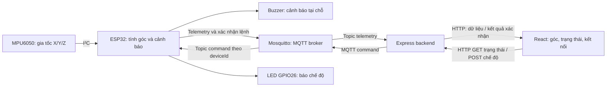

# Context — Bàn giao đồ án khay cảnh báo độ nghiêng

Ngày cập nhật: **11/11/2026**. Đọc cùng **ToDo.md** trước khi hỗ trợ báo cáo hoặc Autodesk Fusion 360. Phần đối chiếu cấu trúc báo cáo ở mục 11; các kết quả kiểm thử phần mềm vẫn là ghi nhận ngày 10/11, không phải vừa chạy lại.

## 1. Nhiệm vụ dành cho trợ lý ở cuộc trò chuyện mới

Tôi cần bạn hỗ trợ **viết báo cáo/đề cương và thiết kế CAD trên Autodesk Fusion 360** cho đồ án Vật lý cho Công nghệ thông tin. Phần firmware/backend/frontend đã có và đã được kiểm thử ở mức mô phỏng. Hãy tiếp tục từ hiện trạng bên dưới, không thiết kế lại phần mềm từ đầu.

- Viết bằng tiếng Việt, dễ hiểu, có cơ sở vật lý và khớp với phần mềm thực tế.
- Hướng dẫn Fusion theo từng bước nhỏ, ưu tiên mô hình tham số có thể sửa theo kích thước linh kiện.
- Phân biệt **đã triển khai**, **đã thử trong mô phỏng**, **chưa thử trên phần cứng thật** và **hướng phát triển tương lai**.
- Không tự điền số đo, kích thước linh kiện, giá mua, sai số hoặc kết quả thí nghiệm chưa được cung cấp.
- Không biến các lựa chọn trong kế hoạch cũ thành yêu cầu chính thức của giảng viên.
- Nếu chưa có file hoặc công cụ truy cập Fusion, hãy hướng dẫn thao tác và nói rõ đầu ra có thể cung cấp; không tuyên bố đã tạo/kiểm tra file CAD khi chưa làm được.
- Chưa cần bổ sung servo, tự cân bằng, AI, cloud hay đổi thuật toán phần mềm nếu tôi chưa yêu cầu mở rộng.

Các đường dẫn trong hai file này là tài liệu cục bộ. ChatGPT/Codex bên web **không tự đọc được thư mục máy tôi**; cần tôi đính kèm những file có liên quan. Nếu có mâu thuẫn, đối chiếu mã nguồn được gửi kèm và hỏi lại tôi trước khi đưa thông tin vào bản nộp.

## 2. Bối cảnh và mục tiêu

| Nội dung | Thông tin hiện có |
|---|---|
| Học phần | Vật lý cho Công nghệ thông tin, lớp 24C11, HK1 năm học 2026–2027 |
| Người thực hiện | Một sinh viên; làm việc trên Windows 11, VS Code và PowerShell |
| Thông tin từ kế hoạch ngày 08/11 | Lưu Chí Hải — MSSV 24127030; cần xác nhận lại trước khi điền bìa và tên file nộp |
| Tên làm việc | Thiết bị đo và cảnh báo độ nghiêng của sàn/khay chở hàng; tên chính thức cần đối chiếu phản hồi giảng viên |
| Mục tiêu dài hạn | Khay trên xe chở hàng có thể tự điều chỉnh tư thế khi xe chạy trên đường để hỗ trợ giữ hàng ổn định |
| Phạm vi hiện tại | Đo và cảnh báo **độ nghiêng tĩnh theo mọi hướng**, giám sát trên web, bật/tắt giám sát từ web kèm LED báo chế độ |
| Hình thức demo dự định | Sản phẩm thật, có khay và hộp linh kiện gọn gàng, phù hợp bản thiết kế |
| Kinh phí | Kế hoạch cũ dự kiến 300.000–400.000 đồng; chưa phải giá mua hoặc ngân sách đã xác nhận lại |
| Tiến độ | Kế hoạch cũ ghi mốc đề cương 14/11/2026; cần kiểm tra thông báo hiện hành. Ngày demo cuối kỳ chưa được xác nhận trong phiên này |

Hiện tại **chưa có cơ cấu tự điều chỉnh khay bằng động cơ**, chưa tách gia tốc khi xe chuyển động, chưa xác nhận khả năng giữ hàng khi tăng tốc/phanh/rẽ. Một khay có thể nghiêng bằng tay để kiểm tra cảm biến không phải là khay tự cân bằng.

## 3. Hai luồng đã triển khai



1. **Cảm biến → web:** MPU6050 → I²C → ESP32 → MQTT → Express → React.
2. **Web → output:** nút React → API Express → MQTT → ESP32 → đổi chế độ đo và bật/tắt LED riêng.

Luồng thứ hai có phản hồi xác nhận của ESP32; giao diện không coi việc vừa bấm nút là thiết bị đã thực hiện. Buzzer là cảnh báo tại chỗ, không phải LED báo chế độ.

## 4. Cấu hình phần cứng và những điều chưa chốt

| Thành phần | Cấu hình trong firmware/Wokwi | Khi làm thật |
|---|---|---|
| ESP32 | ESP32 Dev Module; Wokwi dùng model devkit-v1 | Cần xác nhận đúng board, kích thước, cổng USB và vị trí lỗ thực tế |
| MPU6050 | I²C địa chỉ 0x68, SDA GPIO21, SCL GPIO22; sơ đồ cấp 3V3 | Gắn cứng trên phần khay cần đo; xác nhận module, chân và kích thước |
| Buzzer | GPIO25; Wokwi dùng piezo passive | Cần xác nhận passive/active, điện áp, dòng, kích thước và kiểu lắp |
| LED báo chế độ | GPIO26 → điện trở 330Ω → anode LED; cathode → GND | Xác nhận đường kính và cách gắn LED thực tế |
| Nguồn | Dự kiến cấp nguồn qua USB cho nguyên mẫu | Chưa chốt nguồn di động, đầu nối và tuyến đi dây |

Tên chân trong `diagram.json` của board Wokwi là **D21/D22/D25/D26**; số GPIO trong firmware là 21/22/25/26. Không nhầm tên chân mô phỏng với kích thước/hình dáng board thật.

Chưa có số đo cơ khí từ vật thật được xác nhận cho khay, hộp, board, lỗ vít, cổng USB hoặc linh kiện khác. Không mặc định mọi ESP32 DevKit/MPU6050 có cùng kích thước. Ngày 11/11 đã đọc file Fusion người dùng gửi, xem các ảnh đo và thao tác trực tiếp trên bản sao của mô hình đang mở; kích thước CAD và bản bàn giao hiện tại ở mục 8.1–8.3.

## 5. Cơ sở vật lý và thuật toán đúng với mã hiện tại

### 5.1. Đo nghiêng tĩnh bằng cả ba trục

Acceleration X/Y/Z là thành phần gia tốc, đơn vị g; không phải tọa độ vị trí của xe. Trong mô hình khay đứng yên, độ lớn vector đo gần 1 g; nghiêng khay làm thay đổi các thành phần trên trục cảm biến.

Khi mốc ngang là hướng +Z, công thức tương đương:

```text
theta = atan2(sqrt(ax² + ay²), az) × 180 / π
```

Firmware thực tế dùng vector mốc đã hiệu chuẩn `r` và vector đo `a`:

```text
theta = atan2(|r × a|, r · a) × 180 / π
```

Kết quả là **góc tổng 0–180°**, không mang dấu trái/phải và chưa xuất pitch/roll riêng. Không dùng lại mô tả cũ `atan2(ax, az)` như thuật toán hiện hành: bản đó chỉ đo một hướng và đã được thay thế.

### 5.2. Hiệu chuẩn, lọc và kiểm tra dữ liệu

- Đọc MPU6050 mỗi **100 ms**; đọc tuần tự byte cao rồi byte thấp cho từng trục. Thang gia tốc ±2 g, đổi số đọc sang g bằng cách chia 16384.
- `CAL`: đặt khay ngang và giữ yên; lấy 30 mẫu trong khoảng 3 giây, cần ít nhất 25 mẫu hợp lệ. Lưu vector trung bình đã chuẩn hóa vào Preferences, khóa `ref-v1`.
- Mốc `zero` vô hướng của firmware cũ không được dùng cho thuật toán mới. CAL không thay đổi ngưỡng cảnh báo và chưa phải hiệu chuẩn độ lệch/độ nhạy đầy đủ ba trục.
- Lọc góc: `góc_mới = 0,75 × góc_cũ + 0,25 × góc_vừa_tính`. Lần đầu hoặc sau khôi phục sẽ khởi tạo từ mẫu mới.
- Chỉ chấp nhận tổng gia tốc **0,65–1,35 g** và kết quả hữu hạn. Đây là khoảng kiểm tra do phần mềm lựa chọn, **chưa được xác định bằng thực nghiệm** và không phải giới hạn đo của MPU6050.
- Tổng gia tốc nằm trong khoảng trên vẫn chưa bảo đảm khay đứng yên. Gia tốc do xe tăng tốc/phanh có thể bị hiểu nhầm là nghiêng; bộ lọc mượt không giải quyết hoàn toàn vấn đề này.

### 5.3. Cảnh báo và các trạng thái

| Điều kiện | Hành vi |
|---|---|
| Góc đã lọc ≥15° | Bật cảnh báo nghiêng |
| Góc đã lọc ≤12° | Tắt cảnh báo nghiêng |
| 12° < góc <15° | Giữ trạng thái cảnh báo trước đó |
| Lỗi đọc I²C hoặc dữ liệu không hợp lệ | `sensorOk:false`, `angleDeg:null`, `alarmOn:false`; web báo lỗi và ẩn góc |
| Tạm dừng từ web | Ngừng lấy mẫu, LED tắt, mọi âm thanh tắt, góc null; vẫn có heartbeat |
| Bắt đầu lại | LED sáng, đọc góc mới, khởi tạo lại bộ lọc |
| Quá 5 giây không có bản tin hợp lệ | Web báo mất dữ liệu, ẩn góc và khóa điều khiển |

Với buzzer **passive**, cảnh báo nghiêng là Dual-Tone: **1200 Hz/150 ms → 1800 Hz/150 ms → im 100 ms**, lặp lại bằng `millis()` và PWM LEDC. Khi cảnh báo tắt thì dừng âm ngay tại lần cập nhật, không đợi hết chu kỳ. Bíp lỗi riêng là **2000 Hz/170 ms mỗi giây**. Buzzer active thật chỉ giữ chế độ bật/tắt nếu không hỗ trợ đổi tần số.

LED sáng nghĩa là **đang giám sát**, không chứng minh cảm biến hoặc mạng đang tốt. Khi tạm dừng, `sensorOk` chỉ là kết quả lần đọc trước; web ghi “Chưa đo (tạm dừng)”. Khởi động lại ESP32 mặc định bật giám sát; chế độ tạm dừng không lưu qua reboot. CAL bị từ chối khi tạm dừng.

## 6. Phần mềm và giao thức cần mô tả trong báo cáo

| Phần | Công nghệ và vai trò |
|---|---|
| Firmware | ESP32 Arduino, PubSubClient, Preferences; PlatformIO có môi trường `wokwi` và `hardware`, dùng chung mã |
| Mạng firmware | Task FreeRTOS riêng sở hữu Wi-Fi/MQTT; gửi lệnh qua queue tới loop để áp dụng chế độ/GPIO |
| Backend | Node.js/Express nhận, xác thực telemetry, phát lệnh và chờ xác nhận |
| Frontend | React/Vite; lấy trạng thái khoảng mỗi giây, điều khiển chế độ, xử lý chờ/thất bại |
| Broker demo | Mosquitto trên máy Windows, không mặc định là dịch vụ cloud |

- Telemetry topic: `tilt-tray/telemetry`, khoảng mỗi **500 ms**, gồm cả heartbeat khi tạm dừng.
- Tám trường gốc: `deviceId`, `bootId`, `seq`, `sensorOk`, `alarmOn`, `angleDeg`, `thresholdOn`, `thresholdOff`.
- Ba trường bổ sung: `monitoringEnabled`, `modeLedOn`, `lastCommandId`.
- Topic điều khiển: `tilt-tray/command/<deviceId>`; payload `SET_MONITORING <bootId> <requestId> <0|1>`.
- Lệnh không retain, QoS 0; ESP32 dùng clean session. Kiểm tra bootId và requestId để không nhận nhầm phiên/nhận trùng lệnh gần nhất.
- ESP32 áp dụng chế độ và GPIO rồi gửi metadata xác nhận trong telemetry. `modeLedOn` phản ánh mức GPIO, không phải phép đo quang phát hiện LED hỏng.
- `POST /api/monitoring`, body `{"enabled":true}` hoặc `{"enabled":false}`. Chờ tối đa khoảng 4 giây để xác nhận; web không đổi trạng thái theo giả định thành công.
- `GET /api/status` và `GET /api/health` ở backend mặc định `http://127.0.0.1:3000`. Web dev mặc định `http://127.0.0.1:5173`.
- Wokwi: Wi-Fi `Wokwi-GUEST`, broker `host.wokwi.internal:1883`. Backend: `mqtt://127.0.0.1:1883`. ESP32 thật dùng IP LAN máy broker và cần cấu hình listener/firewall phù hợp mạng đã chọn.
- Cảnh báo tại chỗ tiếp tục theo chế độ hiện tại khi mất mạng. Chỉ chạy một nguồn telemetry trong một lượt demo.

Các lệnh Serial trong **Wokwi Terminal**, không phải PowerShell:

| Lệnh | Ý nghĩa |
|---|---|
| `I2C` | Dùng MPU6050 mô phỏng và thanh trượt Acceleration |
| `CAL` | Lấy mốc ngang khi đang giám sát, nguồn I²C, không bơm lỗi |
| `ACCEL x y z` | Bơm gia tốc qua Serial, bỏ qua I²C; vẫn dùng chung thuật toán/còi/MQTT |
| `FAULT ON` / `FAULT OFF` | Bơm/bỏ lỗi cảm biến; không tự đổi nguồn giữa Serial và I²C |

Các lệnh bơm dữ liệu/lỗi chỉ có trong build Wokwi. Rotation X/Y/Z trong Wokwi là vận tốc góc °/s của gyroscope; firmware hiện tại chưa đọc gyroscope. Không dùng Rotation để thay cho góc nghiêng tĩnh trong bài demo.

## 7. Hiện trạng kiểm chứng — không viết thành kết quả phần cứng thật

Các kết quả sau đã ghi nhận trong lượt triển khai ngày 10/11/2026; lượt tạo Context/ToDo chỉ đọc mã và tổng hợp, không chạy lại toàn bộ nghiệm thu:

- 16 test backend đạt, gồm API/telemetry/chờ xác nhận/timeout/lỗi kết nối.
- Test C++ về tính góc XYZ, hiệu chuẩn vector, lịch Dual-Tone và xử lý lệnh đạt.
- Build frontend thành công; giao diện đã kiểm tra ở desktop, rộng 375px và ngang.
- Firmware build thành công cho Wokwi và hardware với buzzer active/passive; build hardware dùng cấu hình mẫu tạm, chưa nạp board thật.
- Wokwi lint không có lỗi kết nối chân; có thông tin về model devkit-v1 chưa được tài liệu hóa.
- Test tích hợp Mosquitto/API với peer ESP32 giả lập bằng chương trình đã thử pause/resume, heartbeat, lỗi, timeout, dừng/bật broker và không phát lại lệnh cũ.
- Đã thử **React → Express → Mosquitto → firmware ESP32 trong Wokwi → LED**: tạm dừng từ React làm LED tắt/góc null; chờ 20 giây vẫn có heartbeat; bắt đầu lại làm LED sáng và đọc góc mới.
- Đã có log I²C ở tư thế ngang, CAL thành công và chu kỳ lấy mẫu khoảng 100 ms trong phiên Wokwi. Đây chưa phải phép đo sai số góc hoặc trễ đầu-cuối trên thiết bị thật.

**Chưa được xác nhận:** nạp firmware lên linh kiện thật; kích thước/đặc tính linh kiện nhận được; mạch đã đóng hộp; độ chính xác thực nghiệm; âm lượng và khả năng nghe rõ còi thật; độ bền/cơ khí. Người dùng dự định demo sản phẩm thật nhưng chưa cung cấp kết quả nghiệm thu thật trong cuộc trò chuyện này.

Nếu còn tồn tại, `.tools/react-wokwi-paused.png` và `.tools/react-wokwi-resumed.png` là ảnh web từ lượt thử với Wokwi. Các ảnh `.tools/react-control-desktop.png` / `react-control-mobile.png` dùng API giả lập để kiểm tra UI, không dùng làm bằng chứng đo thiết bị thật. Thư mục `.tools` không phải phần bắt buộc có trong bản mã nguồn gửi sang web.

## 8. Định hướng thiết kế Fusion 360 cho bản hiện tại

Thiết kế cần ưu tiên **khay demo có thể nghiêng bằng tay và hộp chứa linh kiện**, đủ gọn để chế tạo/lắp ráp và khớp sản phẩm thật. Nếu muốn thêm cơ cấu nâng bằng tay để lặp lại góc thử thì xác nhận phương án với tôi trước; không mặc định dùng servo/motor.

- Chia rõ component: khay/đế, thân hộp, nắp, gá ESP32, gá MPU6050, LED, buzzer và phần dây/đầu nối cần thể hiện.
- MPU6050 phải gắn cứng vào phần có cùng tư thế với khay. Thể hiện trục X/Y/Z và chiều +Z; không đặt cảm biến ở đế cố định rồi gọi số đo đó là góc khay đang nghiêng.
- Dành chỗ tháo/lắp cáp USB, dây nối và linh kiện. Thiết kế vị trí quan sát LED, lỗ thoát âm buzzer và khả năng mở nắp bảo trì.
- Kích thước board giả lập không thay thế đo board thật. Kích thước lỗ, dung sai lắp ráp, độ dày thành, vật liệu và cách gia công phải được chốt hoặc ghi là giả định thiết kế.
- Mô hình khái niệm khay tự điều chỉnh tương lai, nếu có, phải nằm ở component/tài liệu minh họa riêng và gắn nhãn “đề xuất, chưa chế tạo”.
- Hình báo cáo nên có tổng thể, mặt trên/bên, bên trong hộp, phân rã lắp ráp và bản vẽ kích thước; phân biệt ảnh CAD với ảnh lắp thật.

Chưa cần bịa tải trọng, mô-men động cơ, hệ số ma sát hoặc mức chống lật. Giữ khay ngang chưa tự bảo đảm hàng không trượt khi xe phanh/rẽ.

### 8.1. Các quyết định cơ khí đã được người dùng xác nhận ngày 11/11

- Mô hình ban đầu dựng theo **kích thước dự kiến**; hộp và linh kiện mua thật có thể khác toàn bộ các kích thước này.
- **Mua hộp có sẵn**, chưa chọn được sản phẩm cụ thể; không có kế hoạch tự in 3D hộp trong phiên này.
- **Cả hộp được gắn trên khay chở hàng và nghiêng cùng khay**. MPU6050 cần gắn chắc vào thân hộp; hiệu chuẩn sau khi cố định hoàn chỉnh.
- Lỗ tròn trên nắp là **lỗ thoát âm**, nằm phía trên buzzer. Lỗ chữ nhật bên hông để **đưa dây ra ngoài khi cần**, chưa được xác nhận là lỗ vừa một mẫu cổng USB cụ thể.
- LED báo chế độ đã được dựng và tô xanh trong mô hình người dùng thao tác. Phương án đang minh họa là LED rời 5 mm xuyên nắp: phần đầu nhô ra ngoài, chân và dây trong hộp; chọn đúng linh kiện và cách gá khi mua thật.

### 8.2. Bản CAD minh họa cho report đã hoàn thiện

File bàn giao: **`TiltTray_Report_Concept.f3d`** tại root dự án. Đã xuất bằng Fusion API và nhập lại trong Fusion thành công ngày 11/11. Có **22 component, 66 body**; giữ mô hình linh kiện dạng khối đại diện. Bản gốc người dùng gửi không bị ghi đè; **`TiltTray_before_report_completion.f3d`** là bản lưu từ phiên đang mở trước khi bổ sung các chi tiết mới.

| Chi tiết | Kích thước CAD / hiện trạng | Nguồn và giới hạn |
|---|---|---|
| Thân hộp | 240 × 155 × 30 mm; Shell vào trong 3 mm | Đối chiếu ảnh và hình học Fusion; chưa phải hộp đã mua |
| Nắp | 250 × 165 × 3 mm | Kích thước hình học hiện tại; khung 242 × 157 mm là biểu thức trong sketch, không dùng thay kích thước ngoài |
| Lỗ trên nắp | Thoát âm Ø8 mm; LED Ø5,2 mm | Đọc vòng tròn từ hình học Fusion; cần sửa theo linh kiện/cách gá thật |
| Lỗ đưa dây | 16 × 10 mm | Đọc hình học thân hộp; chưa xác nhận loại cáp/cổng |
| LED | Đầu Ø5 mm nhô 2 mm; bổ sung thân xuyên nắp, gờ và hai chân tượng trưng | Phần gờ/chân là thiết kế minh họa, không phải số đo LED đã mua |
| Điện trở LED | 330 Ω, mô hình riêng có các vòng màu minh họa | Giá trị điện đúng mạch hiện tại; kích thước thân điện trở là dự kiến |
| Dây | Nhánh I²C, 3V3/GND, buzzer, GPIO26 → 330 Ω → LED, dây nguồn USB tượng trưng | Tuyến dây minh họa; điểm chạm trên khối board không phải sơ đồ chân vật lý |
| Cố định | Đệm cách điện/cố định dưới breadboard, MPU6050, buzzer và hai dải dưới hộp | Vật tư và phương pháp cố định thật chưa chọn; chưa chứng minh khả năng chịu rung/tải |
| Khay tham chiếu | 400 × 300 mm; đáy 3 mm; thành cao 20 mm từ mặt trong đáy, tổng chiều cao ngoài 23 mm | **Trợ lý đề xuất tạm để dựng hình, người dùng chưa xác nhận kích thước này**, chưa chọn/mua khay |

Hộp được đặt giữa khay trong bản minh họa. Các component có nhóm lắp ráp tĩnh để thể hiện hộp và khay cùng tư thế; không phải cơ cấu tự cân bằng hay mô phỏng xe chuyển động. Các chi tiết bổ sung mang tên `CONCEPT`/`REFERENCE` và có ghi chú trong thuộc tính CAD. Phần bổ sung dùng Base Features; không mô tả toàn bộ mô hình như một thiết kế đã ràng buộc tham số hoàn chỉnh.

**Kiểm tra đã chạy:** không có chồng lấn thể tích trong nhóm gồm thân/nắp, các linh kiện đại diện, LED, đệm cố định, khối cổng USB tượng trưng, khay và dải cố định hộp. Đã kiểm tra lại sau khi mở archive xuất. **Không bao gồm kiểm tra toàn bộ dây, tiếp điểm điện, các vòng màu điện trở hoặc dung sai chế tạo thực tế.** Log tại `.tools/cad-report-verification.json`; CRC của hai archive mới đều hợp lệ.

### 8.3. Cách dùng bản CAD trong report và phần còn chờ

Bản CAD hiện tại **đủ làm hình thiết kế sơ bộ cho report**, chưa phải bản chế tạo hoặc sản phẩm đã nghiệm thu. Ghi chú hình nên có câu: “Mô hình CAD minh họa; kích thước, tuyến dây và cách gá sẽ điều chỉnh theo hộp, khay và linh kiện thực tế.” Không ghi người dùng đã chọn khay 400 × 300 mm hoặc đã mua LED/đế giữ nếu chưa có xác nhận.

**[CẦN XÁC NHẬN]** Hộp/khay mua thật, kích thước khay tham chiếu, loại LED và cách giữ, kiểu buzzer, vị trí chân/cổng USB, vật tư cố định và cơ cấu giữ nắp đi kèm hộp. Không tự thêm lỗ vít sản xuất theo một model hộp chưa mua.

Người dùng đã cho phép dùng script để thêm chú thích, giữ nguyên ảnh gốc. **Đã tạo `images/` và `report_images/`, gồm 15 cặp PNG cùng tên**: 5 góc nhìn CAD, 1 Drawing, 7 sơ đồ/bảng nguyên lý và 2 ảnh web từ kiểm thử Wokwi ngày 10/11/2026. Xem `report_images/README.md` cho danh mục, nguồn, chú thích và minh chứng còn thiếu; mở `report_images/index.html` để xem nhanh. `manifest.json` ghi kích thước và SHA-256; 5 ảnh CAD gốc không bị script chú thích thay đổi.

Drawing được dựng trong Fusion từ bản sao thân/nắp/LED, có 4 base view độc lập và 10 kích thước gắn với cạnh CAD; PDF A3 tại `output/pdf/TiltTray_Drawing_Concept.pdf`, ảnh nguồn 300 dpi tại `images/06_drawing_hop.png`. Đây là bản tham khảo cho report, chưa đủ vị trí lỗ/dung sai/vật liệu để giao gia công. Không tự tuyên bố là bản chế tạo hoặc tuân thủ đầy đủ quy ước hình chiếu chỉ vì đã chọn khổ/chuẩn ISO trong Fusion.

Người dùng đã **đồng ý lưu bản sao lên Autodesk Fusion**, đích `Default Project → TiltTray_Report`. Nguồn là `TiltTray_Drawing_Source_20261111`, có archive cục bộ `TiltTray_Drawing_Source.f3d`. Bản Drawing cuối hiện mang tên `TiltTray_Drawing_Report_Final`; đã xuất được PDF cục bộ sạch, còn bước Save As cloud đang chờ người dùng thao tác do hộp thoại không được công cụ kích hoạt. Fusion Personal đã chạm giới hạn 10 editable; bản `TiltTray_Drawing_Layout_Draft` do trợ lý tạo đã chuyển sang Read-Only, còn 9/10 trước lần lưu cuối. Không dùng `TiltTray_Drawing_Concept` hoặc `Layout_Draft` làm bản nộp vì đó là bản thử bố trí/ghi chú. Cần cập nhật lại trạng thái này sau khi xác nhận Save As hoàn tất.

Các hình sơ đồ tự vẽ theo mã hiện tại, không phải ảnh chạy Wokwi. Hai ảnh web gốc được dùng lại từ kiểm thử đã có, không tạo kết quả giả cho các trạng thái khác. **Chưa có** bộ ảnh chuỗi góc I²C/Serial đầy đủ, lỗi/mất broker/phục hồi, ảnh sản phẩm thật hoặc số đo sai số/độ trễ. Chưa chèn hình vào report Word. Thông tin tác giả/khung tên Fusion cần người dùng xác nhận trước khi nộp.

## 9. Quy định học phần cần đối chiếu khi làm báo cáo

Nguồn: `TCTA_QUY ĐỊNH ĐỒ ÁN CUỐI KỲ.pdf`, 4 trang, đã được đọc trong phiên trước. Cần đính kèm PDF cho trợ lý bên web để kiểm tra trực tiếp.

- Quy định chung ghi nhóm 2–3 sinh viên. Kế hoạch cá nhân cũ ghi giảng viên đã đồng ý làm cá nhân kèm điều kiện thông báo nhóm cũ; cần đối chiếu xác nhận về tên đề tài và cách tính điểm nhóm.
- Mỗi sinh viên phụ trách **một trong hai luồng căn bản**, không mặc định phải làm cả hai để được 4 điểm chức năng. Có 1 điểm làm việc nhóm/tích hợp, cần xác nhận cách áp dụng cho cá nhân.
- Nâng cao tối đa 4 điểm; tự xây website không NodeRED là tiêu chí 2 điểm. Luồng web → output có mức tối đa 1,5 điểm, cần được giảng viên công nhận cho LED riêng.
- Thiết bị giữa các yêu cầu được tính điểm phải đôi một khác nhau. Không tự cộng thêm một luồng nâng cao dùng lại MPU6050 chỉ vì có buzzer.
- Báo cáo tối đa 1 điểm; nộp trễ theo quy định là 0 điểm đồ án. PDF ghi nội dung/định dạng báo cáo sẽ thông báo sau; khung báo cáo đề xuất không thay thế thông báo chính thức.
- Điểm đồ án = `(điểm căn bản + điểm nâng cao + điểm báo cáo) × K`, K là mức độ hiểu 0–100% do giảng viên đánh giá.
- Sản phẩm thật có thể được xem xét cộng tối đa 1 điểm vào **“điểm tổng kết”** nếu chạy đúng chức năng, đóng hộp gần thiết kế và người thực hiện hiểu luồng; không tự diễn giải thành chắc chắn cộng thẳng vào điểm đồ án.

Ước tính điểm từng trao đổi chỉ là nhận định có điều kiện, không phải điểm đã được chấm. Mục tiêu bàn giao này là hoàn thiện báo cáo/CAD và minh chứng đúng phạm vi, không viết cam kết điểm số.

## 10. Nguồn và file nên đính kèm cho cuộc trò chuyện mới

| File/nguồn | Vai trò và lưu ý |
|---|---|
| `Context.md`, `ToDo.md` | Bản bàn giao hiện trạng và đầu việc |
| `README.md` | Hướng dẫn chạy, nghiệm thu, hai luồng và hướng phát triển hiện hành |
| `firmware/tilt_tray.cpp`, `static_tilt.h`, `buzzer_alert.h`, `monitoring_control.h` | Nguồn để giải thích nguyên lý và thuật toán |
| `diagram.json`, `platformio.ini`, `wokwi.toml` | Sơ đồ điện mô phỏng, chân và cấu hình build |
| `TiltTray_Report_Concept.f3d` | CAD minh họa đã xuất và mở lại kiểm tra ngày 11/11; xem phạm vi, kích thước và giới hạn ở mục 8.2 |
| `TiltTray_before_report_completion.f3d` | Bản lưu mô hình đang mở trước khi trợ lý bổ sung chi tiết; giữ để đối chiếu |
| `TiltTray_Warning_System (~recovered).f3d` | File người dùng gửi ban đầu; không bị ghi đè, có thể cũ hơn mô hình đã có LED/màu trong phiên Fusion |
| `backend/`, `frontend/src/`, `tests/` | Nguồn để kiểm tra mô tả API/web/test khi cần |
| `TCTA_QUY ĐỊNH ĐỒ ÁN CUỐI KỲ.pdf` | Thang đánh giá gốc |
| `VLCNTT (nhóm khác).pdf` | Chỉ tham khảo đề mục/cách trình bày; không phải mẫu chính thức, không lấy nội dung, linh kiện, chức năng hay cách tính điểm của nhóm đó |
| `../../BO_HO_SO_DE_CUONG_KHAY_NGHIENG/DE_CUONG_HOAN_CHINH_NOI_DUNG.md` | Bản nội dung đề cương đã đọc ngày 11/11; có sơ đồ và trình tự nhưng còn thông tin phần mềm cũ; xem đối chiếu ở mục 11 |
| `../../BO_HO_SO_DE_CUONG_KHAY_NGHIENG/DE_CUONG_HOAN_CHINH_KHAY_NGHIENG.docx` | File Word cùng bộ đề cương; đang bị khóa khi thử đọc ngày 11/11 nên chưa xác nhận nội dung có đồng bộ với Markdown hay không |
| `../../BO_HO_SO_DE_CUONG_KHAY_NGHIENG/so_do_he_thong_de_cuong.png` | Sơ đồ cũ đã xem: luồng cảm biến → web và nhánh buzzer; cần bổ sung chiều điều khiển và LED |
| `KE_HOACH_DO_AN_KHAY_NGHIENG.md` ở thư mục cha của gói mã nguồn | Kế hoạch 08/11; có dữ liệu cá nhân/ngân sách/mốc đề cương cần xác nhận lại; mô tả một trục và điều chỉnh ngưỡng từ web đã lỗi thời so với bản hiện tại |
| `DE_CUONG_KHAY_NGHIENG_MAU_WORD.docx` ở cùng nơi với kế hoạch | Có sẵn file mẫu; chưa kiểm tra nội dung trong lượt bàn giao này, cần tải lên nếu muốn dùng |
| Thông báo mới của giảng viên, ảnh linh kiện, kích thước, file CAD hiện có | Cần người dùng bổ sung để chốt bản nộp và bản chế tạo |

Không gửi `firmware/secrets.h`, mật khẩu Wi-Fi, `node_modules`, `.pio` hoặc các bộ cài trong `.tools` chỉ để lấy bối cảnh. Chỉ gửi mã, tài liệu và ảnh cần thiết.

## 11. Đối chiếu cấu trúc báo cáo và đề xuất bổ sung ngày 11/11

### 11.1. Phạm vi đối chiếu và mức độ xác nhận

Đã đọc đủ 12 trang của `VLCNTT (nhóm khác).pdf` và xem trực quan mục lục, phần luồng hoạt động, mô phỏng. Bìa tài liệu ghi **phác thảo đồ án**, vì vậy không dùng nó làm khung đầy đủ cho báo cáo cuối kỳ. Theo người dùng, bản này được chấm chưa đầy đủ điểm vì thiếu/sơ sài; đây là thông tin người dùng cung cấp, không phải kết luận rút ra từ phiếu chấm đã được xem.

Bản report tìm được để đối chiếu là **đề cương** trong `../../BO_HO_SO_DE_CUONG_KHAY_NGHIENG/`: đã đọc `DE_CUONG_HOAN_CHINH_NOI_DUNG.md` và xem hình `so_do_he_thong_de_cuong.png`. File `DE_CUONG_HOAN_CHINH_KHAY_NGHIENG.docx` tồn tại nhưng bị khóa bởi tiến trình khác; chưa đọc được và chưa kết luận nó giống bản Markdown. Chưa tìm thấy bản báo cáo cuối kỳ riêng trong thư mục dự án và các thư mục đã rà ở `../../`.

**[CẦN XÁC NHẬN]** Người dùng đang dùng bản đề cương trên hay một report khác đã sửa? Nếu khác, cần cung cấp **tên file, đường dẫn hoặc bản đính kèm mới nhất**. Các nhận xét “đã có/còn thiếu” dưới đây chỉ áp dụng cho bản Markdown đã đọc; chưa phải nhận xét chắc chắn về Word đang mở.

Phân biệt nguồn khi viết tiếp:

- **[YÊU CẦU CHÍNH THỨC]** Chỉ gắn nhãn này khi có căn cứ từ PDF quy định hoặc thông báo giảng viên; mục 9 tóm tắt quy định đã đọc. Định dạng/nội dung báo cáo mới nhất vẫn chờ xác nhận.
- **[ĐỀ XUẤT BỔ SUNG]** Toàn bộ khung, hình và bảng ở mục 11.2–11.4 là đề xuất cho đồ án này, không tự sinh thêm tiêu chí hay cam kết điểm.
- **[ĐÃ CÓ / CẦN CẬP NHẬT]** Dùng cho phần có trong đề cương cũ nhưng chưa khớp mã hiện tại. Việc lập danh sách trong Context/ToDo chưa có nghĩa đã sửa report, vẽ xong hình hoặc thực hiện thí nghiệm.

### 11.2. Những đề mục tham khảo và khoảng trống thực tế

Các số trang sau là **số in trên trang** của PDF tham khảo; số trang trong trình đọc PDF lớn hơn 1 vì có trang bìa. Chỉ ghi lại cấu trúc, không lấy nội dung kỹ thuật của nhóm khác.

| Đề mục trong tài liệu tham khảo | Hiện trạng bản đề cương của mình | Đề xuất xử lý |
|---|---|---|
| Giới thiệu, bối cảnh, mục tiêu (mục 1, tr. 2) | Đã có ở mục 2–3 | Giữ, cập nhật mục tiêu dài hạn khay tự điều chỉnh; phạm vi cam kết hiện tại vẫn là đo nghiêng tĩnh XYZ |
| Bảng chức năng và mô tả chi tiết, tách phần cứng/web (mục 2, tr. 3–4) | Đã có F01–F08 và W01–W06 ở mục 5–6 | Cập nhật đo XYZ, góc không dấu, Dual-Tone; bổ sung chức năng bắt đầu/tạm dừng và LED, phản hồi xác nhận, lỗi/timeout |
| Danh sách thiết bị (mục 3, tr. 5) | Đã có BOM/giá ở mục 7 | Bổ sung LED, điện trở và vật tư thực sự cần; xác nhận kiểu buzzer và giá/model đã mua, không thay BOM bằng linh kiện nhóm khác |
| Hình dáng ngoài, cấu trúc bên trong (mục 4.1–4.2, tr. 6–7) | Đã có hai phác thảo ở mục 8 | Cập nhật CAD theo linh kiện thật, thêm vị trí LED và trục cảm biến; không coi lưu đồ là hình bố trí cơ khí bên trong |
| Luồng hoạt động kèm sơ đồ và mô tả từng bước (mục 4.2.1, tr. 7–9) | Đã có sơ đồ tổng thể ở 4.1 và sáu bước ở 4.3, nhưng chưa có lưu đồ rẽ nhánh hay chiều điều khiển mới | Hoàn thiện thành mục riêng; có sơ đồ khối hai chiều, lưu đồ xử lý, sơ đồ tuần tự lệnh và thuyết minh từng bước khớp mã |
| Mô phỏng hệ thống (mục 4.2.2, tr. 9) | Chưa có mục riêng trong bản nội dung đề cương | Thêm cách tái lập PlatformIO/Wokwi cục bộ, đường truyền qua broker, tình huống thử và giới hạn minh chứng |
| Phân công và tiến trình (mục 5, tr. 10–11) | Đã có CV01–CV17 và tiến độ ở mục 9–10 | Cập nhật trạng thái thật và thêm đầu việc luồng điều khiển/LED; ghi thực hiện cá nhân, không bê phân công hay lịch nhóm khác |

**Đề xuất vượt ngoài cấu trúc tham khảo:** báo cáo cuối kỳ vẫn cần cơ sở vật lý, giao thức dữ liệu, kiểm thử có số liệu/minh chứng, phân tích kết quả, hạn chế, kết luận và tài liệu tham khảo. Bản đề cương của mình đã có cơ sở vật lý, kiểm thử/rủi ro dự kiến và tài liệu tham khảo; cần cập nhật và bổ sung kết quả khi thật sự có. Không bỏ các phần này vì PDF tham khảo không tách thành chương.

### 11.3. Bộ sơ đồ và mô tả nên đưa vào report

**[ĐỀ XUẤT BỔ SUNG]** Đặt phần “Kiến trúc và luồng hoạt động” trong thiết kế hệ thống; đặt “Bố trí cơ khí bên trong” trong thiết kế cơ khí. Có thể gộp hình nếu vẫn thể hiện đủ thông tin và phù hợp giới hạn trang được xác nhận sau.

| Đầu ra đề xuất | Nội dung tối thiểu, đúng đồ án hiện tại |
|---|---|
| Sơ đồ khối tổng thể | MPU6050/I²C, ESP32, buzzer tại chỗ, LED chế độ, Mosquitto, Express, React; mũi tên telemetry/command/HTTP và phản hồi xác nhận; chỉ rõ phần trên khay và phần trên máy tính |
| Sơ đồ điện và bảng chân | GPIO21/22/25/26, nguồn/GND, LED và điện trở, kiểu buzzer; tách sơ đồ mô phỏng khỏi đấu nối thực tế đã xác nhận |
| Lưu đồ firmware | Khởi tạo/nạp mốc CAL; đang đo hay tạm dừng; đọc và kiểm tra mẫu; nhánh lỗi; tính góc XYZ → lọc → hysteresis → còi; heartbeat vẫn chạy khi tạm dừng; task mạng độc lập, không vẽ reconnect thành bước chặn đo |
| Sơ đồ tuần tự lệnh web | React → POST → Express → broker → ESP32 → áp dụng chế độ/GPIO → telemetry xác nhận → backend trả kết quả → React; có nhánh từ chối/timeout/mất kết nối |
| Bảng chuyển trạng thái | safe, alarm, paused, sensor-error, stale; điều kiện vào/ra, góc có hiển thị không, LED và âm thanh tương ứng; stale thuộc phía backend/web, không phải tư thế của khay |
| Hình mô phỏng và CAD | Ảnh mạch Wokwi có nhãn nguồn dữ liệu, ảnh web kèm điều kiện thử; hình CAD ngoài/trong có vị trí trục cảm biến và LED. Hình nào chưa làm thì để chờ, không dùng hình nhóm khác |

Sơ đồ khối giải thích **thành phần và kết nối**; lưu đồ giải thích **điều kiện và thứ tự xử lý**; sơ đồ tuần tự giải thích **trao đổi giữa các thành phần**. Không dùng một chuỗi mũi tên chung để thay hết ba nội dung. Mỗi hình cần số hình, chú thích và đoạn thuyết minh có dẫn chiếu trong bài.

### 11.4. Nội dung từng bước cần viết bằng lời của đồ án

**Luồng đo và cảnh báo:** (1) MPU6050 trả gia tốc XYZ qua I²C mỗi 100 ms khi đang giám sát; (2) kiểm tra đọc thành công, số hữu hạn và độ lớn vector; (3) tính góc với vector mốc CAL; (4) lọc và giữ trạng thái theo hai ngưỡng 15°/12°; (5) cập nhật âm thanh không chặn; (6) gửi telemetry qua broker khoảng 500 ms/lần; (7) Express xác thực và lưu bản mới nhất; (8) React lấy API khoảng 1 giây/lần để hiển thị. Khi lỗi, không thay bằng góc 0°; khi tạm dừng, bỏ qua đọc mẫu nhưng vẫn có heartbeat. Các chu kỳ này là cấu hình, không phải độ trễ đầu-cuối đã đo.

**Luồng bật/tắt đo:** (1) người dùng chọn Bắt đầu/Tạm dừng; (2) backend kiểm tra kết nối và nguồn dữ liệu mới; (3) phát lệnh gắn bootId/requestId đến topic theo deviceId; (4) ESP32 nhận qua task mạng và chuyển lệnh vào queue; (5) loop áp dụng chế độ/LED, xử lý còi và mẫu mới khi bắt đầu lại; (6) telemetry trả metadata xác nhận sau khi áp dụng; (7) backend kiểm tra đúng thiết bị/phiên/lệnh/trạng thái rồi trả kết quả; (8) React cập nhật hoặc báo lỗi. Hết khoảng 4 giây chưa có xác nhận thì báo timeout, không kết luận LED đã đổi. ACK là metadata trong telemetry, không tạo thêm topic ACK riêng.

**Mô phỏng/tái lập:** mô tả build `wokwi`, Wokwi for VS Code và gateway, Mosquitto cục bộ, backend và web theo README. Tách thử bằng thanh trượt MPU6050/I²C khỏi `ACCEL` bơm qua Serial và `FAULT` bơm lỗi. `npm run simulate` chỉ kiểm tra luồng dữ liệu mẫu/backend/web; dừng nó trước nghiệm thu Wokwi. Không cần tạo URL Wokwi web nếu dự án chỉ có cấu hình chạy cục bộ.

**Mô tả chức năng và kiểm thử:** mỗi chức năng nên có mục đích, đầu vào/điều kiện trước, các bước xử lý, đầu ra, trường hợp lỗi và tiêu chí thử. Bảng đối chiếu nên nối mã chức năng → sơ đồ/mã nguồn liên quan → ca thử → minh chứng → trạng thái đã/chưa thử. Không biến kế hoạch kiểm thử thành kết quả đạt.

**[CẦN XÁC NHẬN]** Bản report đang dùng; mẫu/hạn/số trang mới nhất; thông tin bìa và cá nhân; linh kiện đã mua, kiểu buzzer, kích thước, phương án CAD và kết quả phần cứng thật. Giữ các quyết định đã chốt: đo nghiêng tĩnh XYZ, hai luồng hiện có, ngưỡng 15°/12°, web không chỉnh ngưỡng, chưa có motor tự cân bằng.

Ưu tiên tiếp theo: xác nhận yêu cầu bản nộp → lấy kích thước linh kiện → bố trí CAD → viết phần báo cáo đã đủ căn cứ → thu thập kết quả mạch thật và hoàn thiện bản cuối. Chi tiết tại **ToDo.md**.
