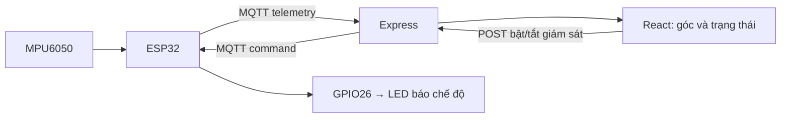
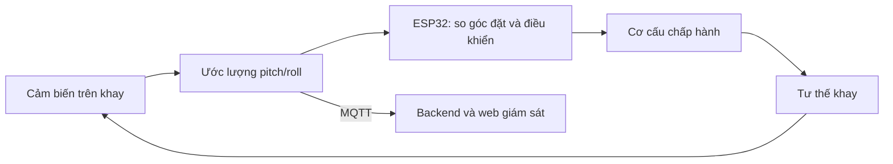

# Phần mềm đồ án khay cảnh báo độ nghiêng

**Mục tiêu dài hạn của đồ án:** xây dựng khay chở hàng có khả năng tự điều chỉnh
độ nghiêng khi xe di chuyển trên đường, nhằm hỗ trợ giữ hàng ổn định trong phạm
vi tải trọng và điều kiện vận hành đã kiểm chứng. Bản hiện tại là bước nền:
đo và cảnh báo độ nghiêng tĩnh, truyền dữ liệu lên web, bật/tắt giám sát từ web
kèm LED báo chế độ. Xem lộ trình tự điều chỉnh khay tại mục 7.

## Phạm vi hiện tại: đo độ nghiêng tĩnh theo mọi hướng

Thiết bị đo khi khay/xe **đứng yên hoặc nghiêng chậm**. Dùng cả gia tốc X/Y/Z,
không chỉ hướng X/Z. Khi mốc ngang là `(0, 0, 1)` g, công thức là:

```text
angleDeg = atan2(sqrt(ax² + ay²), az) × 180 / π
```

Góc tổng nằm trong **0–180°**, không mang dấu trái/phải. Nghiêng 16° theo X,
theo Y hoặc hướng chéo đều được phát hiện. `angleDeg` vẫn là góc đã lọc;
giữ bộ lọc 0,75/0,25, ngưỡng bật 15°, tắt 12° và Dual-Tone. Tám trường MQTT
ban đầu được giữ lại; bổ sung trạng thái chế độ và xác nhận lệnh tại mục 4.

`CAL` lấy 30 mẫu trong khoảng 3 giây, yêu cầu ít nhất 25 mẫu hợp lệ, rồi lưu
**vector trọng lực trung bình đã chuẩn hóa** trong Preferences, khóa `ref-v1`.
Góc được tính giữa vector đo và vector mốc bằng `atan2(|mốc × đo|, mốc · đo)`.
Nhờ vậy không bị sai khi đổi hướng nghiêng như cách trừ hai góc vô hướng.
Đặt khay trên mặt phẳng ngang và giữ yên khi CAL; đây không phải hiệu chuẩn
độ lệch/độ nhạy đầy đủ của cả ba trục cảm biến.

**Sau khi cập nhật từ firmware một trục, hãy chạy CAL lại.** Mốc `zero` cũ không
được dùng cho thuật toán mới; nếu chưa có mốc vector, tạm dùng hướng +Z.
Log `raw` là góc tổng so với mốc CAL trước lọc; `angle` là góc sau lọc.

Để dùng thanh trượt MPU6050 trong phiên Wokwi đang chạy:

1. Gửi `I2C` trong Wokwi Terminal (và `FAULT OFF` nếu đã bơm lỗi).
   Nếu đang tạm dừng, bấm **Bắt đầu giám sát** trên web trước khi hiệu chuẩn.
2. Bấm MPU6050, đặt Acceleration `(X,Y,Z)=(0,0,1)` g, gửi `CAL` và chờ xong.
3. Thử bảng góc X bên dưới, rồi đổi sang hướng Y bằng cách hoán đổi X và Y.
   Ví dụ 16° theo Y: `(0,0.27564,0.96126)` g; hướng ngược lại dùng Y âm.
4. Thử nghiêng chéo 16°: `(0.194905,0.194905,0.961262)` g. Giữ từng mốc 4 giây.
5. Kiểm tra 16° bật, 14° giữ bật, 11° tắt ở từng hướng, đối chiếu còi và web.

Giữ tổng độ lớn gia tốc gần 1 g khi tạo tư thế tĩnh. Bộ kiểm tra hiện vẫn chấp nhận
0,65–1,35 g; khoảng này **không chứng minh thiết bị đang đứng yên**, và không loại
được mọi ảnh hưởng do tăng tốc/phanh. Chưa áp dụng để xác nhận độ nghiêng xe đang chạy.

Test phép tính từ root:

```powershell
g++.exe -std=c++11 -Wall -Wextra -Werror tests/static_tilt.test.cpp -o .tools/static-tilt-test.exe
.\.tools\static-tilt-test.exe
```

Test kiểm tra các hướng ±X/±Y, nghiêng chéo, 90°/180°, vector mốc CAL và khôi phục
mốc, dữ liệu sai/NaN và giới hạn của phép kiểm tra độ lớn gia tốc.

## Chạy Wokwi trong VS Code

Mở đúng thư mục `san_pham_phan_mem`, nơi có `platformio.ini`, `diagram.json` và `wokwi.toml`.
Firmware duy nhất hiện là `firmware/tilt_tray.cpp` (đã chuyển từ `.ino`).

1. Cài extension **PlatformIO IDE** và **Wokwi Simulator**. Hai extension đã được cài trên máy trong phiên hỗ trợ.
2. Lần đầu: F1 → **Wokwi: Request a New License**, hoàn tất kích hoạt bằng tài khoản Wokwi.
3. Trong PowerShell tại root, chạy `pio run -e wokwi`. Nếu dùng môi trường Python đã chuẩn bị trong phiên này:

   ```powershell
   .\.tools\pio-venv\Scripts\python.exe -m platformio run -e wokwi
   ```

4. F1 → **Wokwi: Start Simulator**. Không cần `secrets.h` cho môi trường `wokwi`.
5. Panel **TERMINAL** → chọn **Wokwi Terminal**: đây chính là Serial Monitor của mô phỏng.
   Bấm vào vùng log, gõ `CAL` rồi Enter. Ký tự có thể không hiện trong lúc gõ;
   firmware mới xác nhận bằng `CMD> CAL`, sau đó `CAL started` và khoảng 3 giây sau `CAL done`.
   Không chạy `pio device monitor` để tìm cổng COM của ESP32 mô phỏng.

MPU6050 ban đầu có gia tốc `(0, 0, 1)` g. Log bình thường phải có
`source=I2C sensorOk=1`, góc gần 0 sau hiệu chuẩn. Còi lỗi bíp ngắn mỗi giây
là tín hiệu riêng, không phải cảnh báo nghiêng (`alarmOn`).

Nếu không chỉnh được gia tốc ngay trong giao diện, dùng lệnh Serial dự phòng sau,
giữ từng mốc ít nhất 4 giây và đợi `CAL done` trước khi bắt đầu:

| Góc | Lệnh trong Wokwi Terminal | Cảnh báo nghiêng |
|---|---|---|
| 0° | `ACCEL 0 0 1` | Tắt |
| 10° | `ACCEL 0.17365 0 0.98481` | Tắt |
| 16° | `ACCEL 0.27564 0 0.96126` | Bật |
| 14° | `ACCEL 0.24192 0 0.97030` | Vẫn bật |
| 11° | `ACCEL 0.19081 0 0.98163` | Tắt |

`ACCEL` chỉ có trong build Wokwi, bỏ qua I²C rồi đi qua chung phép tính góc,
bộ lọc, hysteresis, còi và MQTT. Nhập `I2C` để trở về MPU6050 mô phỏng.
`FAULT ON` / `FAULT OFF` bơm / bỏ lỗi cảm biến riêng cho Wokwi.

### Âm thanh Dual-Tone Alert

Với buzzer **passive** (piezo thụ động), cảnh báo nghiêng phát lặp:
**1200 Hz trong 150 ms → 1800 Hz trong 150 ms → im 100 ms**.
Wokwi đang dùng loại này trên GPIO25 (`BUZZER_PASSIVE=1`). ESP32 phát PWM bằng
LEDC channel 0; cấu hình PlatformIO hiện tại khóa Arduino-ESP32 2.0.17 nên dùng
API `ledcSetup` / `ledcAttachPin` / `ledcWriteTone` của phiên bản đó.

`firmware/buzzer_alert.h` chọn tần số theo thời gian `millis()`, không dùng
`delay()` hoặc vòng chờ cho âm thanh. Chỉ ghi lại PWM khi tần số thay đổi.
Khi `alarmOn` chuyển sang `false`, còi tắt ngay tại lần cập nhật đó, kể cả đang
giữa âm 1200/1800 Hz; không đợi hết chu kỳ 400 ms. Chu kỳ lấy mẫu 100 ms,
bộ lọc và hysteresis 15°/12° vẫn giữ nguyên: góc thô vừa giảm chưa đồng nghĩa
cảnh báo đã tắt. Mốc 14° vẫn giữ còi nếu trước đó cảnh báo đã bật.

Lỗi cảm biến vẫn có bíp **2000 Hz trong 170 ms mỗi giây**, riêng với Dual-Tone;
`alarmOn` vẫn chỉ mô tả cảnh báo nghiêng. Khi tạm dừng giám sát, cả Dual-Tone
và bíp lỗi đều tắt; góc không còn được lấy mẫu cho tới khi bắt đầu lại.

Với **thiết bị thật**, kiểm tra nhãn/datasheet của buzzer trước khi chọn chế độ:

- Cần đúng hai cao độ: dùng buzzer **passive**, đặt `#define BUZZER_PASSIVE 1`
  trong `firmware/secrets.h`, rồi build/nạp môi trường `hardware`.
- Còi **active** có mạch dao động riêng: để `BUZZER_PASSIVE 0`, giữ cách bật/tắt
  liên tục như trước; không cam kết phát được 1200/1800 Hz. Đặt
  `BUZZER_ACTIVE_LOW 1` nếu module active kích mức thấp, ngược lại để `0`.
- GPIO25 và mạch điều khiển phải phù hợp điện áp/dòng của linh kiện; dùng tầng
  transistor/driver nếu cần. Chưa có linh kiện thật để xác nhận âm lượng/âm sắc.

Sau khi build mới, Stop rồi **Wokwi: Start Simulator**. Dòng khởi động phải có
`BUZZER passive: dual-tone ...`. Gửi `CAL` khi nằm ngang, đợi xong rồi dùng
chuỗi ACCEL bên trên: 16° phát hai âm, 14° tiếp tục phát, 11° tắt sau khi góc
đã lọc giảm tới 12°. Thử `FAULT ON` để phân biệt bíp lỗi và `FAULT OFF` để khôi phục.

Test lịch âm thanh chạy từ root bằng trình biên dịch C++ trên máy:

```powershell
g++.exe -std=c++11 -Wall -Wextra -Werror tests/buzzer_alert.test.cpp -o .tools/buzzer-alert-test.exe
.\.tools\buzzer-alert-test.exe
```

Test kiểm tra 150/150/100 ms, tắt ở mọi vị trí trong chu kỳ, khởi động lại từ
âm đầu, bíp lỗi và tràn bộ đếm thời gian. Test này không thay thế nghe thử còi
trong Wokwi hoặc đo tín hiệu trên thiết bị thật.
Đã chạy test lịch âm thanh thành công và build thành công ba cấu hình:
`wokwi`, `hardware` với còi active, `hardware` với còi passive. Hai build
`hardware` dùng cấu hình Wi-Fi/MQTT mẫu tạm, đã xóa file bí mật mẫu sau kiểm tra;
chưa nạp thiết bị thật hoặc xác nhận âm thanh trong Wokwi bằng công cụ CLI.
Tham chiếu: [buzzer Wokwi](https://docs.wokwi.com/parts/wokwi-buzzer),
[PWM LEDC của ESP32](https://docs.espressif.com/projects/arduino-esp32/en/latest/api/ledc.html)
(trang API mới nhất có cách gọi khác bản 2.0.17 đã khóa trong dự án).

Để lên web, giữ broker, backend và frontend chạy; dừng `npm run simulate`.
Broker cục bộ có thể chạy từ root bằng:

```powershell
.\.tools\mosquitto\mosquitto.exe -c mosquitto.conf -v
```

Thư mục `.tools` chỉ là công cụ cục bộ đã ignore, không phải thành phần cần đưa vào Git/ZIP.
Nếu máy khác đã cài Mosquitto, dùng đường dẫn tới `mosquitto.exe` của máy đó với cùng `-c mosquitto.conf -v`.
Wokwi dùng gateway tích hợp, broker `host.wokwi.internal:1883`; backend dùng
`mqtt://127.0.0.1:1883`. API `http://127.0.0.1:3000/api/status` cần có
`reading.deviceId` là `khay-01-WOKWI`. Web mặc định `http://127.0.0.1:5173`.

**Lỗi I²C đã sửa:** board `wokwi-esp32-devkit-v1` dùng tên chân `D21`, `D22`, `D25`
trong sơ đồ; tên `21`, `22`, `25` là không hợp lệ cho model board này.
Firmware vẫn dùng số GPIO 21/22/25. Sau khi sửa sơ đồ, dừng mô phỏng bằng nút vuông
Stop rồi F1 → **Wokwi: Start Simulator** để nạp lại kết nối.
Không cần dùng `ACCEL` để che lỗi I²C.

**Lịch sử kiểm tra:** Wokwi CLI lint đã xác nhận sơ đồ không còn lỗi chân;
log người dùng đã xác nhận I²C và CAL ở vị trí ngang. Thuật toán XYZ mới được
kiểm tra bằng test tự động và build; cần thử lại các hướng trên phiên Wokwi.
Những mục tình trạng ban đầu bên dưới mô tả bản trước khi thêm Wokwi.

**Tình trạng ngày 10/11/2026:** Mã nguồn bước đầu được viết khi chưa có ESP32/MPU6050/buzzer thật. Không coi các giá trị giả lập là kết quả đo thiết bị. Sau khi nhận linh kiện, cần xây dựng và thử firmware thực tế, đấu dây, hiệu chuẩn và kiểm chứng tính đúng.

## 1. Cách xem giao diện ngay, không cài gì thêm

Mở tệp **`demo-gia-lap.html`** bằng Chrome hoặc Edge. Không cần Internet, npm, MQTT hay thiết bị.

Bạn có thể:

- Kéo góc 0° → 10° → 16° → 14° → 11° để xem vùng đệm cảnh báo.
- Đánh dấu “Ngắt truyền dữ liệu lên web”, đợi hơn 5 giây để xem trạng thái dữ liệu cũ.
- Đánh dấu “Giả lập lỗi cảm biến” để thấy lỗi không bị hiểu nhầm thành góc 0°.
- Nút hiệu chuẩn chỉ mô phỏng mốc ngang, không gửi lệnh tới ESP32.

**Hạn chế:** Demo này chỉ trình bày logic phía trình duyệt; nó không kiểm thử MQTT, chân buzzer hay MPU6050 thật.

## 2. Cấu trúc mã nguồn

```text
san_pham_phan_mem/
├── demo-gia-lap.html           # Demo mở trực tiếp, không cần Node.js
├── backend/
│   ├── index.mjs               # MQTT → Express API
│   ├── app.mjs                 # API trạng thái và bật/tắt giám sát
│   ├── control.mjs             # Gửi lệnh MQTT và chờ ESP32 xác nhận
│   ├── state.mjs               # Kiểm tra gói tin, thời gian dữ liệu cũ
│   ├── simulate.mjs            # Phát bản tin MQTT giả lập
│   ├── state.test.mjs          # Unit test chạy không cần npm install
│   └── package.json
├── frontend/
│   ├── src/main.jsx            # Giao diện React
│   ├── src/style.css
│   ├── vite.config.js          # Proxy API trong chế độ dev
│   └── package.json
└── firmware/
    ├── tilt_tray.cpp           # Firmware ESP32 dùng chung Wokwi/phần cứng thật
    ├── monitoring_control.h    # Kiểm tra lệnh và trạng thái giám sát
    ├── static_tilt.h           # Tính góc tổng và mốc hiệu chuẩn vector
    ├── buzzer_alert.h          # Lịch Dual-Tone không chặn
    ├── secrets.example.h       # Mẫu Wi-Fi và địa chỉ MQTT
    └── .gitignore
```

## 3. Kiểm thử logic không cần cài thư viện

Mở terminal tại thư mục `san_pham_phan_mem` và chạy:

```powershell
node --test backend/state.test.mjs
```

Các test hiện kiểm tra tính hợp lệ bản tin, phân biệt lỗi cảm biến với 0°, vùng đệm bật/tắt còi và phát hiện dữ liệu cũ. Kết quả test JavaScript **không thay thế** thử phần cứng.

## 4. Hai luồng dữ liệu và điều khiển từ web



Luồng thứ nhất đo và gửi số liệu. Luồng thứ hai cho phép người dùng chọn
**Bắt đầu giám sát** hoặc **Tạm dừng giám sát** trên web; lệnh tới ESP32 làm
đổi chế độ đo và điều khiển một LED riêng, không dùng chung buzzer cảnh báo.
Website không điều chỉnh các ngưỡng 15°/12°.

| Chế độ được ESP32 xác nhận | Lấy mẫu MPU6050 | LED xanh GPIO26 | Còi | Góc trên web |
|---|---|---|---|---|
| Đang giám sát | Mỗi 100 ms | Sáng | Theo cảnh báo nghiêng/lỗi cảm biến | Góc mới hoặc lỗi cảm biến |
| Đã tạm dừng | Ngừng lấy mẫu | Tắt | Im, kể cả bíp lỗi | Ẩn góc, hiện “Đã tạm dừng giám sát” |
| Mất bản tin quá 5 giây | Web không biết tình trạng hiện tại | Giữ theo chế độ trên thiết bị | Thiết bị tiếp tục theo chế độ gần nhất | Ẩn góc, báo mất dữ liệu |

Tạm dừng không cắt nguồn cảm biến hay ngắt Wi-Fi/MQTT. ESP32 vẫn gửi heartbeat
mỗi 500 ms để web biết thiết bị còn kết nối. `sensorOk` khi tạm dừng là kết quả
lần đọc trước đó, không phải một phép đo mới; web ghi **Chưa đo (tạm dừng)**.
Khi bắt đầu lại, firmware lấy mẫu mới và khởi tạo lại bộ lọc, không dùng lại góc
trước khi tạm dừng. `CAL` bị từ chối khi đang tạm dừng; nếu tạm dừng giữa một
lượt CAL, lượt đó bị hủy và mốc đã lưu trước đó được giữ lại.

Khi bật nguồn/khởi động lại ESP32, mặc định **đang giám sát, LED sáng**. Chế độ
tạm dừng không được lưu qua lần khởi động; mốc CAL vẫn được lưu riêng như trước.
LED thể hiện chế độ, không phải đèn xác nhận cảm biến đang tốt hoặc MQTT đang kết nối.

### 4.1. Giao thức lệnh và xác nhận

- Telemetry tiếp tục dùng topic `tilt-tray/telemetry`, giữ tám trường cũ.
  Thêm `monitoringEnabled` (boolean), `modeLedOn` (boolean) và `lastCommandId`
  (số nguyên 32 bit, ban đầu bằng 0). Khi tạm dừng: `angleDeg:null`, `alarmOn:false`.
- Topic lệnh là `tilt-tray/command/<deviceId>`, ví dụ
  `tilt-tray/command/khay-01-WOKWI`. Payload dạng văn bản:
  `SET_MONITORING <bootId> <requestId> <0|1>`; 0 là tạm dừng, 1 là bắt đầu.
- Backend chọn đúng `deviceId` và `bootId` từ bản tin mới nhất. Lệnh không retain,
  dùng QoS 0; không xếp hàng lệnh lúc mất mạng. ESP32 dùng clean session và kiểm
  tra bootId, requestId, giá trị 0/1 trước khi chuyển lệnh từ task MQTT sang loop.
- ESP32 đổi chế độ, ghi GPIO26 và gửi `lastCommandId` cùng trạng thái thực tế
  qua telemetry. `modeLedOn` xác nhận mức GPIO điều khiển; không phải cảm biến
  quang để phát hiện LED hỏng hoặc đứt dây.
- `POST /api/monitoring` nhận JSON `{"enabled":true}` hoặc `{"enabled":false}`.
  API chỉ trả `confirmed:true` sau khi nhận telemetry khớp requestId, bootId,
  chế độ và LED. Khi chờ, web khóa nút để tránh gửi lệnh trùng.
- Chưa có dữ liệu mới hoặc mất broker: HTTP 503; nguồn chỉ hỗ trợ hiển thị hoặc
  đang có lệnh chờ: HTTP 409; chưa nhận xác nhận sau 4 giây: HTTP 504. Timeout
  không chứng minh lệnh chưa được thực hiện; xem trạng thái mới trước khi thử lại.

Backend vẫn đọc được telemetry tám trường của firmware cũ hoặc `simulate.mjs`,
nhưng web sẽ khóa điều khiển đối với nguồn chưa có thông tin chế độ mới.
Chỉ chạy **một nguồn telemetry trên broker demo** trong mỗi lượt thử.

### 4.2. Chạy bằng PowerShell/CLI trên máy hiện tại

Mở các terminal riêng, **mỗi terminal bắt đầu tại root `san_pham_phan_mem`**.
Nếu backend bản cũ đang chạy, Ctrl+C trong terminal của backend rồi chạy lại để
nạp API mới. Dừng `npm run simulate` trước khi chạy Wokwi.

**Terminal A — broker Mosquitto cục bộ:**

```powershell
.\.tools\mosquitto\mosquitto.exe -c mosquitto.conf -v
```

Nếu đã cài Mosquitto riêng, thay đường dẫn `.exe` cho phù hợp. Nếu cổng 1883 đã
có broker đang chạy, dùng broker đó; không chạy thêm bản thứ hai trên cùng cổng.

**Terminal B — backend:**

```powershell
Set-Location .\backend
npm.cmd ci
npm.cmd start
```

**Terminal C — web React:**

```powershell
Set-Location .\frontend
npm.cmd ci
npm.cmd run dev -- --port 5173 --strictPort
```

Hai thư mục hiện đều có lockfile, nên dùng `npm ci` khi cần cài lại. Nếu đã có
dependency đầy đủ, bỏ qua bước `npm.cmd ci` và chỉ chạy lệnh khởi động.
Web: `http://127.0.0.1:5173`; API: `http://127.0.0.1:3000/api/status`;
health: `http://127.0.0.1:3000/api/health`.

**Terminal D — build firmware:**

```powershell
.\.tools\pio-venv\Scripts\python.exe -m platformio run -e wokwi
```

Nếu đang dùng PlatformIO Core của extension, có thể chạy `pio run -e wokwi`
trong PlatformIO terminal. Khi thấy SUCCESS, Stop phiên Wokwi cũ rồi
F1 → **Wokwi: Start Simulator** để nạp firmware và sơ đồ có thêm LED.
CLI build không tự mở mô phỏng; mô phỏng vẫn chạy trong extension VS Code
với license đã kích hoạt. Các lệnh `I2C`, `CAL`, `ACCEL`, `FAULT ON/OFF` nhập
trong **Wokwi Terminal**, không nhập trong PowerShell.

**Terminal E — quan sát hai chiều MQTT và gọi API bằng CLI:**

```powershell
.\.tools\mosquitto\mosquitto_sub.exe -h 127.0.0.1 -p 1883 -t "tilt-tray/telemetry" -t "tilt-tray/command/#" -v
```

Subscriber chạy liên tục; dùng terminal PowerShell khác tại root để gọi API:

```powershell
Invoke-RestMethod http://127.0.0.1:3000/api/status | ConvertTo-Json -Depth 5

$monitoringUri = 'http://127.0.0.1:3000/api/monitoring'
Invoke-RestMethod -Uri $monitoringUri -Method Post -ContentType 'application/json' -Body '{"enabled":false}'
Invoke-RestMethod -Uri $monitoringUri -Method Post -ContentType 'application/json' -Body '{"enabled":true}'
```

Đợi lệnh tạm dừng trả xác nhận rồi mới gửi bắt đầu. Đây là cùng API mà hai nút
React sử dụng; không cần tạo file script để thực hiện các lệnh CLI trên.
Nguồn trên API phải là `khay-01-WOKWI`, không phải `khay-01-SIM`.

### 4.3. Kiểm tra luồng điều khiển trong Wokwi

1. Khi vừa khởi động, kiểm tra LED xanh sáng. Đặt MPU ngang, gửi `I2C` và `CAL`.
2. Đặt góc 16°, chờ còi Dual-Tone và web báo vượt ngưỡng.
3. Bấm **Tạm dừng giám sát**: chờ ESP32 xác nhận; LED tắt, còi im, web ẩn góc.
   Giữ hơn 5 giây: trạng thái vẫn là tạm dừng, không thành mất liên lạc.
4. Đổi góc khi đang tạm dừng: web không cập nhật số đo. Bấm **Bắt đầu giám sát**:
   LED sáng và góc mới được đọc; nếu vẫn trên ngưỡng thì còi cảnh báo trở lại.
5. Dùng `FAULT ON` khi đang giám sát: web báo lỗi và còi bíp lỗi. Tạm dừng phải
   tắt cả bíp lỗi. Bắt đầu lại khi lỗi còn tồn tại phải trở về báo lỗi, không giả
   thành bình thường. Gửi `FAULT OFF` để khôi phục.
6. Dừng broker ở terminal A bằng Ctrl+C: web báo mất dữ liệu sau hơn 5 giây,
   khóa nút điều khiển; LED và cảnh báo tại chỗ giữ hành vi theo chế độ gần nhất.
   Khởi động lại broker, kiểm tra tự kết nối lại và không phát lại lệnh cũ.

### 4.4. Kiểm thử tự động và công cụ demo phụ

Trong `backend/`:

```powershell
npm.cmd test
npm.cmd run test:integration
```

Test tích hợp tự chạy Mosquitto/API trên cổng riêng **19883/13000**, giả lập một
ESP32 nhận lệnh và trả telemetry; kiểm tra pause/resume, heartbeat quá 5 giây,
lỗi cảm biến, timeout, dừng/bật lại broker và không phát lại lệnh cũ. Nó không
thay thế quan sát LED và firmware trong Wokwi. Cần Mosquitto trong `.tools`
hoặc PATH; nếu đặt nơi khác, khai báo `$env:MOSQUITTO_BIN` trước khi chạy test.

Các test C++ trong `tests/` kiểm tra phép tính góc, lịch còi và xử lý lệnh.
`npm.cmd run build` trong `frontend/` kiểm tra build React. Build firmware vẫn
chạy ở root như terminal D.

**Kết quả kiểm tra ngày 10/11/2026:**

| Phần kiểm tra | Kết quả |
|---|---|
| Unit/API test backend | 16 test đạt, gồm dữ liệu tạm dừng, xác nhận đúng lệnh, timeout và lỗi kết nối |
| Test C++ | Phép tính nghiêng XYZ, lịch Dual-Tone và kiểm tra lệnh/chuyển chế độ đều đạt |
| Build frontend | Thành công; kiểm tra Chrome ở desktop, 375px và ngang không tràn bố cục |
| Build firmware | Wokwi và hardware với cả buzzer active/passive thành công; hardware dùng cấu hình mẫu tạm, không nạp thiết bị |
| Wokwi lint | Không có lỗi kết nối chân; có thông tin về model board devkit-v1 cũ |
| Mosquitto/API với ESP32 giả lập bằng chương trình | Pause/resume, heartbeat, lỗi cảm biến, timeout, dừng/bật broker và không phát lại lệnh đều đạt |
| React → Express → Mosquitto → ESP32 Wokwi → LED | Đã thử với firmware thật trong mô phỏng: tạm dừng từ React làm LED tắt, góc null; giữ 20 giây vẫn có heartbeat; bắt đầu lại làm LED sáng và đọc góc mới |

Lượt nghiệm thu Wokwi dùng broker 1883 hiện có, backend kiểm thử 13001 và web
kiểm thử 15174 để không dừng backend 3000 đang chạy bản cũ. Backend kiểm thử
được dừng sau nghiệm thu. Khi tự chạy lại, **khởi động lại backend 3000** bằng
lệnh ở terminal B, vì tiến trình Node cũ không tự nạp mã mới. Chưa nạp thiết bị
thật và chưa xác nhận âm thanh bằng nghe trực tiếp trong lượt kiểm thử này.

`npm run simulate` và `demo-gia-lap.html` được giữ để thử nhanh phần hiển thị.
Chúng không xác nhận luồng web điều khiển GPIO/LED và không chạy cùng Wokwi
trên broker demo. Broker mặc định chỉ nghe localhost trong `mosquitto.conf`.

## 5. Sau khi nhận phần cứng

### Đấu nối đề xuất (PHẢI kiểm tra đúng nhãn trên module thực tế)

| MPU6050/GY-521 | ESP32 |
|---|---|
| VCC | 3V3 |
| GND | GND |
| SDA | GPIO21 |
| SCL | GPIO22 |

LED báo chế độ: **GPIO26 → điện trở 330Ω → anode LED (A/chân dài)**;
cathode LED (C/chân ngắn) nối GND. LED sáng khi đang giám sát, tắt khi tạm dừng.
Kiểm tra lại GPIO26 trên đúng board thực tế và dùng điện trở hạn dòng phù hợp.
Wokwi dùng cùng chân GPIO26, tên kết nối trong sơ đồ là `esp:D26`.

| Module buzzer **active**, mức điều khiển phù hợp | ESP32 |
|---|---|
| Tín hiệu IN | GPIO25 |
| GND | GND |
| VCC | 3V3 **nếu module hỗ trợ** |

**Không lấy chân GPIO cấp trực tiếp cho còi có dòng tiêu thụ cao.** Nếu buzzer thật cần nguồn 5V, active-low hoặc dòng điều khiển lớn, phải điều chỉnh sơ đồ theo thông số của module/giải pháp transistor. Không suy ra mọi buzzer bán trên Shopee giống nhau.

### Nạp firmware dự kiến

1. Cài PlatformIO, chọn đúng board ESP32/cổng USB. `platformio.ini` đã khai báo ESP32 Arduino và **PubSubClient**; build mẫu không thay thế thử trên board thật.
2. Sao chép `firmware/secrets.example.h` thành `firmware/secrets.h` rồi điền Wi-Fi và địa chỉ IP LAN của máy chạy broker. **Không dùng `127.0.0.1` trong ESP32** vì đó là chính ESP32, không phải máy tính.
3. Chọn đúng board trong môi trường `hardware` của `platformio.ini`, build bằng `pio run -e hardware`, nạp bằng `pio run -e hardware -t upload`, mở Serial Monitor 115200 bằng `pio device monitor -b 115200`.
4. Đặt khay nằm ngang và nhập `CAL` để lưu mốc trong bộ nhớ ESP32.
5. Nghiêng chậm theo trước/sau/trái/phải và hướng chéo qua các mốc, đối chiếu số đo và còi. Góc tổng không mang dấu; cần kiểm chứng các hướng khi thử thật.
6. Thử ngắt Wi-Fi/MQTT (nhưng vẫn giữ USB cấp nguồn) và xem còi có tiếp tục hoạt động không.
7. Thử tình huống lỗi I²C theo cách an toàn sau khi đã tắt nguồn để thay đổi dây, rồi cấp lại và quan sát.

Giá trị 15°/12° và giới hạn dữ liệu cũ 5 giây chỉ là mốc đề xuất ban đầu; ghi kết quả thử thật rồi mới chốt tham số cuối. Trạng thái cảm biến lỗi cần được phân biệt với trạng thái bình thường.

## 6. Những việc chưa được xác nhận

- Chưa biết chính xác dòng điện/mức kích hoạt của buzzer được giao; GPIO và logic còi cần kiểm tra.
- Firmware đã được build cho Wokwi và cấu hình phần cứng mẫu; chưa được nạp và kiểm chứng trên linh kiện thật.
- Đã kiểm tra MQTT/API/web và luồng điều khiển LED trong Wokwi; vẫn cần nghiệm thu mạch và âm thanh trên linh kiện thật.
- Tên đề tài vẫn cần giảng viên chốt chính thức. Ngày demo cuối kỳ chưa được thông báo.
- Chưa bổ sung cập nhật ngưỡng từ website, lịch sử, tài khoản hay tính năng ngoài F01–F08.

## 7. Hướng phát triển trong tương lai: khay tự điều chỉnh trên xe chở hàng

### 7.1. Mục đích của đồ án và phạm vi hiện tại

Mục đích dài hạn là phát triển hệ thống giúp xe chở hàng **tự điều chỉnh tư thế
của khay khi chạy trên đường**, chẳng hạn khi lên/xuống dốc, đi qua mặt đường
nghiêng hoặc có rung động. Hệ thống sẽ đo tư thế khay, xác định mức lệch so với
tư thế mong muốn và điều khiển cơ cấu chấp hành để đưa khay về vị trí phù hợp.
Mục tiêu là hỗ trợ hạn chế hàng bị nghiêng, xê dịch hoặc đổ trong những điều kiện
đã thử nghiệm; chưa có cơ sở để cam kết khay xử lý được mọi tình huống giao thông.

Đồ án hiện do **một sinh viên thực hiện**, nên giai đoạn này tập trung hoàn thiện
nguyên lý đo nghiêng tĩnh bằng ESP32 và MPU6050, hiệu chuẩn, cảnh báo tại chỗ,
truyền MQTT và giám sát trên web. Đây là nền tảng để phát triển cơ cấu tự điều
chỉnh sau này. Bản hiện tại **chưa có động cơ điều chỉnh khay, chưa tách gia tốc
chuyển động và chưa điều khiển cân bằng khi xe đang chạy**.

### 7.2. Những phần cần bổ sung để thực hiện mục tiêu

| Hạng mục | Công việc cần làm thêm | Kết quả cần kiểm chứng |
|---|---|---|
| Yêu cầu vận hành | Xác định loại hàng, tải trọng, vị trí trọng tâm, kích thước khay, góc dốc, tốc độ xe và mức rung dự kiến; đặt giới hạn sai số góc, thời gian đáp ứng và hành trình điều chỉnh | Có tiêu chí cụ thể để thiết kế và nghiệm thu; chưa chốt thông số khi chưa có số đo |
| Cảm biến và ước lượng tư thế | Đọc thêm gyroscope của MPU6050, hiệu chuẩn sai lệch cảm biến, đồng bộ thời gian lấy mẫu và kết hợp accelerometer/gyroscope; nghiên cứu tách ảnh hưởng của gia tốc chuyển động | Phân biệt tốt hơn khay nghiêng với xe tăng tốc, phanh hoặc rẽ; đo được sai số trong từng tình huống |
| Hướng nghiêng | Bổ sung góc nghiêng trước/sau và trái/phải có dấu (pitch/roll), thống nhất hệ tọa độ của xe, khay và cảm biến | Biết khay cần điều chỉnh về phía nào; góc tổng 0–180° hiện tại chỉ đủ cho mức cảnh báo |
| Cơ khí | Thiết kế khớp quay, khung đỡ và cơ cấu điều chỉnh; thử một trục trước, sau đó mở rộng hai trục; tính tải, độ cứng, độ rơ, khoảng hở và giới hạn hành trình | Khay chịu được tải và di chuyển đủ góc mà không va chạm, kẹt hoặc mất ổn định |
| Động cơ, driver và nguồn | Chọn servo hoặc động cơ/cơ cấu truyền động theo mô-men, tốc độ, hành trình và khả năng giữ tải đã tính; thiết kế driver, nguồn và bảo vệ điện phù hợp | Động cơ không bị thiếu lực, quá nhiệt hoặc làm ESP32 khởi động lại khi thay đổi tải |
| Điều khiển phản hồi | Đo góc thực tế của khay, so sánh với góc đặt rồi điều khiển động cơ; thử bộ điều khiển đơn giản trước, đánh giá PI/PID nếu phù hợp; giới hạn góc, tốc độ và gia tốc điều chỉnh | Khay tiến về tư thế mong muốn với sai số chấp nhận được, ít dao động và không giật hàng |
| Giám sát và xử lý lỗi | Bổ sung trạng thái cơ cấu, chất lượng ước lượng tư thế, lỗi cảm biến/động cơ, giới hạn hành trình và dừng khẩn cấp | Có phương án xử lý xác định khi mất dữ liệu, kẹt cơ cấu, mất nguồn hoặc vượt khả năng điều chỉnh |

Cảm biến phản hồi cần được gắn chắc trên **khay** để đo đúng đại lượng muốn điều
khiển. Có thể nghiên cứu thêm cảm biến trên thân xe để biết chuyển động của xe
và hỗ trợ điều khiển; nhu cầu này phải được đánh giá qua thử nghiệm. Khi cần
thêm thông tin tốc độ/chuyển động, xem xét encoder bánh xe hoặc GNSS phù hợp
với môi trường vận hành, thay vì mặc định chỉ một MPU6050 là đủ.

Đo nghiêng khi chuyển động khó hơn đo tĩnh: accelerometer chịu ảnh hưởng của
cả trọng lực và gia tốc chuyển động. Bộ lọc kết hợp gyroscope có thể hỗ trợ
ước lượng tư thế, nhưng không bảo đảm tách chính xác mọi đợt tăng tốc kéo dài;
cần đối chiếu với phép đo tham chiếu và bổ sung thông tin khi cần. Cơ sở và
giới hạn được trình bày trong [Analog Devices AN-1057](https://www.analog.com/en/resources/app-notes/an-1057.html)
và [NXP AN3461](https://www.nxp.com/docs/en/application-note/AN3461.pdf).

### 7.3. Nguyên lý điều khiển dự kiến



Vòng điều khiển cần chạy trực tiếp trên ESP32, có nhịp lấy mẫu/điều khiển được
chọn theo đáp ứng thực tế của cơ cấu. MQTT và web phục vụ giám sát; mất mạng
không được làm dừng vòng điều khiển tại chỗ. Chu kỳ đo 100 ms của bản demo
hiện tại cần được đánh giá lại trước khi dùng cho cơ cấu chuyển động.

Góc đặt ban đầu có thể là **khay nằm ngang so với trọng lực**. Tuy nhiên, giữ
khay nằm ngang chưa tự loại được tác động quán tính lên hàng khi xe phanh hoặc
rẽ. Cần kết hợp giải pháp giữ hàng/chống trượt. Việc chủ động nghiêng khay để
bù tác động chuyển động là một bài toán mở rộng riêng, cần mô hình tải và
kiểm chứng thêm trước khi áp dụng.

Bộ điều khiển phản hồi như PI/PID là phương án cần khảo sát và chỉnh định,
không phải chỉ thêm công thức là khay sẽ cân bằng. Tham khảo nguyên lý vòng
phản hồi, thời gian đáp ứng và giới hạn điều khiển tại
[NI: PID Controller & Theory](https://www.ni.com/en/shop/labview/pid-theory-explained.html).

### 7.4. Lộ trình triển khai theo từng bước

1. **Hoàn thiện bản đo tĩnh:** kiểm tra I²C và hiệu chuẩn trên linh kiện thật;
   thử các hướng nghiêng, hysteresis, còi và luồng MQTT/API/web; đối chiếu góc
   với thước đo hoặc thiết bị tham chiếu.
2. **Làm mô hình điều chỉnh một trục trên bàn:** dùng tải thử nhỏ, giới hạn
   hành trình; kiểm tra chiều quay, phản hồi góc, khả năng giữ tải và dừng lỗi.
3. **Mở rộng sang hai trục:** đo pitch/roll, đánh giá ảnh hưởng qua lại giữa
   hai trục, thay đổi vị trí hàng và rung/dao động của cơ cấu.
4. **Thử chuyển động trong khu vực kiểm soát:** bắt đầu ở tốc độ thấp với các
   tình huống dốc, tăng tốc, phanh và rẽ có thể lặp lại; thu thập dữ liệu để
   cải thiện ước lượng tư thế và điều khiển.
5. **Đánh giá theo tải và tình huống lỗi:** tăng dần tải trong giới hạn thiết
   kế; thử mất mạng, lỗi cảm biến, giới hạn hành trình và sự cố nguồn bằng
   phương án thử phù hợp; xác định giới hạn vận hành trước khi thử thực địa.

Mỗi bước cần ghi lại góc đặt/góc đo, sai số, thời gian đáp ứng, dao động, tải,
dòng điện/nhiệt độ nếu có đo, cùng ảnh hoặc video thử nghiệm. So sánh khi
**bật và tắt điều chỉnh** trong cùng điều kiện để đánh giá hiệu quả. Ngưỡng
15°/12° của bản cảnh báo hiện tại không tự động trở thành thông số điều khiển
động cơ; phải xác định riêng giới hạn điều chỉnh và ngưỡng báo nguy hiểm.

Lộ trình trên là **định hướng phát triển chưa triển khai**, không phải kết quả
đã đạt của phiên bản hiện tại. Trong phạm vi thực hiện một người, ưu tiên
hoàn thiện và kiểm chứng bước đo/cảnh báo tĩnh trước, rồi mở rộng từng phần
khi có thêm thời gian, linh kiện và dữ liệu thử nghiệm.

## Tư liệu CAD, Drawing và hình dùng cho báo cáo

- `images/` giữ **15 ảnh/sơ đồ gốc**; `report_images/` có **15 PNG cùng tên đã thêm chú thích bằng script**. Ảnh CAD gốc được giữ nguyên khi thêm nhãn. Xem [danh mục và nguồn hình](report_images/README.md) hoặc [gallery](report_images/index.html).
- [Drawing PDF A3](output/pdf/TiltTray_Drawing_Concept.pdf) có 4 hình chiếu và 10 kích thước liên kết cạnh CAD. Đây là thiết kế sơ bộ; kích thước cần chỉnh theo hộp, khay và linh kiện mua thật. Nguồn rút gọn lưu tại `TiltTray_Drawing_Source.f3d` và trên Fusion ở `Default Project → TiltTray_Report`.
- Drawing cuối trong Fusion mang tên `TiltTray_Drawing_Report_Final`; bước Save As cloud đang chờ thao tác người dùng trong hộp thoại. Các bản `TiltTray_Drawing_Concept` và `TiltTray_Drawing_Layout_Draft` là bản thử, không dùng để nộp. Bản Layout_Draft đã chuyển sang Read-Only để còn chỗ editable trong Fusion Personal.
- Hình web 13–14 lấy từ kiểm thử Wokwi ngày 10/11/2026. Sơ đồ 07–12 và 15 mô tả nguyên lý, không phải số đo thực nghiệm. Danh mục ghi riêng ảnh Wokwi/Serial, chuỗi góc, lỗi/phục hồi và sản phẩm thật còn cần chụp; chưa chèn hình vào report Word.

Từ terminal PowerShell ở thư mục gốc dự án, mở bộ hình hoặc bản vẽ bằng:

```powershell
Start-Process .\report_images\index.html
Start-Process .\output\pdf\TiltTray_Drawing_Concept.pdf
```
