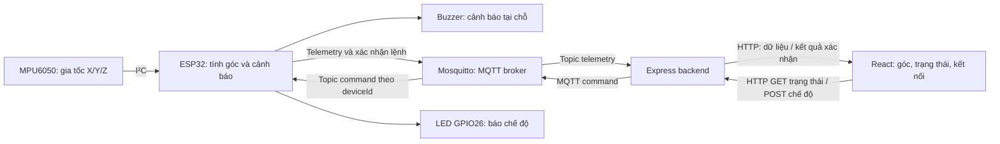

# Hồ sơ bàn giao đề cương

Tài liệu lưu lại bối cảnh, kế hoạch và hướng dẫn soạn báo cáo từ các phiên trước khi nộp. Xem [trạng thái cập nhật](README.md) và [mã nguồn hiện tại](../web/README.md) khi tiếp tục triển khai.


## Bối cảnh và hiện trạng khi bàn giao

Ngày cập nhật: **11/11/2026**. Đọc cùng **ToDo.md** trước khi hỗ trợ báo cáo hoặc Autodesk Fusion 360. Phần đối chiếu cấu trúc báo cáo ở mục 11; các kết quả kiểm thử phần mềm vẫn là ghi nhận ngày 10/11, không phải vừa chạy lại.

### 1. Nhiệm vụ dành cho trợ lý ở cuộc trò chuyện mới

Tôi cần bạn hỗ trợ **viết báo cáo/đề cương và thiết kế CAD trên Autodesk Fusion 360** cho đồ án Vật lý cho Công nghệ thông tin. Phần firmware/backend/frontend đã có và đã được kiểm thử ở mức mô phỏng. Hãy tiếp tục từ hiện trạng bên dưới, không thiết kế lại phần mềm từ đầu.

- Viết bằng tiếng Việt, dễ hiểu, có cơ sở vật lý và khớp với phần mềm thực tế.
- Hướng dẫn Fusion theo từng bước nhỏ, ưu tiên mô hình tham số có thể sửa theo kích thước linh kiện.
- Phân biệt **đã triển khai**, **đã thử trong mô phỏng**, **chưa thử trên phần cứng thật** và **hướng phát triển tương lai**.
- Không tự điền số đo, kích thước linh kiện, giá mua, sai số hoặc kết quả thí nghiệm chưa được cung cấp.
- Không biến các lựa chọn trong kế hoạch cũ thành yêu cầu chính thức của giảng viên.
- Nếu chưa có file hoặc công cụ truy cập Fusion, hãy hướng dẫn thao tác và nói rõ đầu ra có thể cung cấp; không tuyên bố đã tạo/kiểm tra file CAD khi chưa làm được.
- Chưa cần bổ sung servo, tự cân bằng, AI, cloud hay đổi thuật toán phần mềm nếu tôi chưa yêu cầu mở rộng.

Các đường dẫn trong hai file này là tài liệu cục bộ. ChatGPT/Codex bên web **không tự đọc được thư mục máy tôi**; cần tôi đính kèm những file có liên quan. Nếu có mâu thuẫn, đối chiếu mã nguồn được gửi kèm và hỏi lại tôi trước khi đưa thông tin vào bản nộp.

### 2. Bối cảnh và mục tiêu

| Nội dung | Thông tin hiện có |
|---|---|
| Học phần | Vật lý cho Công nghệ thông tin, lớp 24C11, HK1 năm học 2026–2027 |
| Người thực hiện | Một sinh viên; làm việc trên Windows 11, VS Code và PowerShell |
| Thông tin từ kế hoạch ngày 08/11 | Lưu Chí Hải — MSSV 24127030; cần xác nhận lại trước khi điền bìa và tên file nộp |
| Tên làm việc | Thiết bị đo và cảnh báo độ nghiêng của sàn/khay chở hàng; tên chính thức cần đối chiếu phản hồi giảng viên |
| Mục tiêu dài hạn | Khay trên xe chở hàng có thể tự điều chỉnh tư thế khi xe chạy trên đường để hỗ trợ giữ hàng ổn định |
| Phạm vi hiện tại | Đo và cảnh báo **độ nghiêng tĩnh theo mọi hướng**, giám sát trên web, bật/tắt giám sát từ web kèm LED báo chế độ |
| Hình thức demo dự định | Sản phẩm thật, có khay và hộp linh kiện gọn gàng, phù hợp bản thiết kế |
| Kinh phí | Kế hoạch cũ dự kiến 300.000–400.000 đồng; chưa phải giá mua hoặc ngân sách đã xác nhận lại |
| Tiến độ | Kế hoạch cũ ghi mốc đề cương 14/11/2026; cần kiểm tra thông báo hiện hành. Ngày demo cuối kỳ chưa được xác nhận trong phiên này |

Hiện tại **chưa có cơ cấu tự điều chỉnh khay bằng động cơ**, chưa tách gia tốc khi xe chuyển động, chưa xác nhận khả năng giữ hàng khi tăng tốc/phanh/rẽ. Một khay có thể nghiêng bằng tay để kiểm tra cảm biến không phải là khay tự cân bằng.

### 3. Hai luồng đã triển khai



1. **Cảm biến → web:** MPU6050 → I²C → ESP32 → MQTT → Express → React.
2. **Web → output:** nút React → API Express → MQTT → ESP32 → đổi chế độ đo và bật/tắt LED riêng.

Luồng thứ hai có phản hồi xác nhận của ESP32; giao diện không coi việc vừa bấm nút là thiết bị đã thực hiện. Buzzer là cảnh báo tại chỗ, không phải LED báo chế độ.

### 4. Cấu hình phần cứng và những điều chưa chốt

| Thành phần | Cấu hình trong firmware/Wokwi | Khi làm thật |
|---|---|---|
| ESP32 | ESP32 Dev Module; Wokwi dùng model devkit-v1 | Cần xác nhận đúng board, kích thước, cổng USB và vị trí lỗ thực tế |
| MPU6050 | I²C địa chỉ 0x68, SDA GPIO21, SCL GPIO22; sơ đồ cấp 3V3 | Gắn cứng trên phần khay cần đo; xác nhận module, chân và kích thước |
| Buzzer | GPIO25; Wokwi dùng piezo passive | Cần xác nhận passive/active, điện áp, dòng, kích thước và kiểu lắp |
| LED báo chế độ | GPIO26 → điện trở 330Ω → anode LED; cathode → GND | Xác nhận đường kính và cách gắn LED thực tế |
| Nguồn | Dự kiến cấp nguồn qua USB cho nguyên mẫu | Chưa chốt nguồn di động, đầu nối và tuyến đi dây |

Tên chân trong `diagram.json` của board Wokwi là **D21/D22/D25/D26**; số GPIO trong firmware là 21/22/25/26. Không nhầm tên chân mô phỏng với kích thước/hình dáng board thật.

Chưa có số đo cơ khí từ vật thật được xác nhận cho khay, hộp, board, lỗ vít, cổng USB hoặc linh kiện khác. Không mặc định mọi ESP32 DevKit/MPU6050 có cùng kích thước. Ngày 11/11 đã đọc file Fusion người dùng gửi, xem các ảnh đo và thao tác trực tiếp trên bản sao của mô hình đang mở; kích thước CAD và bản bàn giao hiện tại ở mục 8.1–8.3.

### 5. Cơ sở vật lý và thuật toán đúng với mã hiện tại

#### 5.1. Đo nghiêng tĩnh bằng cả ba trục

Acceleration X/Y/Z là thành phần gia tốc, đơn vị g; không phải tọa độ vị trí của xe. Trong mô hình khay đứng yên, độ lớn vector đo gần 1 g; nghiêng khay làm thay đổi các thành phần trên trục cảm biến.

Khi mốc ngang là hướng +Z, công thức tương đương:

```text
theta = atan2(sqrt(ax² + ay²), az) × 180 / π
```

Firmware thực tế dùng vector mốc đã hiệu chuẩn `r` và vector đo `a`:

```text
theta = atan2(|r × a|, r · a) × 180 / π
```

Kết quả là **góc tổng 0–180°**, không mang dấu trái/phải và chưa xuất pitch/roll riêng. Không dùng lại mô tả cũ `atan2(ax, az)` như thuật toán hiện hành: bản đó chỉ đo một hướng và đã được thay thế.

#### 5.2. Hiệu chuẩn, lọc và kiểm tra dữ liệu

- Đọc MPU6050 mỗi **100 ms**; đọc tuần tự byte cao rồi byte thấp cho từng trục. Thang gia tốc ±2 g, đổi số đọc sang g bằng cách chia 16384.
- `CAL`: đặt khay ngang và giữ yên; lấy 30 mẫu trong khoảng 3 giây, cần ít nhất 25 mẫu hợp lệ. Lưu vector trung bình đã chuẩn hóa vào Preferences, khóa `ref-v1`.
- Mốc `zero` vô hướng của firmware cũ không được dùng cho thuật toán mới. CAL không thay đổi ngưỡng cảnh báo và chưa phải hiệu chuẩn độ lệch/độ nhạy đầy đủ ba trục.
- Lọc góc: `góc_mới = 0,75 × góc_cũ + 0,25 × góc_vừa_tính`. Lần đầu hoặc sau khôi phục sẽ khởi tạo từ mẫu mới.
- Chỉ chấp nhận tổng gia tốc **0,65–1,35 g** và kết quả hữu hạn. Đây là khoảng kiểm tra do phần mềm lựa chọn, **chưa được xác định bằng thực nghiệm** và không phải giới hạn đo của MPU6050.
- Tổng gia tốc nằm trong khoảng trên vẫn chưa bảo đảm khay đứng yên. Gia tốc do xe tăng tốc/phanh có thể bị hiểu nhầm là nghiêng; bộ lọc mượt không giải quyết hoàn toàn vấn đề này.

#### 5.3. Cảnh báo và các trạng thái

| Điều kiện | Hành vi |
|---|---|
| Góc đã lọc ≥15° | Bật cảnh báo nghiêng |
| Góc đã lọc ≤12° | Tắt cảnh báo nghiêng |
| 12° < góc <15° | Giữ trạng thái cảnh báo trước đó |
| Lỗi đọc I²C hoặc dữ liệu không hợp lệ | `sensorOk:false`, `angleDeg:null`, `alarmOn:false`; web báo lỗi và ẩn góc |
| Tạm dừng từ web | Ngừng lấy mẫu, LED tắt, mọi âm thanh tắt, góc null; vẫn có heartbeat |
| Bắt đầu lại | LED sáng, đọc góc mới, khởi tạo lại bộ lọc |
| Quá 5 giây không có bản tin hợp lệ | Web báo mất dữ liệu, ẩn góc và khóa điều khiển |

Với buzzer **passive**, cảnh báo nghiêng là Dual-Tone: **1200 Hz/150 ms → 1800 Hz/150 ms → im 100 ms**, lặp lại bằng `millis()` và PWM LEDC. Khi cảnh báo tắt thì dừng âm ngay tại lần cập nhật, không đợi hết chu kỳ. Bíp lỗi riêng là **2000 Hz/170 ms mỗi giây**. Buzzer active thật chỉ giữ chế độ bật/tắt nếu không hỗ trợ đổi tần số.

LED sáng nghĩa là **đang giám sát**, không chứng minh cảm biến hoặc mạng đang tốt. Khi tạm dừng, `sensorOk` chỉ là kết quả lần đọc trước; web ghi “Chưa đo (tạm dừng)”. Khởi động lại ESP32 mặc định bật giám sát; chế độ tạm dừng không lưu qua reboot. CAL bị từ chối khi tạm dừng.

### 6. Phần mềm và giao thức cần mô tả trong báo cáo

| Phần | Công nghệ và vai trò |
|---|---|
| Firmware | ESP32 Arduino, PubSubClient, Preferences; PlatformIO có môi trường `wokwi` và `hardware`, dùng chung mã |
| Mạng firmware | Task FreeRTOS riêng sở hữu Wi-Fi/MQTT; gửi lệnh qua queue tới loop để áp dụng chế độ/GPIO |
| Backend | Node.js/Express nhận, xác thực telemetry, phát lệnh và chờ xác nhận |
| Frontend | React/Vite; lấy trạng thái khoảng mỗi giây, điều khiển chế độ, xử lý chờ/thất bại |
| Broker demo | Mosquitto trên máy Windows, không mặc định là dịch vụ cloud |

- Telemetry topic: `tilt-tray/telemetry`, khoảng mỗi **500 ms**, gồm cả heartbeat khi tạm dừng.
- Tám trường gốc: `deviceId`, `bootId`, `seq`, `sensorOk`, `alarmOn`, `angleDeg`, `thresholdOn`, `thresholdOff`.
- Ba trường bổ sung: `monitoringEnabled`, `modeLedOn`, `lastCommandId`.
- Topic điều khiển: `tilt-tray/command/<deviceId>`; payload `SET_MONITORING <bootId> <requestId> <0|1>`.
- Lệnh không retain, QoS 0; ESP32 dùng clean session. Kiểm tra bootId và requestId để không nhận nhầm phiên/nhận trùng lệnh gần nhất.
- ESP32 áp dụng chế độ và GPIO rồi gửi metadata xác nhận trong telemetry. `modeLedOn` phản ánh mức GPIO, không phải phép đo quang phát hiện LED hỏng.
- `POST /api/monitoring`, body `{"enabled":true}` hoặc `{"enabled":false}`. Chờ tối đa khoảng 4 giây để xác nhận; web không đổi trạng thái theo giả định thành công.
- `GET /api/status` và `GET /api/health` ở backend mặc định `http://127.0.0.1:3000`. Web dev mặc định `http://127.0.0.1:5173`.
- Wokwi: Wi-Fi `Wokwi-GUEST`, broker `host.wokwi.internal:1883`. Backend: `mqtt://127.0.0.1:1883`. ESP32 thật dùng IP LAN máy broker và cần cấu hình listener/firewall phù hợp mạng đã chọn.
- Cảnh báo tại chỗ tiếp tục theo chế độ hiện tại khi mất mạng. Chỉ chạy một nguồn telemetry trong một lượt demo.

Các lệnh Serial trong **Wokwi Terminal**, không phải PowerShell:

| Lệnh | Ý nghĩa |
|---|---|
| `I2C` | Dùng MPU6050 mô phỏng và thanh trượt Acceleration |
| `CAL` | Lấy mốc ngang khi đang giám sát, nguồn I²C, không bơm lỗi |
| `ACCEL x y z` | Bơm gia tốc qua Serial, bỏ qua I²C; vẫn dùng chung thuật toán/còi/MQTT |
| `FAULT ON` / `FAULT OFF` | Bơm/bỏ lỗi cảm biến; không tự đổi nguồn giữa Serial và I²C |

Các lệnh bơm dữ liệu/lỗi chỉ có trong build Wokwi. Rotation X/Y/Z trong Wokwi là vận tốc góc °/s của gyroscope; firmware hiện tại chưa đọc gyroscope. Không dùng Rotation để thay cho góc nghiêng tĩnh trong bài demo.

### 7. Hiện trạng kiểm chứng — không viết thành kết quả phần cứng thật

Các kết quả sau đã ghi nhận trong lượt triển khai ngày 10/11/2026; lượt tạo Context/ToDo chỉ đọc mã và tổng hợp, không chạy lại toàn bộ nghiệm thu:

- 16 test backend đạt, gồm API/telemetry/chờ xác nhận/timeout/lỗi kết nối.
- Test C++ về tính góc XYZ, hiệu chuẩn vector, lịch Dual-Tone và xử lý lệnh đạt.
- Build frontend thành công; giao diện đã kiểm tra ở desktop, rộng 375px và ngang.
- Firmware build thành công cho Wokwi và hardware với buzzer active/passive; build hardware dùng cấu hình mẫu tạm, chưa nạp board thật.
- Wokwi lint không có lỗi kết nối chân; có thông tin về model devkit-v1 chưa được tài liệu hóa.
- Test tích hợp Mosquitto/API với peer ESP32 giả lập bằng chương trình đã thử pause/resume, heartbeat, lỗi, timeout, dừng/bật broker và không phát lại lệnh cũ.
- Đã thử **React → Express → Mosquitto → firmware ESP32 trong Wokwi → LED**: tạm dừng từ React làm LED tắt/góc null; chờ 20 giây vẫn có heartbeat; bắt đầu lại làm LED sáng và đọc góc mới.
- Đã có log I²C ở tư thế ngang, CAL thành công và chu kỳ lấy mẫu khoảng 100 ms trong phiên Wokwi. Đây chưa phải phép đo sai số góc hoặc trễ đầu-cuối trên thiết bị thật.

**Chưa được xác nhận:** nạp firmware lên linh kiện thật; kích thước/đặc tính linh kiện nhận được; mạch đã đóng hộp; độ chính xác thực nghiệm; âm lượng và khả năng nghe rõ còi thật; độ bền/cơ khí. Người dùng dự định demo sản phẩm thật nhưng chưa cung cấp kết quả nghiệm thu thật trong cuộc trò chuyện này.

Nếu còn tồn tại, `.tools/react-wokwi-paused.png` và `.tools/react-wokwi-resumed.png` là ảnh web từ lượt thử với Wokwi. Các ảnh `.tools/react-control-desktop.png` / `react-control-mobile.png` dùng API giả lập để kiểm tra UI, không dùng làm bằng chứng đo thiết bị thật. Thư mục `.tools` không phải phần bắt buộc có trong bản mã nguồn gửi sang web.

### 8. Định hướng thiết kế Fusion 360 cho bản hiện tại

Thiết kế cần ưu tiên **khay demo có thể nghiêng bằng tay và hộp chứa linh kiện**, đủ gọn để chế tạo/lắp ráp và khớp sản phẩm thật. Nếu muốn thêm cơ cấu nâng bằng tay để lặp lại góc thử thì xác nhận phương án với tôi trước; không mặc định dùng servo/motor.

- Chia rõ component: khay/đế, thân hộp, nắp, gá ESP32, gá MPU6050, LED, buzzer và phần dây/đầu nối cần thể hiện.
- MPU6050 phải gắn cứng vào phần có cùng tư thế với khay. Thể hiện trục X/Y/Z và chiều +Z; không đặt cảm biến ở đế cố định rồi gọi số đo đó là góc khay đang nghiêng.
- Dành chỗ tháo/lắp cáp USB, dây nối và linh kiện. Thiết kế vị trí quan sát LED, lỗ thoát âm buzzer và khả năng mở nắp bảo trì.
- Kích thước board giả lập không thay thế đo board thật. Kích thước lỗ, dung sai lắp ráp, độ dày thành, vật liệu và cách gia công phải được chốt hoặc ghi là giả định thiết kế.
- Mô hình khái niệm khay tự điều chỉnh tương lai, nếu có, phải nằm ở component/tài liệu minh họa riêng và gắn nhãn “đề xuất, chưa chế tạo”.
- Hình báo cáo nên có tổng thể, mặt trên/bên, bên trong hộp, phân rã lắp ráp và bản vẽ kích thước; phân biệt ảnh CAD với ảnh lắp thật.

Chưa cần bịa tải trọng, mô-men động cơ, hệ số ma sát hoặc mức chống lật. Giữ khay ngang chưa tự bảo đảm hàng không trượt khi xe phanh/rẽ.

#### 8.1. Các quyết định cơ khí đã được người dùng xác nhận ngày 11/11

- Mô hình ban đầu dựng theo **kích thước dự kiến**; hộp và linh kiện mua thật có thể khác toàn bộ các kích thước này.
- **Mua hộp có sẵn**, chưa chọn được sản phẩm cụ thể; không có kế hoạch tự in 3D hộp trong phiên này.
- **Cả hộp được gắn trên khay chở hàng và nghiêng cùng khay**. MPU6050 cần gắn chắc vào thân hộp; hiệu chuẩn sau khi cố định hoàn chỉnh.
- Lỗ tròn trên nắp là **lỗ thoát âm**, nằm phía trên buzzer. Lỗ chữ nhật bên hông để **đưa dây ra ngoài khi cần**, chưa được xác nhận là lỗ vừa một mẫu cổng USB cụ thể.
- LED báo chế độ đã được dựng và tô xanh trong mô hình người dùng thao tác. Phương án đang minh họa là LED rời 5 mm xuyên nắp: phần đầu nhô ra ngoài, chân và dây trong hộp; chọn đúng linh kiện và cách gá khi mua thật.

#### 8.2. Bản CAD minh họa cho report đã hoàn thiện

File bàn giao: **`TiltTray_Report_Concept.f3d`** tại root dự án. Đã xuất bằng Fusion API và nhập lại trong Fusion thành công ngày 11/11. Có **22 component, 66 body**; giữ mô hình linh kiện dạng khối đại diện. Bản gốc người dùng gửi không bị ghi đè; **`TiltTray_before_report_completion.f3d`** là bản lưu từ phiên đang mở trước khi bổ sung các chi tiết mới.

| Chi tiết | Kích thước CAD / hiện trạng | Nguồn và giới hạn |
|---|---|---|
| Thân hộp | 240 × 155 × 30 mm; Shell vào trong 3 mm | Đối chiếu ảnh và hình học Fusion; chưa phải hộp đã mua |
| Nắp | 250 × 165 × 3 mm | Kích thước hình học hiện tại; khung 242 × 157 mm là biểu thức trong sketch, không dùng thay kích thước ngoài |
| Lỗ trên nắp | Thoát âm Ø8 mm; LED Ø5,2 mm | Đọc vòng tròn từ hình học Fusion; cần sửa theo linh kiện/cách gá thật |
| Lỗ đưa dây | 16 × 10 mm | Đọc hình học thân hộp; chưa xác nhận loại cáp/cổng |
| LED | Đầu Ø5 mm nhô 2 mm; bổ sung thân xuyên nắp, gờ và hai chân tượng trưng | Phần gờ/chân là thiết kế minh họa, không phải số đo LED đã mua |
| Điện trở LED | 330 Ω, mô hình riêng có các vòng màu minh họa | Giá trị điện đúng mạch hiện tại; kích thước thân điện trở là dự kiến |
| Dây | Nhánh I²C, 3V3/GND, buzzer, GPIO26 → 330 Ω → LED, dây nguồn USB tượng trưng | Tuyến dây minh họa; điểm chạm trên khối board không phải sơ đồ chân vật lý |
| Cố định | Đệm cách điện/cố định dưới breadboard, MPU6050, buzzer và hai dải dưới hộp | Vật tư và phương pháp cố định thật chưa chọn; chưa chứng minh khả năng chịu rung/tải |
| Khay tham chiếu | 400 × 300 mm; đáy 3 mm; thành cao 20 mm từ mặt trong đáy, tổng chiều cao ngoài 23 mm | **Trợ lý đề xuất tạm để dựng hình, người dùng chưa xác nhận kích thước này**, chưa chọn/mua khay |

Hộp được đặt giữa khay trong bản minh họa. Các component có nhóm lắp ráp tĩnh để thể hiện hộp và khay cùng tư thế; không phải cơ cấu tự cân bằng hay mô phỏng xe chuyển động. Các chi tiết bổ sung mang tên `CONCEPT`/`REFERENCE` và có ghi chú trong thuộc tính CAD. Phần bổ sung dùng Base Features; không mô tả toàn bộ mô hình như một thiết kế đã ràng buộc tham số hoàn chỉnh.

**Kiểm tra đã chạy:** không có chồng lấn thể tích trong nhóm gồm thân/nắp, các linh kiện đại diện, LED, đệm cố định, khối cổng USB tượng trưng, khay và dải cố định hộp. Đã kiểm tra lại sau khi mở archive xuất. **Không bao gồm kiểm tra toàn bộ dây, tiếp điểm điện, các vòng màu điện trở hoặc dung sai chế tạo thực tế.** Log tại `.tools/cad-report-verification.json`; CRC của hai archive mới đều hợp lệ.

#### 8.3. Cách dùng bản CAD trong report và phần còn chờ

Bản CAD hiện tại **đủ làm hình thiết kế sơ bộ cho report**, chưa phải bản chế tạo hoặc sản phẩm đã nghiệm thu. Ghi chú hình nên có câu: “Mô hình CAD minh họa; kích thước, tuyến dây và cách gá sẽ điều chỉnh theo hộp, khay và linh kiện thực tế.” Không ghi người dùng đã chọn khay 400 × 300 mm hoặc đã mua LED/đế giữ nếu chưa có xác nhận.

**[CẦN XÁC NHẬN]** Hộp/khay mua thật, kích thước khay tham chiếu, loại LED và cách giữ, kiểu buzzer, vị trí chân/cổng USB, vật tư cố định và cơ cấu giữ nắp đi kèm hộp. Không tự thêm lỗ vít sản xuất theo một model hộp chưa mua.

Người dùng đã cho phép dùng script để thêm chú thích, giữ nguyên ảnh gốc. **Đã tạo `images/` và `report_images/`, gồm 15 cặp PNG cùng tên**: 5 góc nhìn CAD, 1 Drawing, 7 sơ đồ/bảng nguyên lý và 2 ảnh web từ kiểm thử Wokwi ngày 10/11/2026. Xem `report_images/README.md` cho danh mục, nguồn, chú thích và minh chứng còn thiếu; mở `report_images/index.html` để xem nhanh. `manifest.json` ghi kích thước và SHA-256; 5 ảnh CAD gốc không bị script chú thích thay đổi.

Drawing được dựng trong Fusion từ bản sao thân/nắp/LED, có 4 base view độc lập và 10 kích thước gắn với cạnh CAD; PDF A3 tại `output/pdf/TiltTray_Drawing_Concept.pdf`, ảnh nguồn 300 dpi tại `images/06_drawing_hop.png`. Đây là bản tham khảo cho report, chưa đủ vị trí lỗ/dung sai/vật liệu để giao gia công. Không tự tuyên bố là bản chế tạo hoặc tuân thủ đầy đủ quy ước hình chiếu chỉ vì đã chọn khổ/chuẩn ISO trong Fusion.

Người dùng đã **đồng ý lưu bản sao lên Autodesk Fusion**, đích `Default Project → TiltTray_Report`. Nguồn là `TiltTray_Drawing_Source_20261111`, có archive cục bộ `TiltTray_Drawing_Source.f3d`. Bản Drawing cuối hiện mang tên `TiltTray_Drawing_Report_Final`; đã xuất được PDF cục bộ sạch, còn bước Save As cloud đang chờ người dùng thao tác do hộp thoại không được công cụ kích hoạt. Fusion Personal đã chạm giới hạn 10 editable; bản `TiltTray_Drawing_Layout_Draft` do trợ lý tạo đã chuyển sang Read-Only, còn 9/10 trước lần lưu cuối. Không dùng `TiltTray_Drawing_Concept` hoặc `Layout_Draft` làm bản nộp vì đó là bản thử bố trí/ghi chú. Cần cập nhật lại trạng thái này sau khi xác nhận Save As hoàn tất.

Các hình sơ đồ tự vẽ theo mã hiện tại, không phải ảnh chạy Wokwi. Hai ảnh web gốc được dùng lại từ kiểm thử đã có, không tạo kết quả giả cho các trạng thái khác. **Chưa có** bộ ảnh chuỗi góc I²C/Serial đầy đủ, lỗi/mất broker/phục hồi, ảnh sản phẩm thật hoặc số đo sai số/độ trễ. Chưa chèn hình vào report Word. Thông tin tác giả/khung tên Fusion cần người dùng xác nhận trước khi nộp.

### 9. Quy định học phần cần đối chiếu khi làm báo cáo

Nguồn: `TCTA_QUY ĐỊNH ĐỒ ÁN CUỐI KỲ.pdf`, 4 trang, đã được đọc trong phiên trước. Cần đính kèm PDF cho trợ lý bên web để kiểm tra trực tiếp.

- Quy định chung ghi nhóm 2–3 sinh viên. Kế hoạch cá nhân cũ ghi giảng viên đã đồng ý làm cá nhân kèm điều kiện thông báo nhóm cũ; cần đối chiếu xác nhận về tên đề tài và cách tính điểm nhóm.
- Mỗi sinh viên phụ trách **một trong hai luồng căn bản**, không mặc định phải làm cả hai để được 4 điểm chức năng. Có 1 điểm làm việc nhóm/tích hợp, cần xác nhận cách áp dụng cho cá nhân.
- Nâng cao tối đa 4 điểm; tự xây website không NodeRED là tiêu chí 2 điểm. Luồng web → output có mức tối đa 1,5 điểm, cần được giảng viên công nhận cho LED riêng.
- Thiết bị giữa các yêu cầu được tính điểm phải đôi một khác nhau. Không tự cộng thêm một luồng nâng cao dùng lại MPU6050 chỉ vì có buzzer.
- Báo cáo tối đa 1 điểm; nộp trễ theo quy định là 0 điểm đồ án. PDF ghi nội dung/định dạng báo cáo sẽ thông báo sau; khung báo cáo đề xuất không thay thế thông báo chính thức.
- Điểm đồ án = `(điểm căn bản + điểm nâng cao + điểm báo cáo) × K`, K là mức độ hiểu 0–100% do giảng viên đánh giá.
- Sản phẩm thật có thể được xem xét cộng tối đa 1 điểm vào **“điểm tổng kết”** nếu chạy đúng chức năng, đóng hộp gần thiết kế và người thực hiện hiểu luồng; không tự diễn giải thành chắc chắn cộng thẳng vào điểm đồ án.

Ước tính điểm từng trao đổi chỉ là nhận định có điều kiện, không phải điểm đã được chấm. Mục tiêu bàn giao này là hoàn thiện báo cáo/CAD và minh chứng đúng phạm vi, không viết cam kết điểm số.

### 10. Nguồn và file nên đính kèm cho cuộc trò chuyện mới

| File/nguồn | Vai trò và lưu ý |
|---|---|
| `Context.md`, `ToDo.md` | Bản bàn giao hiện trạng và đầu việc |
| `README.md` | Hướng dẫn chạy, nghiệm thu, hai luồng và hướng phát triển hiện hành |
| `firmware/tilt_tray.cpp`, `static_tilt.h`, `buzzer_alert.h`, `monitoring_control.h` | Nguồn để giải thích nguyên lý và thuật toán |
| `diagram.json`, `platformio.ini`, `wokwi.toml` | Sơ đồ điện mô phỏng, chân và cấu hình build |
| `TiltTray_Report_Concept.f3d` | CAD minh họa đã xuất và mở lại kiểm tra ngày 11/11; xem phạm vi, kích thước và giới hạn ở mục 8.2 |
| `TiltTray_before_report_completion.f3d` | Bản lưu mô hình đang mở trước khi trợ lý bổ sung chi tiết; giữ để đối chiếu |
| `TiltTray_Warning_System (~recovered).f3d` | File người dùng gửi ban đầu; không bị ghi đè, có thể cũ hơn mô hình đã có LED/màu trong phiên Fusion |
| `backend/`, `frontend/src/`, `tests/` | Nguồn để kiểm tra mô tả API/web/test khi cần |
| `TCTA_QUY ĐỊNH ĐỒ ÁN CUỐI KỲ.pdf` | Thang đánh giá gốc |
| `VLCNTT (nhóm khác).pdf` | Chỉ tham khảo đề mục/cách trình bày; không phải mẫu chính thức, không lấy nội dung, linh kiện, chức năng hay cách tính điểm của nhóm đó |
| `../../BO_HO_SO_DE_CUONG_KHAY_NGHIENG/DE_CUONG_HOAN_CHINH_NOI_DUNG.md` | Bản nội dung đề cương đã đọc ngày 11/11; có sơ đồ và trình tự nhưng còn thông tin phần mềm cũ; xem đối chiếu ở mục 11 |
| `../../BO_HO_SO_DE_CUONG_KHAY_NGHIENG/DE_CUONG_HOAN_CHINH_KHAY_NGHIENG.docx` | File Word cùng bộ đề cương; đang bị khóa khi thử đọc ngày 11/11 nên chưa xác nhận nội dung có đồng bộ với Markdown hay không |
| `../../BO_HO_SO_DE_CUONG_KHAY_NGHIENG/so_do_he_thong_de_cuong.png` | Sơ đồ cũ đã xem: luồng cảm biến → web và nhánh buzzer; cần bổ sung chiều điều khiển và LED |
| `KE_HOACH_DO_AN_KHAY_NGHIENG.md` ở thư mục cha của gói mã nguồn | Kế hoạch 08/11; có dữ liệu cá nhân/ngân sách/mốc đề cương cần xác nhận lại; mô tả một trục và điều chỉnh ngưỡng từ web đã lỗi thời so với bản hiện tại |
| `DE_CUONG_KHAY_NGHIENG_MAU_WORD.docx` ở cùng nơi với kế hoạch | Có sẵn file mẫu; chưa kiểm tra nội dung trong lượt bàn giao này, cần tải lên nếu muốn dùng |
| Thông báo mới của giảng viên, ảnh linh kiện, kích thước, file CAD hiện có | Cần người dùng bổ sung để chốt bản nộp và bản chế tạo |

Không gửi `firmware/secrets.h`, mật khẩu Wi-Fi, `node_modules`, `.pio` hoặc các bộ cài trong `.tools` chỉ để lấy bối cảnh. Chỉ gửi mã, tài liệu và ảnh cần thiết.

### 11. Đối chiếu cấu trúc báo cáo và đề xuất bổ sung ngày 11/11

#### 11.1. Phạm vi đối chiếu và mức độ xác nhận

Đã đọc đủ 12 trang của `VLCNTT (nhóm khác).pdf` và xem trực quan mục lục, phần luồng hoạt động, mô phỏng. Bìa tài liệu ghi **phác thảo đồ án**, vì vậy không dùng nó làm khung đầy đủ cho báo cáo cuối kỳ. Theo người dùng, bản này được chấm chưa đầy đủ điểm vì thiếu/sơ sài; đây là thông tin người dùng cung cấp, không phải kết luận rút ra từ phiếu chấm đã được xem.

Bản report tìm được để đối chiếu là **đề cương** trong `../../BO_HO_SO_DE_CUONG_KHAY_NGHIENG/`: đã đọc `DE_CUONG_HOAN_CHINH_NOI_DUNG.md` và xem hình `so_do_he_thong_de_cuong.png`. File `DE_CUONG_HOAN_CHINH_KHAY_NGHIENG.docx` tồn tại nhưng bị khóa bởi tiến trình khác; chưa đọc được và chưa kết luận nó giống bản Markdown. Chưa tìm thấy bản báo cáo cuối kỳ riêng trong thư mục dự án và các thư mục đã rà ở `../../`.

**[CẦN XÁC NHẬN]** Người dùng đang dùng bản đề cương trên hay một report khác đã sửa? Nếu khác, cần cung cấp **tên file, đường dẫn hoặc bản đính kèm mới nhất**. Các nhận xét “đã có/còn thiếu” dưới đây chỉ áp dụng cho bản Markdown đã đọc; chưa phải nhận xét chắc chắn về Word đang mở.

Phân biệt nguồn khi viết tiếp:

- **[YÊU CẦU CHÍNH THỨC]** Chỉ gắn nhãn này khi có căn cứ từ PDF quy định hoặc thông báo giảng viên; mục 9 tóm tắt quy định đã đọc. Định dạng/nội dung báo cáo mới nhất vẫn chờ xác nhận.
- **[ĐỀ XUẤT BỔ SUNG]** Toàn bộ khung, hình và bảng ở mục 11.2–11.4 là đề xuất cho đồ án này, không tự sinh thêm tiêu chí hay cam kết điểm.
- **[ĐÃ CÓ / CẦN CẬP NHẬT]** Dùng cho phần có trong đề cương cũ nhưng chưa khớp mã hiện tại. Việc lập danh sách trong Context/ToDo chưa có nghĩa đã sửa report, vẽ xong hình hoặc thực hiện thí nghiệm.

#### 11.2. Những đề mục tham khảo và khoảng trống thực tế

Các số trang sau là **số in trên trang** của PDF tham khảo; số trang trong trình đọc PDF lớn hơn 1 vì có trang bìa. Chỉ ghi lại cấu trúc, không lấy nội dung kỹ thuật của nhóm khác.

| Đề mục trong tài liệu tham khảo | Hiện trạng bản đề cương của mình | Đề xuất xử lý |
|---|---|---|
| Giới thiệu, bối cảnh, mục tiêu (mục 1, tr. 2) | Đã có ở mục 2–3 | Giữ, cập nhật mục tiêu dài hạn khay tự điều chỉnh; phạm vi cam kết hiện tại vẫn là đo nghiêng tĩnh XYZ |
| Bảng chức năng và mô tả chi tiết, tách phần cứng/web (mục 2, tr. 3–4) | Đã có F01–F08 và W01–W06 ở mục 5–6 | Cập nhật đo XYZ, góc không dấu, Dual-Tone; bổ sung chức năng bắt đầu/tạm dừng và LED, phản hồi xác nhận, lỗi/timeout |
| Danh sách thiết bị (mục 3, tr. 5) | Đã có BOM/giá ở mục 7 | Bổ sung LED, điện trở và vật tư thực sự cần; xác nhận kiểu buzzer và giá/model đã mua, không thay BOM bằng linh kiện nhóm khác |
| Hình dáng ngoài, cấu trúc bên trong (mục 4.1–4.2, tr. 6–7) | Đã có hai phác thảo ở mục 8 | Cập nhật CAD theo linh kiện thật, thêm vị trí LED và trục cảm biến; không coi lưu đồ là hình bố trí cơ khí bên trong |
| Luồng hoạt động kèm sơ đồ và mô tả từng bước (mục 4.2.1, tr. 7–9) | Đã có sơ đồ tổng thể ở 4.1 và sáu bước ở 4.3, nhưng chưa có lưu đồ rẽ nhánh hay chiều điều khiển mới | Hoàn thiện thành mục riêng; có sơ đồ khối hai chiều, lưu đồ xử lý, sơ đồ tuần tự lệnh và thuyết minh từng bước khớp mã |
| Mô phỏng hệ thống (mục 4.2.2, tr. 9) | Chưa có mục riêng trong bản nội dung đề cương | Thêm cách tái lập PlatformIO/Wokwi cục bộ, đường truyền qua broker, tình huống thử và giới hạn minh chứng |
| Phân công và tiến trình (mục 5, tr. 10–11) | Đã có CV01–CV17 và tiến độ ở mục 9–10 | Cập nhật trạng thái thật và thêm đầu việc luồng điều khiển/LED; ghi thực hiện cá nhân, không bê phân công hay lịch nhóm khác |

**Đề xuất vượt ngoài cấu trúc tham khảo:** báo cáo cuối kỳ vẫn cần cơ sở vật lý, giao thức dữ liệu, kiểm thử có số liệu/minh chứng, phân tích kết quả, hạn chế, kết luận và tài liệu tham khảo. Bản đề cương của mình đã có cơ sở vật lý, kiểm thử/rủi ro dự kiến và tài liệu tham khảo; cần cập nhật và bổ sung kết quả khi thật sự có. Không bỏ các phần này vì PDF tham khảo không tách thành chương.

#### 11.3. Bộ sơ đồ và mô tả nên đưa vào report

**[ĐỀ XUẤT BỔ SUNG]** Đặt phần “Kiến trúc và luồng hoạt động” trong thiết kế hệ thống; đặt “Bố trí cơ khí bên trong” trong thiết kế cơ khí. Có thể gộp hình nếu vẫn thể hiện đủ thông tin và phù hợp giới hạn trang được xác nhận sau.

| Đầu ra đề xuất | Nội dung tối thiểu, đúng đồ án hiện tại |
|---|---|
| Sơ đồ khối tổng thể | MPU6050/I²C, ESP32, buzzer tại chỗ, LED chế độ, Mosquitto, Express, React; mũi tên telemetry/command/HTTP và phản hồi xác nhận; chỉ rõ phần trên khay và phần trên máy tính |
| Sơ đồ điện và bảng chân | GPIO21/22/25/26, nguồn/GND, LED và điện trở, kiểu buzzer; tách sơ đồ mô phỏng khỏi đấu nối thực tế đã xác nhận |
| Lưu đồ firmware | Khởi tạo/nạp mốc CAL; đang đo hay tạm dừng; đọc và kiểm tra mẫu; nhánh lỗi; tính góc XYZ → lọc → hysteresis → còi; heartbeat vẫn chạy khi tạm dừng; task mạng độc lập, không vẽ reconnect thành bước chặn đo |
| Sơ đồ tuần tự lệnh web | React → POST → Express → broker → ESP32 → áp dụng chế độ/GPIO → telemetry xác nhận → backend trả kết quả → React; có nhánh từ chối/timeout/mất kết nối |
| Bảng chuyển trạng thái | safe, alarm, paused, sensor-error, stale; điều kiện vào/ra, góc có hiển thị không, LED và âm thanh tương ứng; stale thuộc phía backend/web, không phải tư thế của khay |
| Hình mô phỏng và CAD | Ảnh mạch Wokwi có nhãn nguồn dữ liệu, ảnh web kèm điều kiện thử; hình CAD ngoài/trong có vị trí trục cảm biến và LED. Hình nào chưa làm thì để chờ, không dùng hình nhóm khác |

Sơ đồ khối giải thích **thành phần và kết nối**; lưu đồ giải thích **điều kiện và thứ tự xử lý**; sơ đồ tuần tự giải thích **trao đổi giữa các thành phần**. Không dùng một chuỗi mũi tên chung để thay hết ba nội dung. Mỗi hình cần số hình, chú thích và đoạn thuyết minh có dẫn chiếu trong bài.

#### 11.4. Nội dung từng bước cần viết bằng lời của đồ án

**Luồng đo và cảnh báo:** (1) MPU6050 trả gia tốc XYZ qua I²C mỗi 100 ms khi đang giám sát; (2) kiểm tra đọc thành công, số hữu hạn và độ lớn vector; (3) tính góc với vector mốc CAL; (4) lọc và giữ trạng thái theo hai ngưỡng 15°/12°; (5) cập nhật âm thanh không chặn; (6) gửi telemetry qua broker khoảng 500 ms/lần; (7) Express xác thực và lưu bản mới nhất; (8) React lấy API khoảng 1 giây/lần để hiển thị. Khi lỗi, không thay bằng góc 0°; khi tạm dừng, bỏ qua đọc mẫu nhưng vẫn có heartbeat. Các chu kỳ này là cấu hình, không phải độ trễ đầu-cuối đã đo.

**Luồng bật/tắt đo:** (1) người dùng chọn Bắt đầu/Tạm dừng; (2) backend kiểm tra kết nối và nguồn dữ liệu mới; (3) phát lệnh gắn bootId/requestId đến topic theo deviceId; (4) ESP32 nhận qua task mạng và chuyển lệnh vào queue; (5) loop áp dụng chế độ/LED, xử lý còi và mẫu mới khi bắt đầu lại; (6) telemetry trả metadata xác nhận sau khi áp dụng; (7) backend kiểm tra đúng thiết bị/phiên/lệnh/trạng thái rồi trả kết quả; (8) React cập nhật hoặc báo lỗi. Hết khoảng 4 giây chưa có xác nhận thì báo timeout, không kết luận LED đã đổi. ACK là metadata trong telemetry, không tạo thêm topic ACK riêng.

**Mô phỏng/tái lập:** mô tả build `wokwi`, Wokwi for VS Code và gateway, Mosquitto cục bộ, backend và web theo README. Tách thử bằng thanh trượt MPU6050/I²C khỏi `ACCEL` bơm qua Serial và `FAULT` bơm lỗi. `npm run simulate` chỉ kiểm tra luồng dữ liệu mẫu/backend/web; dừng nó trước nghiệm thu Wokwi. Không cần tạo URL Wokwi web nếu dự án chỉ có cấu hình chạy cục bộ.

**Mô tả chức năng và kiểm thử:** mỗi chức năng nên có mục đích, đầu vào/điều kiện trước, các bước xử lý, đầu ra, trường hợp lỗi và tiêu chí thử. Bảng đối chiếu nên nối mã chức năng → sơ đồ/mã nguồn liên quan → ca thử → minh chứng → trạng thái đã/chưa thử. Không biến kế hoạch kiểm thử thành kết quả đạt.

**[CẦN XÁC NHẬN]** Bản report đang dùng; mẫu/hạn/số trang mới nhất; thông tin bìa và cá nhân; linh kiện đã mua, kiểu buzzer, kích thước, phương án CAD và kết quả phần cứng thật. Giữ các quyết định đã chốt: đo nghiêng tĩnh XYZ, hai luồng hiện có, ngưỡng 15°/12°, web không chỉnh ngưỡng, chưa có motor tự cân bằng.

Ưu tiên tiếp theo: xác nhận yêu cầu bản nộp → lấy kích thước linh kiện → bố trí CAD → viết phần báo cáo đã đủ căn cứ → thu thập kết quả mạch thật và hoàn thiện bản cuối. Chi tiết tại **ToDo.md**.

## Kế hoạch CAD và thu thập kết quả thử

Ngày cập nhật: **11/11/2026**. Dùng cùng **Context.md**. Đây là kế hoạch công việc, không phải báo cáo kết quả đã hoàn thành. Mục 5 đã bổ sung việc đối chiếu đề cương và cấu trúc PDF tham khảo.

### 1. Cách dùng với ChatGPT/Codex bên web

Tải lên hai file này cùng quy định PDF, README và bản report mới nhất. Nếu gửi thêm `VLCNTT (nhóm khác).pdf`, chỉ dùng nó để tham khảo cấu trúc; không sao chép nội dung, linh kiện hay chức năng. Có thể dùng lời nhắn mở đầu:

> Hãy đọc Context.md và ToDo.md. Giúp tôi hoàn thiện báo cáo và bản thiết kế Autodesk Fusion 360 theo đúng phạm vi đo/cảnh báo nghiêng tĩnh và điều khiển giám sát qua web đã có. Tôi làm một mình, dự định demo bằng sản phẩm thật. Trước tiên hãy đối chiếu yêu cầu nộp, xác định thông tin thiếu và lập thứ tự làm việc. Không bịa số đo, kích thước hoặc kết quả; không biến khay tự cân bằng tương lai thành tính năng hiện tại. Nếu chưa có công cụ thao tác Fusion, hướng dẫn tôi từng bước theo giao diện/ảnh thực tế.

Chỉ đánh dấu hoàn tất một mục khi có đầu ra tương ứng. Việc đã kiểm thử bằng Wokwi không đồng nghĩa đã nghiệm thu linh kiện thật.

### 2. Phần nền đã có — không làm lại từ đầu

- [x] Firmware tính góc tĩnh từ X/Y/Z, hiệu chuẩn vector, lọc và hysteresis 15°/12°.
- [x] Còi Dual-Tone passive và bíp lỗi riêng; cấu hình active/passive cho phần cứng thật.
- [x] Luồng MPU6050 → ESP32 → MQTT → Express → React.
- [x] Luồng web → ESP32 → LED GPIO26, kết hợp bắt đầu/tạm dừng giám sát, có xác nhận lệnh.
- [x] Phân biệt safe/alarm/paused/sensor-error/stale; ẩn góc khi không nên hiển thị.
- [x] Build Wokwi/hardware mẫu, 16 test backend và các test C++; đã thử luồng điều khiển với Wokwi.
- [x] README có hướng dẫn chạy và hướng phát triển khay tự điều chỉnh trên xe.
- [ ] Nạp và kiểm chứng với board/cảm biến/còi/LED thật; ghi lại kết quả mới.

Các ô đã đánh dấu là hiện trạng ghi nhận từ phiên triển khai trước, không phải phép thử vừa được chạy lại khi tạo hai file bàn giao.

### 3. P0 — Chốt đầu vào trước khi làm bản nộp hoặc bản chế tạo

- [ ] Xác nhận đang cần **đề cương/proposal**, **báo cáo cuối kỳ** hay cả hai. Không dùng phần kết quả của báo cáo cuối kỳ như dữ liệu có sẵn trong đề cương.
- [ ] Tải lên thông báo/biểu mẫu mới nhất của giảng viên: nội dung, định dạng, số trang, hạn nộp, slide, thời lượng trình bày và quy tắc tên file.
- [ ] Xác nhận tên đề tài, họ tên/MSSV, giảng viên và cách ghi nhóm cá nhân. Đối chiếu thông tin từ kế hoạch cũ trước khi điền bìa.
- [ ] Đối chiếu việc được làm cá nhân và cách tính điểm tích hợp/luồng LED; không tự khẳng định điểm được nhận.
- [ ] Tải lên đề cương `.docx` và file Fusion hiện có nếu muốn chỉnh tiếp, thay vì tạo bản mới không liên quan.
- [ ] **[CẦN XÁC NHẬN]** Chọn bản report làm gốc: đã đọc `../../BO_HO_SO_DE_CUONG_KHAY_NGHIENG/DE_CUONG_HOAN_CHINH_NOI_DUNG.md`; Word cùng thư mục tên `DE_CUONG_HOAN_CHINH_KHAY_NGHIENG.docx` đang bị khóa nên chưa đọc/so đồng bộ được. Nếu đang dùng bản khác, cung cấp tên file và đường dẫn hoặc đính kèm bản mới nhất. Chưa tìm thấy báo cáo cuối kỳ riêng trong phạm vi thư mục đã rà.
- [ ] Xác nhận linh kiện đã mua/đã nhận, ngân sách còn lại, cách chế tạo vỏ và thời gian có thể dành cho đồ án.

**Đầu ra:** bảng “đã chốt / chờ xác nhận”, phạm vi bản nộp, danh sách nguồn và thứ tự ưu tiên. Có thể viết các phần đã đủ thông tin trong lúc chờ những mục còn thiếu.

### 4. P1 — Thu kích thước và chuẩn bị thiết kế Fusion

#### 4.1. Dữ liệu cần người dùng cung cấp

- [ ] Ảnh rõ mặt trên/dưới của ESP32, MPU6050, buzzer, LED và bảng mạch lắp thử thực tế.
- [ ] Kích thước dài × rộng × cao từng module; chiều cao chân cắm, đầu nối và dây.
- [ ] Đường kính/vị trí lỗ bắt vít, khoảng cách tâm lỗ; vị trí và hướng cổng USB.
- [ ] Kích thước khay/đế dự kiến, khoảng trống cho hộp, cách cố định hộp và vị trí đặt cảm biến.
- [ ] Xác nhận lắp bằng breadboard, board hàn lỗ hay PCB; không dựng vỏ khít theo một phương án chưa chọn.
- [ ] Xác nhận vật liệu và cách làm: in 3D, gia công thủ công, hộp có sẵn hoặc phương án khác.
- [ ] Xác nhận có cần đế chỉnh góc bằng tay để lặp lại phép thử hay chỉ cần nghiêng khay bằng tay.

Nếu chỉ có ảnh mà chưa có thước/kích thước tham chiếu, không suy ra kích thước chế tạo chính xác. Dùng hình khối đại diện và ghi **TBD/chờ đo**.

#### 4.2. Tạo mô hình theo tham số

- [ ] Chốt đơn vị mm, gốc tọa độ và các trục khay. Nêu rõ +Z khi khay nằm ngang.
- [ ] Lập bảng tham số, tối thiểu: kích thước khay, kích thước hộp, độ dày thành/nắp, khe hở lắp ráp, gá board, lỗ USB, lỗ LED, lỗ âm buzzer và vị trí lỗ bắt vít.
- [ ] Mỗi tham số ghi nguồn: đo thực tế, datasheet đúng model hay giả định thiết kế. Không điền số giả định như số đo linh kiện.
- [ ] Bố trí linh kiện trước khi dựng chi tiết vỏ; kiểm tra USB cắm/rút được và nắp mở được.
- [ ] Tạo component riêng cho khay/đế, thân hộp, nắp và các gá/linh kiện đại diện; đặt tên rõ ràng.
- [ ] Gắn MPU6050 cứng lên phần chuyển động cùng khay; thể hiện vị trí và trục cảm biến trong hình.
- [ ] Thiết kế thân/nắp, vị trí LED, lỗ âm còi, lối dây và cách cố định board; thêm bo mép/gân/gá theo phương pháp chế tạo đã chọn.
- [ ] Nếu có cơ cấu chỉnh góc bằng tay, thể hiện giới hạn và khoảng hở; không mô tả nó là cơ cấu tự cân bằng.
- [ ] Kiểm tra lắp ráp, va chạm, tiếp cận vít, dây bị kẹp, khả năng đặt cảm biến đúng tư thế và độ ổn định khi demo.

**Điều kiện chốt kích thước:** có số đo linh kiện đủ dùng, phương pháp chế tạo xác định và bố trí đã được người dùng đối chiếu. Khi chưa đủ, chỉ bàn giao mô hình khái niệm/bản nháp tham số.

#### 4.3. Đầu ra CAD phục vụ báo cáo và chế tạo

- [ ] File thiết kế gốc Fusion có component, tham số và lịch sử dựng phù hợp; định dạng native theo cấu trúc thiết kế thực tế.
- [ ] Hình tổng thể khay và hộp, mặt trên/bên, bên trong hộp và hình phân rã có chú thích.
- [ ] Bản vẽ kích thước đủ để làm vỏ/gá; thống nhất đơn vị và các kích thước dùng trong báo cáo.
- [ ] Nếu cần in/gia công: xuất định dạng mà nơi chế tạo yêu cầu, kiểm tra đơn vị, tỉ lệ và đối chiếu lại file xuất.
- [ ] Chèn vào báo cáo hình tự dựng, phân biệt “mô hình CAD”, “thiết kế đề xuất” và “ảnh sản phẩm thực tế”.
- [ ] Sau khi lắp thật, đo lại và sửa CAD cho khớp hiện vật; ghi rõ nếu hiện vật còn khác thiết kế.

#### 4.4. Cập nhật CAD ngày 11/11 — đã có bản minh họa, còn chờ linh kiện thật

- [x] Người dùng xác nhận mua hộp có sẵn, chưa chọn hộp cụ thể; cả hộp gắn trên khay và nghiêng cùng khay.
- [x] Xác nhận chức năng hai lỗ cũ: thoát âm buzzer trên nắp và đưa dây qua thành hộp.
- [x] Đối chiếu ảnh đo và đọc hình học trong Fusion: thân 240 × 155 × 30 mm/Shell 3 mm; nắp 250 × 165 × 3 mm; lỗ buzzer Ø8, LED Ø5,2, lỗ dây 16 × 10 mm. Tất cả là kích thước CAD dự kiến.
- [x] Lưu `TiltTray_before_report_completion.f3d` trước khi bổ sung; giữ nguyên file `.f3d` người dùng gửi.
- [x] Xuất `TiltTray_Report_Concept.f3d`: 22 component/66 body, thêm phần LED xuyên nắp và chân, điện trở 330 Ω, tuyến dây tượng trưng, đệm cố định và khay tham chiếu. Phần mới là hình học minh họa/Base Features, chưa ràng buộc tham số hoàn chỉnh.
- [x] Kiểm tra nhóm cơ khí chính trong Fusion: 0 chồng lấn thể tích; mở lại file xuất và kiểm tra lại đạt; CRC archive hợp lệ. Không coi đây là kiểm tra toàn bộ dây/dung sai/vật thật.
- [ ] **[CẦN XÁC NHẬN]** Khay 400 × 300 mm là đề xuất tạm của trợ lý, chưa phải kích thước người dùng chốt. Bản minh họa có đáy 3 mm, thành cao 20 mm từ mặt trong đáy (cao ngoài 23 mm); cập nhật khi chọn khay thật.
- [ ] Chọn hộp và khay mua thật, lấy kích thước lòng hộp/chiều cao sử dụng/cách giữ nắp; sửa CAD thay vì đặt mua với giả định sẽ đúng bản vẽ.
- [ ] Chốt LED, cách gá, buzzer, chân/cổng, vật tư cố định và khoảng trống mở nắp. Các đệm, chân LED, điện trở và cổng USB trong CAD hiện chỉ minh họa.
- [x] Tạo `images/` giữ ảnh gốc và `report_images/` chứa bản có chú thích bằng script theo lựa chọn của người dùng; đã có 15 cặp PNG cùng tên, manifest SHA-256, danh mục Markdown và gallery HTML.
- [x] Xuất 5 góc nhìn Fusion: tổng thể khay–hộp, hộp đóng nắp, bên trong, mặt trên và chi tiết LED/330 Ω. Bản chú thích ghi rõ CAD dự kiến, tuyến dây minh họa.
- [x] Dựng Drawing Fusion: 4 base view, 10 kích thước liên kết cạnh, xuất PDF A3 `output/pdf/TiltTray_Drawing_Concept.pdf` và ảnh gốc 300 dpi `images/06_drawing_hop.png`; đã kiểm tra trực quan và sửa ghi chú tiếng Việt. Là bản tham khảo cho report, chưa đủ để gia công.
- [ ] Hoàn tất/xác nhận Save As bản `TiltTray_Drawing_Report_Final` tại `Default Project → TiltTray_Report`: đang chờ người dùng bấm hộp thoại mà công cụ không kích hoạt được. Đã chuyển bản Layout_Draft của trợ lý sang Read-Only để giải phóng 1 chỗ editable; không dùng các bản Drawing thử làm bản nộp.
- [x] Tạo hình kiến trúc hai luồng, đấu nối, xử lý firmware, tuần tự lệnh/ACK, nguyên lý góc XYZ, hysteresis/Dual-Tone và bảng trạng thái; dùng lại hai ảnh web Wokwi đã kiểm thử. Xem `report_images/README.md` cho nguồn, chú thích và cách dùng.
- [ ] Chụp bổ sung Wokwi Simulator + Serial I²C, chuỗi góc và các lỗi/phục hồi; chụp sản phẩm thật, dụng cụ đo và thu số liệu sau khi mua/lắp. Không coi sơ đồ nguyên lý là ảnh nghiệm thu.
- [ ] Chèn hình vào bản report mới nhất, đánh số theo chương; xác nhận tên tác giả/MSSV/tên đề tài và khung tên Drawing trước khi nộp.

### 5. P1 — Soạn báo cáo theo đúng hiện trạng

Khung dưới đây là đề xuất nội dung, phải đối chiếu mẫu chính thức. Khi viết đề cương, dùng mục “kiểm thử dự kiến”; khi viết báo cáo cuối kỳ, chỉ điền kết quả đã thu được.

#### 5.1. Khung nội dung tổng quát

- [ ] **Mở đầu:** tình huống chở hàng, mục tiêu dài hạn tự điều chỉnh khay, lý do chọn bước đầu đo/cảnh báo nghiêng tĩnh trong phạm vi một người.
- [ ] **Mục tiêu và giới hạn:** đo khay đứng yên/nghiêng chậm; chưa đo tin cậy khi xe tăng tốc/phanh/rẽ; chưa có motor tự cân bằng; chưa kết luận hàng chắc chắn trượt hoặc xe sắp lật.
- [ ] **Cơ sở vật lý:** vector trọng lực, hệ trục gắn đất/gắn cảm biến, gia tốc khác vị trí/vận tốc; lý do dùng cả X/Y/Z và giới hạn khi có gia tốc chuyển động.
- [ ] **Thuật toán:** góc giữa vector đo và mốc CAL, trường hợp mốc +Z, góc tổng 0–180°, lấy mẫu 100 ms, bộ lọc 0,75/0,25, kiểm tra 0,65–1,35 g và hysteresis 15°/12°.
- [ ] **Phân tích trạng thái:** đang đo, vượt ngưỡng, tạm dừng, lỗi cảm biến và mất dữ liệu; giải thích vì sao tạm dừng vẫn gửi heartbeat và `alarmOn` không đại diện bíp lỗi.
- [ ] **Thiết kế điện/phần mềm:** bảng linh kiện, sơ đồ đấu nối, GPIO21/22/25/26, vai trò firmware/task mạng/backend/frontend/broker và hai chiều MQTT.
- [ ] **Luồng điều khiển:** web gửi lệnh, backend chờ ESP32 xác nhận, GPIO/LED đổi trước khi báo thành công; phân biệt gửi được lệnh với thực hiện được lệnh.
- [ ] **Thiết kế cơ khí:** mục tiêu đóng gói, bố trí, vị trí cảm biến, hướng trục, thông số đã chốt, hình CAD ngoài/trong và phương án lắp ráp.
- [ ] **Bảng chức năng:** cập nhật chức năng đo XYZ, CAL, cảnh báo, MQTT/web, mất dữ liệu, lỗi cảm biến và bật/tắt giám sát kèm LED; bỏ mô tả web chỉ hiển thị hoặc thay đổi ngưỡng nếu chưa triển khai.
- [ ] **Bảng kinh phí:** dùng linh kiện thực tế/giá tra cứu có ngày và nguồn; phân biệt dự toán, đã mua và phí chế tạo/vận chuyển.
- [ ] **Phân công và tiến độ:** ghi đúng thực hiện cá nhân; tách các đầu việc cụ thể và cập nhật mốc theo thông báo mới, không giữ nguyên lịch cũ như lịch chính thức.
- [ ] **Kiểm thử/kết quả:** tách unit test, peer giả lập, Wokwi và thiết bị thật; ảnh và bảng số liệu phải có nguồn/ngày/điều kiện thử.
- [ ] **Hạn chế và hướng phát triển:** nêu tách gia tốc, gyroscope/hợp nhất cảm biến, pitch/roll có dấu, cơ cấu hai trục, driver/nguồn, điều khiển phản hồi và kiểm chứng tải là các bước chưa thực hiện.
- [ ] **Tài liệu tham khảo và phụ lục:** dẫn đúng tài liệu cảm biến, Wokwi, mã nguồn, công thức; ghi nhận nguồn/hỗ trợ AI theo yêu cầu học phần và khả năng giải thích của người thực hiện.

#### 5.2. Đối chiếu đã làm và các nội dung cũ cần cập nhật

**[ĐỀ XUẤT BỔ SUNG]** Các mục 5.2–5.5 phục vụ hoàn thiện report, không phải danh sách tiêu chí mới của giảng viên. Căn cứ chính thức và các điểm cần hỏi thầy ở Context mục 9; bảng đối chiếu chi tiết ở Context mục 11. PDF tham khảo là bản phác thảo, theo người dùng còn thiếu/sơ sài, không dùng làm chuẩn đầy đủ hay bảo đảm điểm.

- [x] Đọc 12 trang PDF tham khảo; đối chiếu mục lục, sơ đồ/luồng kèm diễn giải từng bước và mục mô phỏng.
- [x] Đọc bản nội dung đề cương Markdown và xem sơ đồ hệ thống đi kèm; xác định đã có sơ đồ tổng thể và trình tự hoạt động, không ghi nhầm là thiếu hoàn toàn.
- [x] Ghi khoảng trống và đề xuất vào Context/ToDo. Đã tạo bộ 15 hình tại `report_images/`; chưa sửa/chèn hình vào report Word/Markdown gốc, vẫn cần ảnh và số đo thực nghiệm còn thiếu.
- [ ] Đối chiếu lại Word sau khi truy cập được và người dùng xác nhận đó là bản mới nhất; nếu nội dung khác Markdown, cập nhật bảng khoảng trống trước khi viết tiếp.
- [ ] Sửa phần một trục/`atan2(ax, az)`/góc có dấu tại mục 3–6 của đề cương thành góc tổng XYZ theo vector CAL, đúng Context mục 5.
- [ ] Giữ ngưỡng chỉ đọc; sửa diễn đạt “web chưa có luồng điều khiển ngược” thành đã có Bắt đầu/Tạm dừng, LED chế độ và xác nhận thực hiện. Rà cả bảng F/W và tài liệu/slide liên quan nếu được giao chỉnh sau.
- [ ] Bổ sung chức năng điều khiển chế độ vào bảng tổng hợp và mô tả chi tiết, giữ mã F/W cũ nhất quán; cập nhật ca thử tương ứng. Không coi nhánh buzzer tự động là lệnh điều khiển từ web.
- [ ] Cập nhật kiểu còi: passive hỗ trợ Dual-Tone; active chỉ bật/tắt. BOM cũ chưa có LED/điện trở cần bổ sung theo phương án thật đã xác nhận.
- [ ] Cập nhật tiến độ/đầu việc CV để phản ánh phần mềm đã thử ngày 10/11 và phần cứng chưa nghiệm thu; thay nhãn “dự kiến” bằng kết quả chỉ ở nơi đã có bằng chứng.

#### 5.3. Hoàn thiện mục riêng “Kiến trúc và luồng hoạt động”

- [ ] **Sơ đồ khối:** vẽ đủ MPU6050 → ESP32 → Mosquitto → Express → React, chiều lệnh quay lại ESP32 và nhánh buzzer/LED. Ghi rõ I²C, MQTT, HTTP; xác định phần trên khay và phần trên máy tính. Sơ đồ cũ chỉ có chiều đo và buzzer cần cập nhật.
- [ ] **Sơ đồ điện:** dùng chân đã chốt, nguồn/GND, điện trở LED và buzzer đúng kiểu; thêm bảng chân để người đọc có thể đấu nối. Xác nhận mạch thật trước khi gắn nhãn “đã lắp”.
- [ ] **Lưu đồ firmware:** khởi tạo/nạp CAL → kiểm tra chế độ → đọc/kiểm tra dữ liệu → tính góc → lọc → hysteresis → cập nhật còi; vẽ nhánh lỗi, tạm dừng và heartbeat. Task mạng/reconnect chạy riêng, không vẽ thành bước chặn đọc cảm biến.
- [ ] **Sơ đồ tuần tự bật/tắt:** React/POST → Express → broker → ESP32/queue → chế độ và GPIO26 → telemetry xác nhận → Express → React. Thể hiện bootId/requestId, thời gian chờ khoảng 4 giây và nhánh thất bại; ACK nằm trong telemetry.
- [ ] **Bảng trạng thái:** safe/alarm/paused/sensor-error/stale; điều kiện chuyển, góc hiển thị/ẩn, còi và LED. Nêu rõ stale do độ mới bản tin, paused vẫn có heartbeat, LED không chứng minh cảm biến tốt.
- [ ] **Thuyết minh từng bước luồng đo:** đầu vào XYZ → kiểm tra mẫu → tính góc theo CAL → lọc → ngưỡng/còi → MQTT → backend xác thực → API → web; ghi chu kỳ cấu hình 100 ms/500 ms/1 giây và lỗi ở từng chặng.
- [ ] **Thuyết minh từng bước luồng điều khiển:** kiểm tra nguồn dữ liệu mới → phát lệnh theo thiết bị/phiên → áp dụng → xác nhận → kết quả web; giải thích mất mạng/timeout không được coi là thành công.
- [ ] Bổ sung mô tả CAL, cách dừng/bắt đầu lại và tiếng bíp lỗi; nêu điều kiện không nhận CAL và việc tạm dừng có thể hủy CAL đang chạy.
- [ ] Đánh số hình/bảng, có chú thích, giải thích ký hiệu và đoạn dẫn chiếu. Tách hình cơ khí bên trong khỏi lưu đồ phần mềm; dùng cùng thuật ngữ với giao diện/mã nguồn.

**Đầu ra cần có:** sơ đồ tổng thể hai chiều, sơ đồ điện/bảng chân, lưu đồ firmware, sơ đồ tuần tự lệnh, bảng trạng thái và phần mô tả từng bước. Đây là đề xuất nội dung; có thể gộp hình để phù hợp số trang chính thức, nhưng không bỏ các nhánh lỗi quan trọng.

#### 5.4. Bổ sung mục “Mô phỏng hệ thống và cách tái lập”

- [ ] Mô tả PlatformIO môi trường `wokwi`, `diagram.json`, `wokwi.toml`, Wokwi for VS Code và gateway; ghi điều kiện extension/kích hoạt theo README, không bịa đường dẫn dự án Wokwi web.
- [ ] Mô tả thứ tự broker → backend → frontend → Wokwi; địa chỉ broker phía firmware mô phỏng khác địa chỉ phía backend, topic telemetry/command và các API; dẫn README cho lệnh chi tiết.
- [ ] Chèn ảnh mạch của chính đồ án và ảnh web/Serial tương ứng, có nguồn/ngày/điều kiện thử. Tách thử MPU6050 qua I²C/thanh trượt khỏi `ACCEL` bơm Serial và `FAULT` bơm lỗi.
- [ ] Nêu rõ `npm run simulate` là dữ liệu mẫu, dừng trước nghiệm thu Wokwi; chỉ chạy một nguồn telemetry mỗi lượt. Tách kết quả mô phỏng khỏi kết quả sản phẩm thật.
- [ ] Liên kết kịch bản 0° → 10° → 16° → 14° → 11°, pause/resume, lỗi cảm biến và ngắt/khôi phục broker với bảng kiểm thử mục 6. Ghi cả kết quả mong đợi và quan sát thật, không chỉ đưa ảnh/link mô phỏng.

#### 5.5. Làm rõ từng chức năng và kiểm chứng độ đầy đủ

- [ ] Với mỗi chức năng, viết đủ **mục đích → đầu vào/điều kiện trước → từng bước xử lý → đầu ra → trường hợp lỗi → tiêu chí thử**; không dừng ở một câu “ESP32 xử lý rồi gửi web”.
- [ ] Lập bảng mã chức năng → khối/sơ đồ/mã nguồn liên quan → ca thử → minh chứng → đã/chưa thử. Dùng riêng trạng thái mô phỏng và phần cứng thật.
- [ ] Bổ sung bảng giao thức ngắn: topic/payload/trường dữ liệu/đơn vị, API và metadata xác nhận; lấy từ Context mục 6 và mã hiện hành, không tự tạo topic ACK hay đổi định dạng.
- [ ] Kiểm tra sự thống nhất giữa chức năng, luồng, BOM, hình điện, CAD, tiến độ và kiểm thử. Thiếu dữ liệu thì ghi **[CẦN XÁC NHẬN]** thay vì chép từ nhóm khác.
- [ ] Với báo cáo cuối kỳ, tách kết quả, phân tích so với mục tiêu, hạn chế và kết luận; chỉ viết sau khi có bằng chứng tương ứng. Không bỏ cơ sở vật lý/tài liệu tham khảo vì PDF mẫu không tách chương đó.

### 6. P1 — Thu minh chứng thật trước khi viết phần kết quả cuối cùng

#### 6.1. Bảng đo góc và cảnh báo

- [ ] Chọn dụng cụ đo góc tham chiếu và cách đặt khay cố định; mô tả giới hạn của dụng cụ.
- [ ] CAL trên mặt phẳng ngang; ghi board/cảm biến, nguồn cấp, cấu hình buzzer và ngày thử.
- [ ] Chạy 0° → 10° → 16° → 14° → 11°; giữ mỗi mốc đủ lâu cho bộ lọc/web cập nhật.
- [ ] Thử trước/sau/trái/phải và một số hướng chéo; lặp lại để đánh giá độ ổn định.
- [ ] Ghi góc tham chiếu, số đo thiết bị ổn định, trạng thái còi/LED/web và nhận xét; chỉ tính sai số khi có số đo thực.
- [ ] Đánh giá ngưỡng 15°/12° và khoảng kiểm tra gia tốc sau thử; nếu đổi tham số, cập nhật mã, bảng và mô tả đồng thời.

#### 6.2. Hai chiều MQTT và các tình huống lỗi

- [ ] Quay/ghi lại khay thật thay đổi góc, telemetry và web thay đổi tương ứng.
- [ ] Từ web tạm dừng khi đang cảnh báo: LED tắt, còi im, góc ẩn; chờ hơn 5 giây vẫn hiện tạm dừng.
- [ ] Bắt đầu lại: LED sáng, lấy góc mới và cảnh báo theo tư thế hiện tại.
- [ ] Ngắt broker/mạng trong điều kiện thử kiểm soát: cảnh báo tại chỗ theo chế độ hiện có, web chuyển stale sau >5 giây; khôi phục và kiểm tra không phát lại lệnh cũ.
- [ ] Thử lỗi cảm biến bằng phương án phù hợp; phân biệt lỗi bơm qua `FAULT ON` trong Wokwi với lỗi trên mạch thật.
- [ ] Kiểm tra reboot: giám sát mặc định bật, mốc CAL đã lưu được nạp lại; ghi điều kiện thực tế thay vì suy từ mô phỏng.
- [ ] Chụp sản phẩm đã đóng hộp, bên trong, các cổng và vị trí cảm biến; đối chiếu với CAD.

Giữ bảng “mong đợi” và “quan sát được” riêng. Mốc 100 ms/500 ms/1 giây trong mã là chu kỳ thiết kế, không tự biến thành độ trễ đầu-cuối đã đo. `ACCEL` bỏ qua I²C và không phải phép đo cảm biến thật. Không đổi ảnh dùng API giả lập thành ảnh nghiệm thu mạch thật.

### 7. P2 — Kết nối kết quả CAD và báo cáo, chuẩn bị nộp/demo

- [ ] Soát tên linh kiện, chân, ngưỡng, công thức và các trạng thái giữa firmware, README, báo cáo, sơ đồ điện và bản vẽ.
- [ ] Soát số thứ tự hình/bảng, chú thích, nguồn, đơn vị, tài liệu tham khảo và các liên kết nội bộ.
- [ ] Đánh dấu hoặc xử lý hết các chỗ chờ xác nhận; không âm thầm điền dữ liệu chưa có để làm đẹp bản nộp.
- [ ] Xuất DOCX/PDF và slide nếu đúng yêu cầu hiện hành; mở thử từng file và kiểm tra trực quan hình, bảng, font, mục lục, số trang.
- [ ] Chuẩn bị kịch bản demo hai luồng, ảnh/video dự phòng và checklist chạy broker/backend/web/firmware theo README.
- [ ] Ôn vấn đáp: giải thích atan2/vector CAL, Y có vai trò gì, hysteresis, lọc, Dual-Tone, GPIO LED, MQTT, xác nhận lệnh, trạng thái tạm dừng và giới hạn đo tĩnh.
- [ ] Kiểm tra tên file, nơi nộp, hạn nộp và lưu bằng chứng nộp theo thông báo được xác nhận.

### 8. P3 — Tương lai, không đưa vào mục đã hoàn thành

- [ ] Tách ảnh hưởng gia tốc chuyển động bằng ước lượng tư thế/hợp nhất accelerometer–gyroscope và đánh giá giới hạn khi tăng tốc kéo dài.
- [ ] Xuất pitch/roll có dấu, bổ sung dữ liệu chuyển động khác nếu có căn cứ cần thiết.
- [ ] Thiết kế và thử cơ cấu điều chỉnh một trục trên bàn trước khi mở rộng hai trục.
- [ ] Tính tải/trọng tâm, chọn động cơ/driver/nguồn theo số đo và yêu cầu, xây điều khiển phản hồi, giới hạn hành trình và xử lý lỗi.
- [ ] Thử với tải và chuyển động có kiểm soát; so sánh bật/tắt điều chỉnh, đánh giá trượt hàng và giới hạn vận hành.

Không mặc định giữ khay nằm ngang là đã bù được quán tính lúc phanh/rẽ. Phần cơ cấu tự điều chỉnh chỉ là định hướng sau khi bản đo/cảnh báo hiện tại được kiểm chứng.

### 9. Bước bắt đầu được đề nghị cho trợ lý mới

1. Tóm tắt lại phạm vi hiện tại và tương lai bằng một đoạn để xác nhận cùng hiểu đúng.
2. Xác định bản nộp cần làm và xin những tài liệu/thông số còn thiếu quan trọng nhất; gộp câu hỏi, không hỏi rời rạc quá nhiều.
3. Lập khung báo cáo có thể điền dần và sơ đồ bố trí CAD bằng các tham số đã biết/chờ đo.
4. Triển khai phần đã đủ thông tin trước; theo dõi các mục chờ xác nhận trong bảng công việc.
5. Chỉ chốt bản chế tạo và phần kết quả thực nghiệm sau khi có dữ liệu tương ứng từ người dùng.

## Hướng dẫn hoàn thiện bản đề cương

Tài liệu bàn giao cho ChatGPT/Codex bên web, đối chiếu ngày 11/11/2026 với report `24127030.docx`, mã nguồn và bộ hình của chính đồ án. Người dùng đã xác nhận **`24127030.docx` là report hiện tại**, được viết trước đó dựa trên `Context.md` và `ToDo.md`.

Nhiệm vụ là tiếp tục hoàn thiện bản này: giữ phần đã đúng, sửa điểm không còn phù hợp, chèn hình có căn cứ và làm rõ mức độ kiểm chứng. Không viết lại toàn bộ từ đầu chỉ vì thấy các tài liệu bàn giao cũ nói report còn thiếu luồng hoạt động.

### 1. Chỉ dẫn có thể gửi trực tiếp cho ChatGPT bên web

> Hãy đọc `24127030.docx` và file hướng dẫn này trước khi chỉnh báo cáo. Đây là report hiện tại của đồ án cá nhân Lưu Chí Hải, MSSV 24127030, lớp 24C11, học phần Vật lý cho Công nghệ thông tin. Report được viết từ Context.md và ToDo.md nên nhiều phần kỹ thuật đã đúng; hãy cập nhật có chọn lọc, giữ cách trình bày và các mã F01–F10, W01–W10, CV01–CV10, KT01–KT10 nhất quán.
>
> Đối chiếu phần mô tả hành vi với mã nguồn được đính kèm; dùng `images/` làm nguồn gốc và `report_images/` làm bộ hình có chú thích. Không suy ra rằng một phép thử đã đạt chỉ vì mã có chức năng đó, test tự động tồn tại, hay hình nguyên lý mô tả kết quả mong đợi. Không biến kế hoạch sản phẩm thật thành kết quả đã lắp và nghiệm thu.
>
> Ưu tiên hoàn thiện phần vỏ hộp mua sẵn, hộp gắn trên khay và nghiêng cùng khay, chương CAD/Drawing, ảnh giao diện và cách diễn giải minh chứng. Người dùng chưa chọn được mẫu hộp thật; kích thước CAD là dự kiến. Phần hiện tại đo/cảnh báo nghiêng tĩnh, có hai chiều trao đổi và điều khiển chế độ đo kèm LED. Tự điều chỉnh khay trên xe đang chạy là hướng phát triển tương lai.
>
> Hãy lập bảng giữ/sửa/bổ sung ngắn theo đúng các mục của report, rồi thực hiện phần đã đủ thông tin. Chỉ hỏi gộp các dữ kiện cần xác nhận; không dừng việc chèn hình và sửa nội dung đã có căn cứ để chờ những số đo thực nghiệm chưa tồn tại. Đánh dấu `[CẦN XÁC NHẬN]` hoặc `[CHƯA CÓ MINH CHỨNG]` đúng chỗ trong bản làm việc, không tự điền.
>
> Xuất một bản Word cập nhật riêng, dự kiến tên `24127030_cap_nhat.docx`, giữ bản gốc. Nếu xuất được, cung cấp thêm PDF và bảng thay đổi/nghiệm thu còn thiếu. Nếu môi trường không chỉnh được DOCX, cung cấp nội dung hoàn chỉnh theo từng mục cùng bảng vị trí chèn hình; không nói đã sửa file Word khi mới soạn văn bản trả lời.

### 2. Cách ưu tiên nguồn và phạm vi bàn giao

| Nguồn | Cách sử dụng |
|---|---|
| Chỉ dẫn và quyết định mới nhất của người dùng | Quyết định phạm vi, cách mua/lắp, bản report hiện tại và những điều đã chốt. |
| `24127030.docx` | Bản cần hoàn thiện; dùng cấu trúc và cách diễn đạt đang có làm nền. |
| Mã nguồn được gửi cùng | Căn cứ mô tả chính xác thuật toán, chân, giao thức, API và giao diện. Nếu khác mô tả trong report, nêu rõ chỗ khác để sửa. |
| `images/`, `report_images/`, manifest và danh mục hình | Căn cứ về hình ảnh và nguồn minh chứng, trong đúng giới hạn ghi ở từng hình. |
| `README.md`, `Context.md`, `ToDo.md` | Bối cảnh và kết quả bàn giao theo thời điểm. Các câu cũ như “chưa tìm thấy report hiện tại” không còn áp dụng sau xác nhận về `24127030.docx`. |
| PDF quy định và thông báo giảng viên do người dùng cung cấp | Căn cứ cho yêu cầu chính thức. Không lấy đề xuất của trợ lý làm quy định chấm điểm. |
| `VLCNTT (nhóm khác).pdf`, nếu được gửi | Chỉ tham khảo đề mục; không chép nội dung, linh kiện, chức năng hoặc kết quả của nhóm khác. |

Không dùng bản Markdown đề cương cũ ở thư mục khác để thay thế `24127030.docx`. Không suy thông tin tác giả từ tên tài khoản/khung tên Fusion: thông tin trên bìa report hiện tại là **Lưu Chí Hải – 24127030**.

Trên ChatGPT web, đường dẫn trong tài liệu chỉ là chỉ dẫn tên file. Muốn đọc được, các file phải được người dùng tải lên hoặc cung cấp qua kết nối có quyền truy cập. Không nói đã mở mã nguồn hoặc ảnh trên máy Windows chỉ vì thấy đường dẫn được nhắc tới.

### 3. Report hiện tại đã có gì và cần cập nhật ở đâu

Đã đọc nội dung Word, các bảng, công thức toán và 5 ảnh nhúng: một logo trên bìa cùng bốn sơ đồ ở chương 4. Những nhận xét dưới đây là đối chiếu nội dung/cấu trúc; chưa phải kiểm định bố cục từng trang Word sau khi xuất bản mới.

| Vị trí trong report hiện tại | Giữ và hoàn thiện |
|---|---|
| Bìa và mục lục | Đang ghi “BÁO CÁO ĐỀ CƯƠNG ĐỒ ÁN CUỐI KỲ”. Giữ loại bản nộp này nếu chưa có chỉ dẫn đổi sang báo cáo tổng kết. Rà khoảng trắng/xuống dòng của tên đề tài; cập nhật mục lục tự động sau khi chèn hình. Mã nhóm đang để trống, cần xác nhận. |
| 1. Giới thiệu đề tài | Đã có tình huống xe chở hàng, mục tiêu hiện tại và giới hạn đo tĩnh. Bổ sung rõ cả hộp sẽ gắn trên khay và nghiêng cùng khay; nghiêng bằng tay là cách thử nguyên mẫu trên bàn. Không mô tả xe đang chạy đã được xử lý chính xác. |
| 2. Bảng tóm tắt chức năng | Đã có F01–F10 và W01–W10, gồm bật/tạm dừng và LED. Giữ mã hiện có; sửa mô tả nếu cần, không tạo bộ mã mới song song. |
| 3. Cơ sở vật lý và cách tính góc | Đã dùng vector CAL và XYZ, không còn thuật toán một trục cũ. Giữ công thức Word dạng Equation, bổ sung diễn giải hệ trục gắn cảm biến, vai trò Y và ví dụ tư thế tĩnh nếu cần. |
| 4. Kiến trúc và luồng hoạt động | **Đã có** sơ đồ khối, đấu nối, lưu đồ firmware, các bước của hai luồng, sơ đồ tuần tự, topic/API và bảng trạng thái. Không đánh dấu chúng là “chưa có”. Chỉ sửa sai biệt với mã hoặc thay hình khi hình mới rõ hơn. |
| 4.4 và 4.5 | Các tiêu đề con “Luồng từ cảm biến lên web”, “Luồng điều khiển…”, “Kiểm tra trước và sau…” đang cùng cấp Heading 2 với mục cha. Đề xuất dùng Heading 3 hoặc nhãn đoạn phù hợp để mục lục không bị lệch cấp. |
| 5. Mô tả chi tiết chức năng | Đã có mục đích, đầu vào, xử lý, đầu ra/lỗi và mã kiểm thử. Giữ cấu trúc; làm rõ còi lỗi khác `alarmOn`, LED là chế độ, xác nhận là metadata telemetry. |
| 6. Mô phỏng hệ thống | Đã có môi trường, thứ tự chạy, I²C/ACCEL/FAULT, bảng chuỗi góc và Bảng 9 kết quả ghi nhận. Bổ sung ảnh web có nguồn; đối chiếu riêng các khẳng định “đã đạt” trong Bảng 9. |
| 7.1. Vỏ hộp và vật tư cần chốt | **Phải sửa** câu “Vỏ sẽ được làm riêng theo bản Fusion 360”: người dùng định **mua hộp có sẵn**, chưa chọn mẫu, không có máy in 3D. CAD mô tả bố trí dự kiến và sẽ chỉnh theo hộp mua được. |
| 7. Bảng thiết bị và chi phí | Đã có LED và 330 Ω nhưng đang chờ giá; chưa có giá hộp/khay/vật tư gá. Giữ giá lịch sử như dữ liệu dự toán, không nói đã mua đúng biến thể ESP32 Type-C hay đã xác nhận giá mới. |
| 8. Bản vẽ phác thảo sản phẩm | Hai vị trí ảnh CAD còn là placeholder. Thay bằng ảnh thật từ bộ hình; bổ sung khay–hộp, thông số CAD, LED/điện trở, Drawing và giới hạn thiết kế. Có thể đổi tên mục thành “Thiết kế cơ khí và bố trí sản phẩm”, giữ số chương 8. |
| 8.1 | **Phải sửa** cách gọi “khe USB”: lỗ bên hông được người dùng xác nhận là **lỗ đưa dây ra ngoài hộp khi cần**. Dây USB minh họa trong CAD không biến nó thành cổng USB đã chọn kích thước. |
| 8.2 | Có thể yêu cầu hình chỉ rõ trục cảm biến nhưng ảnh CAD hiện tại chưa xác nhận hướng trục trên module thật. Không tự gắn Ox/Oy với hướng xe chạy; đánh dấu cần bổ sung sau khi chốt cách lắp. |
| 9. Phân công và kế hoạch | Đã thể hiện một người thực hiện. Giữ tên/mã CV; cập nhật trạng thái việc đã làm và việc còn chờ. Không đổi tất cả thành “hoàn thành” vì phần mềm/CAD đã có. Mốc 14/11 và lịch demo cần đối chiếu thông báo hiện hành. |
| 10. Kiểm thử và hướng phát triển | Đã có KT01–KT10 và cách đánh giá. Giữ các tiêu chí dự kiến, bổ sung bảng ghi nhận/bằng chứng riêng. Mở rộng hướng phát triển tự điều chỉnh khay theo mục 9 của hướng dẫn này. |
| Tài liệu tham khảo và bảng đối chiếu mã | Giữ liên kết có thật trong Word, rà trích dẫn và tên file; frontend thực tế là `frontend/src/main.jsx`, không phải `App.jsx`. Mã nguồn là căn cứ triển khai; Context/ToDo là hồ sơ nội bộ, không thay cho datasheet và chuẩn giao thức. |

#### Những khẳng định cần rà kỹ trong Bảng 9

- Dòng “người thực hiện đã xác nhận chuỗi góc, hướng Y/chéo và mất dữ liệu đều đạt” cần log/ảnh/video hoặc xác nhận cụ thể. Không tự coi toàn bộ dòng này đã được kiểm chứng chỉ vì nó đã xuất hiện trong report.
- Có ghi nhận trước đó về 16 test backend, test C++, build frontend/firmware và thử điều khiển React tới Wokwi. Dẫn nguồn và ngày của lượt thử; không nói đã chạy lại trong lần sửa report nếu chưa chạy.
- Thử với peer ESP32 giả lập bằng chương trình, thử `npm run simulate`, thử Wokwi và thử ESP32 thật là bốn loại minh chứng khác nhau.
- Hai ảnh web 13–14 hỗ trợ mô tả pause/resume của lượt Wokwi đã ghi nhận. Chúng không chứng minh mọi góc, âm thanh, độ chính xác hay sản phẩm thật đều đạt.

### 4. Các dữ kiện kỹ thuật phải đúng với mã nguồn

#### 4.1. Đo góc và hiệu chuẩn

Đối chiếu `firmware/static_tilt.h` và `firmware/tilt_tray.cpp`:

- MPU6050 được đọc qua I²C ở địa chỉ `0x68`; SDA GPIO21, SCL GPIO22. Các byte cao/thấp của mỗi trục được đọc tuần tự rõ ràng.
- Thang gia tốc ±2 g; chia số đọc signed 16 bit cho 16384 để đổi sang g. Kỳ lấy mẫu cấu hình 100 ms.
- `a = (ax, ay, az)` là vector gia tốc theo trục **gắn với cảm biến**, không phải vị trí hoặc vận tốc xe trong không gian.
- `r` là vector đơn vị của tư thế ngang lấy khi CAL. Công thức hiện tại:

```text
θ = atan2(‖r × a‖, r · a) × 180 / π
```

- Nếu `r = (0, 0, 1)`, công thức tương đương `atan2(sqrt(ax² + ay²), az) × 180/π`. Kết quả là góc tổng không dấu 0–180°, chưa xuất pitch/roll hoặc hướng xe chuyển động. Không quay lại mô tả `atan2(ax, az)` của phiên bản cũ.
- Công thức trong Word hiện là Equation có phân số 180/π. Khi trích xuất XML, tử và mẫu có thể nối thành “180π”; không vì vậy kết luận công thức gốc đang thiếu dấu chia.
- CAL thu 30 mẫu trong khoảng 3 giây, cần ít nhất 25 mẫu hợp lệ, chuẩn hóa vector trung bình rồi lưu Preferences khóa `ref-v1`. Đây là đặt mốc hướng ngang, không phải hiệu chuẩn bias/scale đầy đủ ba trục.
- CAL chỉ được nhận khi đang giám sát; trên Wokwi cần nguồn I²C, không bơm lỗi. Pause có thể hủy CAL. Mốc được giữ qua reboot; chế độ pause không được giữ qua reboot.
- Lọc góc `0,75 × góc đã lọc trước + 0,25 × góc mới`. Lần đầu, sau bật lại hoặc phục hồi mẫu hợp lệ, bộ lọc lấy mẫu mới làm điểm khởi tạo.
- Kiểm tra mẫu hữu hạn và `0,65 ≤ ‖a‖ ≤ 1,35 g` là heuristic của phần mềm, chưa xác lập từ thử thật. Không gọi đó là giới hạn ±2 g của cảm biến, tiêu chuẩn nhà sản xuất, hay bằng chứng xe đứng yên. Vượt khoảng này nghĩa là mẫu không phù hợp phép đo hiện tại, không đủ để kết luận module đã hỏng.

Khi diễn giải vật lý, có thể dùng mô hình đơn giản gia tốc kế đo gia tốc riêng theo hệ trục cảm biến. Ở trạng thái tĩnh, hướng vector đo liên hệ với phương trọng trường; dấu phụ thuộc quy ước trục. Gia tốc do chuyển động cũng ảnh hưởng kết quả, nên chỉ ba số ax/ay/az không cho phép tách duy nhất trọng lực và gia tốc xe.

#### 4.2. Cảnh báo và còi

| Nội dung | Hành vi hiện tại |
|---|---|
| Bật cảnh báo | Góc **đã lọc ≥15°**. Không viết thành chỉ bật khi >15°. |
| Tắt cảnh báo | Góc đã lọc ≤12°. |
| Khoảng giữa | 12° < góc <15°: giữ trạng thái trước. |
| Passive buzzer | 1200 Hz/150 ms → 1800 Hz/150 ms → im 100 ms, lặp lại. |
| Dừng cảnh báo | Tắt âm ở lần cập nhật điều khiển khi trạng thái cảnh báo tắt; không chờ hết chu kỳ âm. Không đồng nghĩa dừng ngay lúc góc vật lý vừa vượt qua ngưỡng vì còn lấy mẫu/lọc. |
| Lỗi cảm biến khi đang giám sát | `sensorOk=false`, `angleDeg=null`, `alarmOn=false`; bíp lỗi riêng 2000 Hz/170 ms mỗi giây với buzzer passive. |
| Buzzer thật active | Có bộ dao động riêng; nhánh mã mặc định điều khiển bật/tắt, không bảo đảm Dual-Tone. Cần kiểm tra linh kiện và cấu hình build. |

Đối chiếu `firmware/buzzer_alert.h`, `config.h`, `platformio.ini` và hàm `setBuzzer`. Wokwi bật `BUZZER_PASSIVE=1`, chân còi GPIO25, PWM LEDC. Hardware mặc định không tự bật passive; đổi theo linh kiện.

**Không viết “firmware hoàn toàn không dùng delay()”.** Mã hiện có `delay(1)` cuối loop và nhường task mạng; chuỗi âm thanh được xếp lịch không chặn bằng `millis()`, không dùng delay 150/150/100 ms để phát còi. Cũng không khẳng định mọi tác vụ I²C/mạng có độ trễ bằng 0.

#### 4.3. LED và điều khiển từ web

- GPIO26 → 330 Ω → anode LED, cathode → GND chung. LED sáng là giám sát đang bật; LED tắt là tạm dừng. Không biến LED này thành LED chỉ báo vượt ngưỡng hoặc một nút bật LED độc lập chưa có trong web.
- `modeLedOn` lấy theo mức GPIO firmware đọc lại, không phải cảm biến quang chứng minh LED vật lý đang phát sáng.
- Pause ngừng đọc mẫu, tắt còi/LED, góc null và cảnh báo nghiêng false; vẫn gửi heartbeat định kỳ để nhận lệnh bật lại. `sensorOk` lúc pause có thể là kết quả lần đọc trước; UI ghi “Chưa đo (tạm dừng)”.
- Resume đọc mẫu mới và khởi tạo lại lọc. Sau reboot, giám sát mặc định bật và mốc CAL được nạp lại nếu hợp lệ.
- ACK chỉ gửi sau khi loop áp dụng chế độ và GPIO. Backend đối chiếu thiết bị, bootId, lastCommandId và trạng thái yêu cầu. Web chờ phản hồi thay vì giả định vừa bấm nút là đã thực hiện.
- Các ID và chính sách MQTT giúp kiểm soát đúng phiên/lệnh gần nhất; không mô tả thành hệ thống xác thực bảo mật hoặc chống phát lại tuyệt đối.

#### 4.4. Mạng và giao thức

| Thành phần | Giá trị/cơ chế |
|---|---|
| Firmware | ESP32 Arduino, PubSubClient, Preferences; chung nguồn cho build `wokwi` và `hardware`. |
| MQTT/Wi-Fi | Task FreeRTOS riêng, trao đổi queue với loop đo/điều khiển; queue telemetry giữ snapshot mới nhất. |
| Telemetry | Topic `tilt-tray/telemetry`, chu kỳ chuẩn bị định kỳ 500 ms; có thể có bản tin khi áp dụng lệnh. |
| Lệnh | Topic `tilt-tray/command/<deviceId>`, payload `SET_MONITORING <bootId> <requestId> <0|1>`. |
| ACK | Nằm trong telemetry; không có topic ACK riêng. |
| Chính sách lệnh | QoS 0, không retain, clean session; backend không giữ hàng đợi lệnh offline để phát lại. |
| Backend | Express/MQTT.js, giữ một bản tin mới nhất trong bộ nhớ; chưa có cơ sở dữ liệu hoặc biểu đồ lịch sử trong triển khai này. |
| API | `GET /api/status`, `GET /api/health`, `POST /api/monitoring`. Body POST chỉ có `{"enabled":true}` hoặc false. |
| Chờ lệnh | Backend khoảng 4 giây; frontend có timeout HTTP riêng 6,5 giây. Không đánh đồng hai timeout hoặc xem đó là độ trễ đã đo. |
| Web | React/Vite, poll trạng thái khoảng 1 giây; frontend thực tế nằm trong `frontend/src/main.jsx`. |
| Dữ liệu cũ | Backend dùng thời gian nhận **bản tin hợp lệ mới nhất**, stale sau >5000 ms; `reading=null`, web ẩn góc. |
| Mất broker | Cờ broker có thể đổi trước khi dữ liệu quá 5 giây; không nhất thiết chuyển stale ngay tại thời điểm broker ngắt. Lỗi gọi API ở frontend cũng làm web hiện mất dữ liệu. |
| Broker demo | Mosquitto cục bộ; Wokwi dùng `host.wokwi.internal:1883`, backend dùng `mqtt://127.0.0.1:1883`. |
| Phần cứng thật | Firmware dùng Wi-Fi thật và IP LAN của máy broker, cấu hình listener/mạng phù hợp; không dùng `127.0.0.1` trong ESP32 để chỉ máy Windows. |

Telemetry hiện có **11 trường**: `deviceId`, `bootId`, `seq`, `sensorOk`, `alarmOn`, `angleDeg`, `thresholdOn`, `thresholdOff`, `monitoringEnabled`, `modeLedOn`, `lastCommandId`. Góc rỗng là JSON `null`, không phải chuỗi `"null"`. `alarmOn` chỉ là cảnh báo nghiêng, không phải mọi âm thanh của còi.

Giữ đủ hai luồng:

1. MPU6050 → I²C → ESP32 tính góc/lọc/cảnh báo → MQTT/Mosquitto → Express → HTTP → React.
2. React → POST Express → MQTT command → ESP32 áp dụng chế độ/LED → telemetry xác nhận → Express trả HTTP → React cập nhật.

Khi mất mạng, thiết bị tiếp tục xử lý cảnh báo cục bộ theo chế độ đã áp dụng, nếu cảm biến/task cục bộ hoạt động. Pause từ web cần đường truyền và xác nhận; không khẳng định lệnh offline đã đến thiết bị.

#### 4.5. Các nguồn demo khác nhau

| Cách thử | Được phép kết luận |
|---|---|
| Wokwi `I2C`, chỉnh Acceleration XYZ | Firmware đọc qua I²C từ MPU6050 mô phỏng, sau đó xử lý/gửi dữ liệu. |
| Wokwi `ACCEL x y z` | Bơm mẫu qua Serial, bỏ qua I²C; dùng chung phép tính, lọc, cảnh báo và MQTT. Mẫu được giữ cho các lần đọc tiếp theo đến khi đổi nguồn/giá trị/reboot, không tự hết hạn sau vài giây. |
| Wokwi `FAULT ON/OFF` | Bơm/bỏ lỗi phần mềm trong mô phỏng; không chứng minh cơ chế hỏng của cảm biến thật. Không tự đổi nguồn I²C/ACCEL. |
| `npm run simulate` hoặc `demo-gia-lap.html` | Công cụ phụ kiểm tra một số tầng với dữ liệu mẫu; không thay thế nghiệm thu MPU6050/ESP32. |
| ESP32 và module thật | Chỉ ghi đã đạt khi có nạp/chạy/quan sát/số đo thực tế tương ứng. |

Lệnh I2C/CAL/ACCEL/FAULT nhập trong Wokwi Terminal, không nhập như lệnh PowerShell. Rotation trong Wokwi là dữ liệu vận tốc góc gyroscope; firmware hiện tại chưa đọc gyro. Chỉ một nguồn telemetry chạy trong mỗi lượt demo.

### 5. Chèn và lựa chọn hình cho report

Hai thư mục đang có 15 PNG cùng tên. `images/` giữ bản gốc, `report_images/` là bản có tiêu đề/nhãn/mũi tên/giải thích bằng script. Không ghi đè ảnh gốc. Xem thêm `report_images/README.md`, `manifest.json`, `index.html`.

| File trong `report_images/` | Vị trí phù hợp và cách dùng |
|---|---|
| `01_cad_tong_the.png` | Chương 8: toàn cảnh hộp trên khay. Bắt buộc nói khay 400 × 300 mm mới là tham chiếu minh họa chưa được người dùng xác nhận kích thước. |
| `02_cad_ben_ngoai.png` | Thay placeholder tại 8.1/Hình 5: nắp, thân, thoát âm, lỗ đưa dây, LED. |
| `03_cad_ben_trong.png` | Thay placeholder tại 8.2/Hình 6: bố trí ESP32, breadboard, MPU6050, buzzer, LED/điện trở và dây tượng trưng. |
| `04_cad_mat_tren.png` | Bổ sung 8.2 nếu mặt bằng giúp nhìn rõ bố trí; tránh lặp lại diễn giải của hình 03. |
| `05_cad_led_dien_tro.png` | Mục LED/chương 8: chi tiết LED rời, gờ/chân minh họa và 330 Ω. Không coi kích thước chân/gờ là datasheet của LED đã mua. |
| `06_drawing_hop.png` | Chương 8 hoặc phụ lục: Drawing A3 và kích thước dự kiến. Ưu tiên PDF gốc `output/pdf/TiltTray_Drawing_Concept.pdf` khi cần đọc/in rõ. |
| `07_so_do_he_thong.png` | 4.1, có thể thay Hình 1 hiện tại nếu rõ hơn. Không chèn hai sơ đồ cùng ý liên tiếp. |
| `08_so_do_dau_noi.png` | 4.2, có thể thay Hình 2 và giữ Bảng 4. Đây là sơ đồ vẽ lại từ cấu hình, không phải ảnh Wokwi Simulator. |
| `09_luong_firmware.png` | 4.3. So với lưu đồ hiện có trước khi chọn; giữ hình có nhánh/vòng lặp dễ đọc, không thay hình cũ một cách máy móc. |
| `10_luong_lenh_web.png` | 4.5, có thể thay Hình 4 hiện tại, giải thích ACK và timeout trong đoạn dẫn. |
| `11_nguyen_ly_goc_xyz.png` | Chương 3, bổ trợ Equation và giải thích vector, không thay công thức bằng một ảnh khó chỉnh sửa. |
| `12_hysteresis_dual_tone.png` | 5.2–5.3 hoặc chương 6: nguyên lý và kết quả mong đợi, không phải kết quả đo. |
| `13_web_paused.png` | 6.3: ảnh web của lượt thử Wokwi ngày 10/11/2026, góc ẩn/chế độ pause. |
| `14_web_resumed.png` | 6.3, đi cùng hình 13: resume và góc mới gần 0°. Không chứng minh độ chính xác bằng một ảnh hiển thị 0,0°. |
| `15_bang_trang_thai.png` | Tham khảo để hoàn thiện Bảng 6 ở 4.6. Ưu tiên bảng Word chỉnh sửa được; không cần vừa chèn ảnh bảng vừa lặp lại bảng cùng nội dung. |

Nguyên tắc trình bày:

- Không bắt buộc chèn cả 15 hình: chọn hình làm rõ lập luận, giữ bộ còn lại làm tư liệu/phụ lục. Đây là đề xuất biên tập, không phải yêu cầu của giảng viên.
- Mỗi hình cần câu dẫn trước hình, caption phía dưới, nguồn/điều kiện và đoạn giải thích sau hình khi cần. Phải đọc được chữ khi đặt trên trang Word.
- Giữ Hình 1–4 nếu không thay; sau khi thêm CAD/web, đánh số và cập nhật tham chiếu trong toàn văn. Số đầu tên PNG là số sắp xếp file, không phải số hình cuối cùng trong báo cáo.
- Ảnh có chú thích đã có tiêu đề bên trong; caption Word chỉ cần ngắn, không chép nguyên toàn bộ chữ trong ảnh. Nếu cần bản gốc cho bố cục gọn hơn, dùng đúng file tương ứng từ `images/` và giữ thông tin giới hạn trong caption/đoạn văn.
- Drawing có tỷ lệ ghi cho bản A3; ảnh bị thu nhỏ khi chèn A4 không còn là bản in đúng tỷ lệ. Không đổi con số kích thước để làm vừa trang. Bản này là hình chiếu tham khảo độc lập, chưa đủ dung sai/vị trí lỗ để giao gia công; không tự tuyên bố đã đáp ứng đầy đủ quy ước bản vẽ chế tạo.
- Chưa có ảnh thực tế thì để mục cần bổ sung, không dùng ảnh CAD đổi caption thành “sản phẩm đã hoàn thành”. Không dùng AI để làm ảnh nghiệm thu giả.

### 6. Nội dung chương cơ khí cần thay và bổ sung

#### 6.1. Đoạn nền có thể biên tập đưa vào 7.1 và 8

> Em dự định mua hộp có sẵn để lắp nguyên mẫu. Hiện em chưa chọn được mẫu hộp cụ thể nên mô hình Fusion 360 dùng kích thước dự kiến để minh họa cách bố trí linh kiện, vị trí LED, lỗ thoát âm và lỗ đưa dây. Sau khi mua hộp và linh kiện, em sẽ đo lại khoảng trống bên trong, đầu nối và cách gá rồi điều chỉnh thiết kế cho phù hợp.
>
> Cả hộp thiết bị sẽ được gắn cố định trên khay chở hàng và nghiêng cùng khay. MPU6050 cần được giữ chắc theo phần khay cần đo, tránh dịch chuyển tương đối trong lúc thử. Đặt mốc CAL khi khay nằm ngang. Trong phạm vi hiện tại, em thay đổi độ nghiêng bằng tay và giữ yên tại từng mốc để kiểm tra chức năng; hệ thống chưa có cơ cấu tự điều chỉnh khay.

#### 6.2. Bảng thông số CAD để đưa vào report

| Hạng mục | Thông số của mô hình | Giới hạn phải ghi |
|---|---|---|
| Thân hộp | 240 × 155 × 30 mm; Shell vào trong 3 mm | Chưa phải thông số hộp đã mua. |
| Nắp | 250 × 165 × 3 mm | Chỉnh theo kết cấu nắp của hộp thật. |
| Lỗ thoát âm | Ø8 mm, trên nắp phía trên buzzer | Mục đích thoát âm, chưa kiểm chứng âm lượng/đặc tính bảo vệ. |
| Lỗ LED | Ø5,2 mm; đầu LED minh họa Ø5 mm nhô 2 mm | LED/đế giữ thực tế chưa mua/chốt. |
| Lỗ bên hông | 16 × 10 mm | Lỗ đưa dây, không khẳng định là cổng USB chuẩn đã lắp vừa. |
| Điện trở LED | 330 Ω | Giá trị mạch; kích thước thân trong CAD là minh họa. |
| Khay tham chiếu | 400 × 300 mm; đáy 3 mm; thành cao 20 mm từ mặt trong đáy, tổng cao ngoài 23 mm | Trợ lý dựng tham chiếu, **chưa được người dùng chốt kích thước khay**. |
| Dây, đệm, khối board | Bố trí đại diện cho các nhánh điện và chỗ gá | Không phải mô hình chân/đầu nối chính xác hoặc tuyến dây đã nghiệm thu. |

Phần CAD bổ sung dùng hình học minh họa/Base Features; không mô tả toàn bộ là thiết kế tham số hoàn chỉnh. Màu/Appearance trong Fusion phục vụ phân biệt chi tiết, không chứng minh vật liệu thật đã chọn. Không ghi “in 3D vỏ”, “hộp chống nước”, “đã tối ưu chịu rung/chịu tải” hoặc “mạch đã lắp kín” nếu chưa có căn cứ mới.

Chú thích dùng được cho các hình CAD:

> Mô hình CAD minh họa bố trí dự kiến. Kích thước, tuyến dây và cách gá sẽ điều chỉnh theo hộp, khay và linh kiện thực tế; chưa phải bản vẽ chế tạo hoặc ảnh sản phẩm đã lắp.

File Drawing PDF cục bộ đã có và có thể dùng cho report. Hồ sơ bàn giao còn ghi bước lưu cloud bản `TiltTray_Drawing_Report_Final` cần xác nhận do giới hạn editable/hộp thoại Save As; không cần dừng viết report để chờ bước này và không khẳng định cloud đã lưu xong khi chưa được xác nhận. Không dùng các bản Drawing thử bố trí làm bản nộp.

### 7. Cách viết phần kiểm thử có căn cứ

Giữ KT01–KT10 của Bảng 13, thêm cột hoặc một bảng liên kết gồm:

```text
Mã KT | Môi trường | Ngày / cấu hình | Nguồn dữ liệu | Thao tác
Kết quả mong đợi | Kết quả quan sát | File ảnh/log/video | Đã/chưa thử
```

Nếu chưa có quan sát, ghi “Chưa thử trên phần cứng thật” hoặc “Chờ bổ sung minh chứng”. Không tự điền 0,0°, sai số ±1°, độ trễ <1 giây, âm lượng hoặc số lần lặp để làm bảng đầy đủ.

| Nhóm minh chứng | Cách diễn đạt phù hợp với tài liệu hiện có |
|---|---|
| Mã nguồn/test tồn tại | “Đã triển khai/có test cho…”; kết quả đạt cần log hoặc hồ sơ lượt chạy. |
| Kết quả bàn giao 10/11 | “Theo ghi nhận kiểm thử ngày 10/11/2026…”; phân biệt test C++, backend, UI dùng API giả và Wokwi thực. |
| Hai ảnh web Wokwi | Dẫn hình 13–14 cho pause/resume. Mốc heartbeat 20 giây là ghi nhận của lượt thử được bàn giao, không suy ra chỉ từ hai ảnh tĩnh. |
| Chuỗi góc và hướng Y/chéo | Bảng giá trị hiện là đầu vào/kết quả mong đợi. Chỉ ghi “đạt” khi có ghi nhận tương ứng; có thể giữ lời xác nhận của người thực hiện nếu được xác nhận rõ nguồn. |
| Hardware build mẫu | Chứng minh khả năng biên dịch với cấu hình mẫu, không chứng minh nạp/chạy/âm thanh trên board mua thật. |
| Sản phẩm thật/sai số/độ trễ | Chờ phép đo và ảnh thực tế; chưa có thì không viết thành kết quả. |

Bộ minh chứng cần thu tiếp: mạch Wokwi và Serial `source=I2C`; chuỗi 0° → 10° → 16° → 14° → 11° trong cùng phiên; pause/resume; lỗi cảm biến; ngắt/khôi phục broker; ảnh mạch thật và hộp trên khay; dụng cụ góc tham chiếu; âm thanh/video nếu cần chứng minh còi.

Khi thử qua Acceleration để tạo một góc trong mặt XZ, dùng `ax=sin(θ)`, `ay=0`, `az=cos(θ)` theo g. Giữ đủ lâu để lọc và web cập nhật. Nếu dùng ACCEL thì ghi “bơm qua Serial”, không đổi tên thành phép đo I²C. Còi ở 14° còn kêu hay không phụ thuộc trạng thái trước đó; cần chạy đúng thứ tự để thể hiện hysteresis.

Chương 6 có thể ghi kết quả mô phỏng đã có và phần còn thiếu. Chương 10 vẫn là kế hoạch kiểm thử sản phẩm thật nếu chưa có dữ liệu. Nếu người dùng muốn chuyển thành báo cáo tổng kết cuối kỳ, bổ sung riêng “Kết quả và thảo luận”, “Hạn chế”, “Kết luận” dựa trên bằng chứng mới; không biến kế hoạch thành kết quả bằng cách đổi thì của câu.

### 8. Chi phí, thông tin học phần và tài liệu tham khảo

- Các giá Shopee trong Bảng 10 được ghi khảo sát ngày 09/11/2026. Tổng các mục có giá là **312.232 đồng**, cộng dự phòng vận chuyển **45.000 đồng** thành **357.232 đồng**. Đây chưa bao gồm đầy đủ các mục đang chờ giá; không viết là tổng chi phí sản phẩm hoàn chỉnh đã mua.
- Bổ sung dòng hộp mua sẵn, khay nếu mua riêng, LED, 330 Ω và vật tư gá/cách điện cần thiết; để chờ giá nếu chưa có. Không bịa shop, link, mã hàng, hóa đơn hay số tiền. Nếu cần cập nhật giá, phải khảo sát lại và ghi ngày/biến thể.
- ESP32 30 chân Type-C và cáp Type-C trong bảng đang là phương án khảo sát; không lấy hình khối CAD làm bằng chứng đã chọn đúng board/đầu nối. Còi passive/active cần chốt theo hàng nhận được.
- Giữ tên sinh viên và MSSV theo report; hỏi mã nhóm, tên đề tài chính thức, loại bản nộp, mốc đề cương/demo và thông báo định dạng nếu còn thiếu. Không tự chốt lịch chỉ từ kế hoạch cũ.
- Chỉ gắn nhãn `[YÊU CẦU CHÍNH THỨC]` khi có PDF/thông báo giảng viên hỗ trợ. Sơ đồ, Drawing, bảng kiểm thử và cấu trúc bổ sung trong hướng dẫn này là `[ĐỀ XUẤT BIÊN TẬP]`, không phải một thang điểm mới; không hứa điểm số.
- Giữ trích dẫn datasheet MPU6050, tài liệu Wokwi/PlatformIO và chuẩn MQTT từ nguồn gốc có thật. Kiểm tra URL/trích dẫn đánh số sau chỉnh sửa. Nếu không truy cập được nguồn, nêu rõ; không tự tạo trang, số trang hoặc trích dẫn đã đọc.
- Context/ToDo/README có thể được dẫn như hồ sơ kỹ thuật của chính đồ án, không dùng làm nguồn độc lập cho các thông số nhà sản xuất hoặc cho kết luận vật lý.

### 9. Hướng phát triển tự điều chỉnh khay khi xe chạy

Giữ mục đích dài hạn đã chốt: hỗ trợ xe chở hàng điều chỉnh tư thế khay trên đường. Trình bày lộ trình vừa sức, không bổ sung motor vào danh sách phần cứng hiện tại như thể đã lắp:

1. Kiểm chứng nguyên mẫu đo/cảnh báo tĩnh bằng board thật, mốc CAL, thước tham chiếu và các hướng nghiêng.
2. Nghiên cứu hợp nhất accelerometer/gyroscope để ước lượng tư thế và giảm nhầm lẫn giữa trọng lực với gia tốc chuyển động; đánh giá cả rung và tăng tốc kéo dài. Đọc thêm cảm biến không tự bảo đảm tách hoàn toàn gia tốc.
3. Xác định pitch/roll có dấu, hệ trục khay/xe và các chuyển động cần điều chỉnh. Chỉ ax/ay/az hiện tại chưa xác định được hướng di chuyển của xe.
4. Tính tải, trọng tâm, mô-men/lực nâng, hành trình, tốc độ và nguồn; chọn cơ cấu/động cơ/driver theo yêu cầu thật, không chọn tùy ý chỉ để đủ linh kiện.
5. Thử điều chỉnh một trục trên bàn với tải nhỏ và phản hồi góc; bổ sung giới hạn hành trình, dừng lỗi và trạng thái an toàn. Khi ổn định mới mở rộng hai trục.
6. Thử chuyển động có kiểm soát, so sánh bật/tắt điều chỉnh; đo sai số, dao động, độ trễ, ảnh hưởng tăng tốc/phanh/rẽ và khả năng giữ hàng.

Giữ khay ngang theo trọng lực không tự bù được quán tính lúc phanh/rẽ. Cảnh báo nghiêng tĩnh chỉ là bước đầu của hướng phát triển này; chưa chứng minh an toàn vận tải hoặc khả năng chống đổ hàng trên xe đang chạy. Phần hạn chế nên nêu phù hợp nguồn lực một người, không mô tả thành lý do đã hoàn tất các phần chưa làm.

### 10. Quy trình chỉnh Word và đầu ra cần bàn giao

1. Đọc report hiện tại trước; kiểm kê mục, bảng, hình, placeholder và liên kết. Đừng bắt người dùng giải thích lại những dữ kiện đã có trong file.
2. Lập bảng giữ/sửa/bổ sung theo mục 3; ưu tiên sửa 7.1, 8.1, hoàn thiện chương 8 và đối chiếu Bảng 9. Giữ phần XYZ/hai luồng/LED đã đúng.
3. Viết nội dung bằng tiếng Việt rõ ràng, mức sinh viên CNTT trình bày đồ án Vật lý, giữ xưng “em” và giọng văn hiện tại. Giải thích từng bước, liên hệ công thức với hành vi và hình; không chỉ nối các từ khóa kỹ thuật thành danh sách. Không dùng ngôn ngữ quảng cáo hoặc nhận xét “hiện đại, tối ưu, an toàn tuyệt đối” không có số liệu.
4. Chèn hình được chọn, caption/câu dẫn, công thức Equation và bảng Word chỉnh sửa được. Dùng bảng trạng thái và chức năng hiện có thay vì lặp nguyên nhiều ảnh cùng nội dung.
5. Rà đồng bộ F/W/CV/KT, số hình/bảng và viện dẫn. Dùng Heading 1/2/3 đúng cấp; cập nhật TOC và các field tham chiếu bằng Word. Không giữ số trang mục lục cũ sau khi nội dung đổi.
6. Đọc bản xuất cuối ở từng trang: bảng/hình có vừa trang, chữ có đọc được, tiếng Việt có lỗi font, công thức có đủ phân số, caption có bị tách khỏi hình và trang ngang có đúng hướng. Không nói “đã kiểm tra bố cục toàn bộ” nếu chỉ đọc nội dung XML.
7. Bàn giao bản cập nhật riêng, bảng những mục đã sửa và danh sách dữ kiện/minh chứng còn chờ. Giữ bản gốc, mã nguồn và `images/` không bị ghi đè.

Nếu cần nêu lệnh kiểm tra trong báo cáo, lấy từ README/package.json hiện có: `npm.cmd test` ở backend, `npm.cmd run build` ở frontend, `pio run -e wokwi` từ root. Chỉ ghi đã chạy và đạt khi thực sự chạy trong môi trường đó; việc viết hướng dẫn này không phải một lượt build/test/nghiệm thu mới.

#### Checklist trước khi trả bản cập nhật

- [ ] Report gốc vẫn còn và bản cập nhật dùng đúng `24127030.docx` làm nền.
- [ ] Không còn câu vỏ bắt buộc làm riêng/in 3D; lỗ dây không bị gọi nhầm thành khe USB đã chọn.
- [ ] Có hộp gắn trên khay, cùng nghiêng; CAD/kích thước/material đều được trình bày đúng mức dự kiến.
- [ ] Giữ đúng XYZ/vector CAL, 15°/12°, Dual-Tone passive, lỗi cảm biến, pause/resume và LED.
- [ ] Không nói gyroscope, tự cân bằng, web chỉnh ngưỡng, cơ sở dữ liệu hoặc phần cứng thật đã hoạt động khi chưa có trong nguồn/minh chứng.
- [ ] Sơ đồ và diễn giải có cả hai chiều cùng metadata xác nhận sau áp dụng GPIO.
- [ ] Ảnh mô phỏng, ảnh CAD, sơ đồ nguyên lý và kết quả thật được phân biệt rõ.
- [ ] Bảng 9 không biến một ghi nhận tổng hợp thành kết luận đã thử tất cả; KT dự kiến tách khỏi quan sát thực tế.
- [ ] Giá lịch sử/tổng dự toán ghi đúng phần đã bao gồm và phần chưa có giá.
- [ ] Hình có nguồn/caption, số thứ tự nhất quán, bảng và chữ đủ đọc; mục lục/cross-reference đã cập nhật.
- [ ] Các chỗ cần người dùng xác nhận được liệt kê rõ, không tự điền dữ liệu còn thiếu.

### 11. Những file nên gửi kèm trên web

**Bộ tối thiểu:** `24127030.docx`, file hướng dẫn này, `Context.md`, `ToDo.md`, `README.md`, các PNG sẽ dùng từ `report_images/` và danh mục của thư mục đó. Gửi `images/` tương ứng nếu cần đối chiếu gốc. Có thể nén hai thư mục để giữ cặp tên file; ChatGPT phải kiểm tra khả năng giải nén/đọc ảnh thực tế.

**Mã nguồn ưu tiên để đối chiếu:**

- `firmware/tilt_tray.cpp`, `static_tilt.h`, `buzzer_alert.h`, `monitoring_control.h`, `config.h`.
- `diagram.json`, `platformio.ini`, `wokwi.toml`.
- `backend/index.mjs`, `state.mjs`, `app.mjs`, `control.mjs` và các test khi cần đối chiếu ca thử.
- `frontend/src/main.jsx`, `frontend/vite.config.js` cùng package.json nếu cần tái lập demo.
- Drawing PDF cục bộ; F3D chỉ cần khi tiếp tục kiểm tra/sửa CAD, không phải điều kiện để chèn các ảnh đã xuất.
- PDF quy định và thông báo giảng viên mới nhất nếu muốn chốt loại bản nộp/định dạng chính thức.

Không gửi `firmware/secrets.h`, Wi-Fi thật, mật khẩu, `.env`, `node_modules`, `.pio` hoặc cả thư mục công cụ `.tools`. Nếu thiếu nguồn quan trọng, ChatGPT cần báo đúng tên file chưa nhận và phần không thể xác nhận, đồng thời tiếp tục sửa những phần đã đủ dữ kiện.
