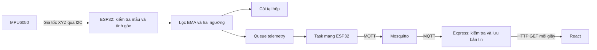

# Luồng hoạt động và chức năng theo mã nguồn

Hệ thống có hai luồng chính: đưa số đo từ ESP32 lên web và gửi lệnh giám sát từ web xuống ESP32. Phép tính góc, lọc, ngưỡng và phát còi nằm trong firmware. Backend kiểm tra bản tin, lưu trạng thái mới nhất và đối chiếu xác nhận lệnh. React hiển thị kết quả và nhận thao tác.

Các liên kết code ghi rõ dòng bắt đầu và kết thúc. Số dòng cần cập nhật nếu mã nguồn thay đổi. Việc có code hoặc bài test không đồng nghĩa chức năng đã được thử trên phần cứng thật.

## 1. Luồng lấy mẫu và hiển thị



| Bước | Xử lý cụ thể | Code |
| --- | --- | --- |
| 1 | `loop()` chỉ lấy mẫu khi giám sát bật và đã đến kỳ khoảng 100 ms. Khi trạng thái cảm biến đang lỗi, thử khởi tạo MPU trước khi đọc lại | [tilt_tray.cpp:647-671](../firmware/tilt_tray.cpp#L647-L671) |
| 2 | `readAcceleration()` đọc 6 byte từ thanh ghi `0x3B`. `readAxis()` ghép byte cao trước byte thấp thành số nguyên có dấu 16 bit. Chia cho 16.384 để đổi sang g | [tilt_tray.cpp:119-166](../firmware/tilt_tray.cpp#L119-L166) |
| 3 | `StaticTilt::angle()` kiểm tra vector hữu hạn, độ lớn 0,65-1,35 g rồi tính góc so với mốc CAL. Mẫu sai làm hàm trả `false` | [static_tilt.h:17-20](../firmware/static_tilt.h#L17-L20), [39-52](../firmware/static_tilt.h#L39-L52) |
| 4 | `sampleSensor()` khởi tạo góc lọc từ mẫu đầu. Các mẫu sau dùng `0.75 * filteredAngle + 0.25 * rawAngle`. Góc lọc quyết định bật từ 15°, tắt khi còn 12° hoặc thấp hơn | [tilt_tray.cpp:197-223](../firmware/tilt_tray.cpp#L197-L223) |
| 5 | `setBuzzer()` cập nhật tần số PWM hoặc mức bật/tắt. Việc phát còi được xử lý tại ESP32 trước khi số đo đến web | [tilt_tray.cpp:173-195](../firmware/tilt_tray.cpp#L173-L195) |
| 6 | Khoảng 500 ms, `queueTelemetry()` chụp trạng thái và tăng `seq`. Queue dài một phần tử, bản mới thay bản trước | [tilt_tray.cpp:272-302](../firmware/tilt_tray.cpp#L272-L302), [627-628](../firmware/tilt_tray.cpp#L627-L628), [675-679](../firmware/tilt_tray.cpp#L675-L679) |
| 7 | `networkTask()` đọc snapshot mới nhất, kiểm tra `seq` chưa gửi và tuổi snapshot không quá 1 giây, rồi gọi `publishTelemetry()` | [tilt_tray.cpp:458-470](../firmware/tilt_tray.cpp#L458-L470) |
| 8 | `publishTelemetry()` tạo JSON và gửi topic `tilt-tray/telemetry`, không retain. Khi lỗi hoặc tạm dừng, góc gửi là JSON `null` | [tilt_tray.cpp:370-402](../firmware/tilt_tray.cpp#L370-L402) |
| 9 | Backend nhận đúng topic, bỏ payload quá 1.024 byte, parse JSON và gọi validator. Trong cùng thiết bị và lần khởi động, `seq` phải tăng | [index.mjs:56-79](../backend/index.mjs#L56-L79) |
| 10 | Bản tin hợp lệ thay `latest`, cập nhật giờ nhận và được chuyển vào bộ đối chiếu lệnh. Trạng thái được giữ trong RAM | [index.mjs:20-25](../backend/index.mjs#L20-L25), [64-73](../backend/index.mjs#L64-L73) |
| 11 | `GET /api/status` tính trạng thái và tuổi dữ liệu. Nếu stale, API trả `reading: null`. React gọi API khoảng mỗi giây rồi cập nhật giao diện | [app.mjs:9-23](../backend/app.mjs#L9-L23), [main.jsx:114-167](../frontend/src/main.jsx#L114-L167) |

### Phép tính góc nằm ở đâu

Với `r` là vector mốc đã chuẩn hóa và `a` là vector đo:

```text
theta = atan2(norm(r × a), r · a) × 180 / pi
```

Code tính ba thành phần tích có hướng tại [static_tilt.h:45-49](../firmware/static_tilt.h#L45-L49), tích vô hướng ở [dòng 50](../firmware/static_tilt.h#L50), gọi `atan2f` và đổi sang độ ở [dòng 51](../firmware/static_tilt.h#L51).

`atan2f` nhận hai đại lượng theo thứ tự tương tự `atan2(y, x)`. Trong bài này, đối số thứ nhất là độ lớn tích có hướng, đối số thứ hai là tích vô hướng. Cách gọi này xác định góc giữa hai vector mà không chia trực tiếp cho tích vô hướng, kể cả khi đại lượng đó bằng 0.

Nếu mốc là `(0, 0, 1)`, biểu thức tương đương:

```text
theta = atan2(sqrt(ax² + ay²), az) × 180 / pi
```

Góc tổng từ 0° đến 180°, không có dấu trái/phải. Backend nhận `alarmOn` từ firmware, không tính lại góc hoặc tự quyết định còi. Hàm `nextAlarmState()` ở [state.mjs:88-99](../backend/state.mjs#L88-L99) là helper được bài test sử dụng, không nằm trong đường xử lý telemetry của `index.mjs`.

## 2. Luồng điều khiển từ web và xác nhận

```mermaid
sequenceDiagram
    participant Web as React
    participant API as Express
    participant Broker as Mosquitto
    participant Net as Task mạng ESP32
    participant Loop as Loop ESP32
    Web->>API: POST /api/monitoring
    API->>Broker: SET_MONITORING bootId requestId enabled
    Broker->>Net: Lệnh theo topic thiết bị
    Net->>Loop: Queue lệnh đã parse
    Loop->>Loop: Đổi chế độ và GPIO26
    Loop->>Net: Snapshot telemetry có lastCommandId
    Net->>Broker: Telemetry
    Broker->>API: Telemetry mới
    API->>API: Đối chiếu phiên, yêu cầu, chế độ và LED
    API-->>Web: confirmed true hoặc lỗi
    Web->>API: GET /api/status để lấy trạng thái
```

| Bước | Xử lý cụ thể | Code |
| --- | --- | --- |
| 1 | Web chỉ cho gửi khi nguồn hỗ trợ điều khiển, dữ liệu chưa stale, broker có kết nối và không lỗi backend. Đang chờ lệnh thì khóa hai nút | [main.jsx:169-180](../frontend/src/main.jsx#L169-L180), [249-271](../frontend/src/main.jsx#L249-L271) |
| 2 | `sendMonitoring()` chặn nhấn lặp bằng ref, đặt trạng thái chờ, POST JSON `{ "enabled": false }` hoặc `true`. Timeout phía trình duyệt là 6,5 giây | [main.jsx:183-204](../frontend/src/main.jsx#L183-L204) |
| 3 | Express chỉ nhận object có đúng một thuộc tính `enabled` kiểu boolean. JSON body giới hạn 1 KB | [app.mjs:30-70](../backend/app.mjs#L30-L70) |
| 4 | `setMonitoring()` kiểm tra kết nối, dữ liệu mới, hỗ trợ điều khiển và không có yêu cầu trước đang chờ | [control.mjs:65-104](../backend/control.mjs#L65-L104) |
| 5 | Backend tạo `requestId` khác 0 và khác ID xác nhận gần nhất. Lệnh nhắm đúng `deviceId` và `bootId`, gửi QoS 0, `retain: false` | [control.mjs:105-124](../backend/control.mjs#L105-L124) |
| 6 | Callback MQTT trên ESP32 kiểm tra topic và parser. Lệnh hợp lệ được đặt vào queue, callback không tự đổi GPIO | [tilt_tray.cpp:355-368](../firmware/tilt_tray.cpp#L355-L368), [monitoring_control.h:33-96](../firmware/monitoring_control.h#L33-L96) |
| 7 | `applyPendingControl()` trong loop lấy lệnh, kiểm tra phiên và trùng ID, áp dụng trạng thái, ghi GPIO26 và đọc lại mức GPIO | [tilt_tray.cpp:304-326](../firmware/tilt_tray.cpp#L304-L326), [monitoring_control.h:109-117](../firmware/monitoring_control.h#L109-L117) |
| 8 | Khi có thay đổi chế độ, firmware reset góc lọc và cảnh báo. Pause hủy CAL. Resume lấy mẫu mới. Sau cập nhật còi, firmware đưa snapshot xác nhận vào queue telemetry | [tilt_tray.cpp:327-352](../firmware/tilt_tray.cpp#L327-L352) |
| 9 | `observe()` đối chiếu thiết bị, phiên, `lastCommandId`, chế độ và LED với yêu cầu đang chờ. Chỉ khi khớp mới trả `confirmed: true` | [control.mjs:13-63](../backend/control.mjs#L13-L63) |
| 10 | Web kiểm tra HTTP và `confirmed`, lấy lại trạng thái rồi hiện thông báo thành công. Khi lỗi, hiện thông báo và mở lại điều khiển theo điều kiện hiện tại | [main.jsx:201-229](../frontend/src/main.jsx#L201-L229) |

Ví dụ định dạng lệnh, các số chỉ để minh họa:

```text
Topic: tilt-tray/command/khay-01-WOKWI
Payload: SET_MONITORING 123 456 0
```

Ở đây `123` là phiên khởi động đích, `456` là yêu cầu điều khiển, `0` là tạm dừng. Dùng `1` để bắt đầu. Parser không nhận số âm, số tràn `uint32_t`, trạng thái ngoài `0|1`, ID yêu cầu bằng 0, dữ liệu dư hoặc sai `bootId`.

ACK trong tài liệu này nghĩa là xác nhận ở mức ứng dụng bằng telemetry. Publish MQTT thành công chưa đủ để báo ESP32 đã áp dụng lệnh. `modeLedOn` được lấy từ mức GPIO đọc lại, không phải cảm biến quang xác nhận LED thật đã sáng.

## 3. Những luồng còn lại

### 3.1. Khởi động và chạy lại sau reboot

1. `MonitoringState` mặc định bật giám sát, ID lệnh gần nhất bằng 0. Xem [monitoring_control.h:99-102](../firmware/monitoring_control.h#L99-L102).
2. `setup()` mở Serial, đặt GPIO LED, khởi tạo buzzer và I²C. Xem [tilt_tray.cpp:579-595](../firmware/tilt_tray.cpp#L579-L595).
3. Mở namespace Preferences `tilt-tray`, đọc đúng kích thước vector `ref-v1` và kiểm tra mốc. Nếu không có mốc hợp lệ, dùng mốc mặc định +Z. Xem [tilt_tray.cpp:597-619](../firmware/tilt_tray.cpp#L597-L619) và [static_tilt.h:61](../firmware/static_tilt.h#L61).
4. Sinh `bootId`, khởi tạo MPU, tạo hai queue dài một phần tử và task mạng ghim core 0. Xem [tilt_tray.cpp:620-632](../firmware/tilt_tray.cpp#L620-L632).
5. Bắt đầu vòng lấy mẫu và kết nối mạng. Mất mốc CAL và lỗi đọc MPU là hai tình huống khác nhau.

Trạng thái pause không được lưu Preferences nên reboot trở lại giám sát bật. Code có cơ chế đọc mốc đã lưu, nhưng lượt Wokwi đã ghi nhận `ref-v1 NOT_FOUND` chưa chứng minh lưu CAL qua reboot thành công.

### 3.2. CAL trên mặt ngang

| Giai đoạn | Hành vi | Code |
| --- | --- | --- |
| Nhận `CAL` | Từ chối nếu đang pause. Trong Wokwi còn yêu cầu nguồn I²C và không có FAULT | [tilt_tray.cpp:476-492](../firmware/tilt_tray.cpp#L476-L492) |
| Bắt đầu | Xóa tổng vector và bộ đếm, bật cờ `calibrating` | [tilt_tray.cpp:493-498](../firmware/tilt_tray.cpp#L493-L498) |
| Thu mẫu | Sau mỗi lần lấy mẫu, tăng bộ đếm. Chỉ cộng XYZ khi `sensorOk` đúng. Xử lý sau 30 lượt, cần ít nhất 25 mẫu hợp lệ | [tilt_tray.cpp:225-248](../firmware/tilt_tray.cpp#L225-L248), [664-665](../firmware/tilt_tray.cpp#L664-L665) |
| Tạo mốc | Tính vector trung bình và chuẩn hóa bằng `StaticTilt::setReference()`. Vector trung bình không hợp lệ thì báo CAL thất bại | [tilt_tray.cpp:249-259](../firmware/tilt_tray.cpp#L249-L259), [static_tilt.h:23-31](../firmware/static_tilt.h#L23-L31) |
| Lưu và áp dụng | Ghi `ref-v1`, chỉ áp dụng mốc mới nếu ghi thành công, reset bộ lọc và cảnh báo | [tilt_tray.cpp:260-269](../firmware/tilt_tray.cpp#L260-L269) |

Khoảng 3 giây xuất phát từ 30 lượt với kỳ lấy mẫu 100 ms. Code không chứng minh khay nằm ngang hoặc đứng yên, người thử phải đặt khay đúng trước CAL. Đây là đặt hướng mốc, chưa phải hiệu chuẩn đầy đủ bias và độ nhạy từng trục.

### 3.3. Tạm dừng, heartbeat và bắt đầu lại

- **Tạm dừng:** ngừng nhánh lấy mẫu, tắt LED, xóa trạng thái cảnh báo và góc, hủy CAL nếu có. `setBuzzer()` tắt cả còi nghiêng lẫn bíp lỗi. Xem [tilt_tray.cpp:325-348](../firmware/tilt_tray.cpp#L325-L348), [173-195](../firmware/tilt_tray.cpp#L173-L195), [651](../firmware/tilt_tray.cpp#L651).
- **Heartbeat:** phần chuẩn bị telemetry vẫn chạy ngoài nhánh lấy mẫu, nên pause không làm backend stale nếu mạng còn truyền bản tin. Góc trong JSON là `null`. Xem [tilt_tray.cpp:675-679](../firmware/tilt_tray.cpp#L675-L679), [374-381](../firmware/tilt_tray.cpp#L374-L381).
- **Đổi ACCEL lúc pause:** chỉ thay các biến đầu vào Serial. Firmware chưa lấy mẫu nên web vẫn ẩn góc. Xem [tilt_tray.cpp:526-530](../firmware/tilt_tray.cpp#L526-L530), [651](../firmware/tilt_tray.cpp#L651).
- **Bắt đầu lại:** reset bộ lọc và gọi `sampleSensor()` ngay khi chế độ chuyển sang bật. Nếu FAULT vẫn còn, thiết bị trở lại lỗi và bíp lỗi. Xem [tilt_tray.cpp:327-350](../firmware/tilt_tray.cpp#L327-L350).

`sensorOk` khi pause có thể giữ trạng thái lần đọc trước. Web vì vậy hiện “Chưa đo (tạm dừng)” thay vì coi đây là phép đọc mới. Xem [main.jsx:275](../frontend/src/main.jsx#L275).

### 3.4. Lỗi cảm biến và phục hồi

Lỗi có thể xuất phát từ đọc I²C thất bại, mẫu gia tốc không hợp lệ hoặc FAULT trong Wokwi. `sampleSensor()` đặt `sensorOk=false`, `alarmOn=false`, reset khởi tạo lọc và cập nhật còi tại [tilt_tray.cpp:201-208](../firmware/tilt_tray.cpp#L201-L208).

Khi đang giám sát, `BuzzerAlert::frequency()` chọn 2.000 Hz trong 170 ms mỗi giây ở [buzzer_alert.h:9-20](../firmware/buzzer_alert.h#L9-L20). Telemetry gửi góc `null`. Backend phân loại `sensor-error` nếu dữ liệu còn mới và không pause, tại [state.mjs:71-85](../backend/state.mjs#L71-L85).

Mẫu hợp lệ tiếp theo đặt lại `sensorOk=true` và khởi tạo lọc từ góc mới, tại [tilt_tray.cpp:209-216](../firmware/tilt_tray.cpp#L209-L216). Nếu góc mới vượt ngưỡng, còi có thể chuyển sang cảnh báo nghiêng. Phục hồi lỗi không có nghĩa luôn im còi ở mọi tư thế.

### 3.5. Phát âm không chờ hết chu kỳ

| Điều kiện | Đầu ra của bộ điều khiển còi |
| --- | --- |
| Đang pause | Im |
| Đang giám sát và cảm biến lỗi | Bíp lỗi 2.000 Hz, 170 ms mỗi giây |
| Cảm biến hợp lệ, `alarmOn=false` | Im |
| Cảm biến hợp lệ, `alarmOn=true` | 1.200 Hz trong 150 ms, 1.800 Hz trong 150 ms, im 100 ms, lặp lại |

`BuzzerAlert` trả tần số dựa trên thời gian hiện tại, không có vòng chờ cho từng âm. Khi hết cảnh báo, hàm trả 0 ở lần gọi tiếp theo. Khi bật lại cảnh báo, chu kỳ bắt đầu lại. Code ở [buzzer_alert.h:9-47](../firmware/buzzer_alert.h#L9-L47), được gọi bởi [tilt_tray.cpp:173-195](../firmware/tilt_tray.cpp#L173-L195) và [672](../firmware/tilt_tray.cpp#L672).

Vòng firmware vẫn có `delay(1)` để nhường CPU, I²C có timeout và mạng có task riêng. Do đó mô tả chính xác là bộ điều khiển âm thanh không chờ hết âm. Chưa có căn cứ nói toàn bộ firmware không bao giờ chặn hoặc độ trễ bằng 0.

### 3.6. Dừng nguồn dữ liệu hoặc mất backend

`calculateStatus()` ưu tiên stale nếu chưa có dữ liệu, giờ nhận không hợp lệ hoặc đã hơn 5.000 ms. API vẫn có thể báo broker kết nối trong khi ESP32 không gửi bản tin. Xem [state.mjs:71-85](../backend/state.mjs#L71-L85).

Khi stale, `/api/status` trả `reading: null` nhưng giữ thông tin ngưỡng nếu từng nhận dữ liệu. React ẩn góc, hiện trạng thái mất liên lạc và khóa điều khiển. Xem [app.mjs:13-21](../backend/app.mjs#L13-L21), [main.jsx:169-180](../frontend/src/main.jsx#L169-L180), [249-271](../frontend/src/main.jsx#L249-L271).

Nếu HTTP lấy trạng thái thất bại hoặc quá 2,5 giây, React đặt `backendError=true` và dùng trạng thái stale tại giao diện. Không có HTTP thành công không đồng nghĩa MPU6050 hỏng. Xem [main.jsx:114-172](../frontend/src/main.jsx#L114-L172).

Mốc 5 giây tính từ lần nhận telemetry hợp lệ cuối, không phải thời hạn lệnh ACCEL. Một vector ACCEL có thể giữ liên tục và tiếp tục sinh telemetry mới.

### 3.7. Mất Wi-Fi hoặc broker rồi kết nối lại

1. Task mạng kiểm tra Wi-Fi, đóng TCP cũ nếu Wi-Fi mất và thử kết nối theo mốc 5 giây. MQTT cũng có mốc thử lại 5 giây. Xem [tilt_tray.cpp:413-456](../firmware/tilt_tray.cpp#L413-L456).
2. Lấy mẫu, xử lý góc và còi vẫn thuộc loop riêng. Mất broker không tự đổi chế độ giám sát. Xem [tilt_tray.cpp:647-679](../firmware/tilt_tray.cpp#L647-L679).
3. Backend đánh dấu broker ngắt và kết thúc yêu cầu điều khiển đang chờ bằng lỗi 503. Xem [index.mjs:43-50](../backend/index.mjs#L43-L50), [control.mjs:139-142](../backend/control.mjs#L139-L142).
4. Khi MQTT phục hồi, ESP32 subscribe topic lệnh và gửi snapshot mới nhất còn đủ mới. Queue không lưu cả lịch sử mẫu. Xem [tilt_tray.cpp:448-470](../firmware/tilt_tray.cpp#L448-L470).
5. Backend subscribe lại telemetry, nhận bản tin mới và cập nhật trạng thái cho lần polling kế tiếp của web. Xem [index.mjs:32-41](../backend/index.mjs#L32-L41), [56-73](../backend/index.mjs#L56-L73).

Không phát lại lệnh cũ dựa trên lệnh không retain, clean session và backend tắt hàng đợi QoS 0 khi offline. Xem [control.mjs:124](../backend/control.mjs#L124), [index.mjs:9-13](../backend/index.mjs#L9-L13), [tilt_tray.cpp:448-450](../firmware/tilt_tray.cpp#L448-L450). Hành vi không phát lại đã được thử bằng integration với peer giả lập. Phép thử Wokwi đã ghi nhận web phục hồi và còi tiếp tục kêu khi broker ngắt, chưa tách riêng phép thử phát lại lệnh cũ trên Wokwi.

### 3.8. Lệnh trùng, sai phiên và timeout

| Trường hợp | Cách xử lý | Code |
| --- | --- | --- |
| Sai `bootId`, ID bằng 0 hoặc sai cú pháp | Parser từ chối lệnh trước khi đưa vào queue | [monitoring_control.h:33-96](../firmware/monitoring_control.h#L33-L96) |
| ID trùng lệnh vừa áp dụng | `MonitoringState::apply()` trả false | [monitoring_control.h:109-117](../firmware/monitoring_control.h#L109-L117) |
| Thiết bị reboot hoặc nguồn đổi khi đang chờ | Backend kết thúc chờ với lỗi 409 | [control.mjs:46-49](../backend/control.mjs#L46-L49) |
| Sai ID, chế độ hoặc LED trong phản hồi | Chưa hoàn thành yêu cầu, tiếp tục chờ đến xác nhận đúng hoặc timeout | [control.mjs:51-62](../backend/control.mjs#L51-L62) |
| Một lệnh khác đang chờ | Backend trả lỗi 409, chưa gửi lệnh mới | [control.mjs:101-103](../backend/control.mjs#L101-L103) |
| Chưa có kết nối và dữ liệu mới | Trả lỗi 503 trước publish | [control.mjs:87-91](../backend/control.mjs#L87-L91) |
| Quá khoảng 4 giây chưa có xác nhận khớp | Backend trả lỗi 504 và giải phóng yêu cầu đang chờ | [control.mjs:13-25](../backend/control.mjs#L13-L25), [118-121](../backend/control.mjs#L118-L121) |
| Publish lỗi hoặc broker ngắt | Báo 503, không báo đổi chế độ thành công | [control.mjs:122-142](../backend/control.mjs#L122-L142) |

Firmware chỉ nhớ `lastCommandId`, không lưu toàn bộ lịch sử các ID. Cơ chế này không phải xác thực bảo mật hoặc bảo đảm chống mọi hình thức phát lại. Timeout cũng không hoàn tác một lệnh mà thiết bị có thể đã nhận. Sau lỗi cần dựa vào trạng thái thiết bị cập nhật tiếp theo.

### 3.9. Serial và nguồn dữ liệu Wokwi

| Lệnh | Hành vi | Code |
| --- | --- | --- |
| `CAL` | Bắt đầu thu vector mốc nếu điều kiện phù hợp | [tilt_tray.cpp:479-498](../firmware/tilt_tray.cpp#L479-L498) |
| `I2C` | Tắt nguồn ACCEL Serial, quay về đọc MPU6050. Không tự bỏ FAULT | [tilt_tray.cpp:501-505](../firmware/tilt_tray.cpp#L501-L505) |
| `FAULT ON` / `FAULT OFF` | Bật hoặc bỏ cờ lỗi mô phỏng. Không tự đổi nguồn ACCEL/I²C | [tilt_tray.cpp:507-511](../firmware/tilt_tray.cpp#L507-L511) |
| `ACCEL x y z` | Nhận ba số hữu hạn, từng thành phần có trị tuyệt đối không quá 2 g, từ chối khi đang CAL. Lưu vector và bật nguồn Serial | [tilt_tray.cpp:513-531](../firmware/tilt_tray.cpp#L513-L531) |
| Lệnh không đúng | In thông báo không nhận diện lệnh | [tilt_tray.cpp:534](../firmware/tilt_tray.cpp#L534) |

Kiểm tra từng thành phần trong parser ACCEL không thay thế kiểm tra độ lớn vector 0,65-1,35 g ở bước tính góc. Ví dụ ba thành phần đều trong ±2 g vẫn có thể tạo vector bị từ chối.

`readAcceleration()` ưu tiên FAULT, sau đó nguồn ACCEL, nếu không mới đọc I²C. Xem [tilt_tray.cpp:127-165](../firmware/tilt_tray.cpp#L127-L165). Vì ACCEL bỏ qua đọc MPU6050, thanh trượt XYZ của part Wokwi không thay đổi theo lệnh này. Vector giữ đến khi nhập giá trị khác, gửi I2C hoặc reboot.

`serviceSerial()` đọc tối đa 32 ký tự mỗi lượt loop, hỗ trợ backspace, nhận dòng bằng CR/LF và bỏ dòng tràn bộ đệm. Xem [tilt_tray.cpp:537-577](../firmware/tilt_tray.cpp#L537-L577). Các lệnh I2C, ACCEL và FAULT chỉ được biên dịch khi `TILT_WOKWI=1`.

### 3.10. Bản tin sai, bản tin cũ và nguồn cũ

- `validateTelemetry()` kiểm tra kiểu dữ liệu, ngưỡng, góc, trạng thái pause và nhóm trường điều khiển. Nếu có một trường control thì phải có đủ nhóm hợp lệ, LED phải bằng chế độ. Xem [state.mjs:10-69](../backend/state.mjs#L10-L69).
- Bản tin thiếu cả ba trường control vẫn có thể được nhận để hiển thị. Backend từ chối điều khiển nguồn này, React hiện hướng dẫn phù hợp. Xem [state.mjs:17-24](../backend/state.mjs#L17-L24), [control.mjs:93-95](../backend/control.mjs#L93-L95), [main.jsx:249-271](../frontend/src/main.jsx#L249-L271).
- JSON lỗi, payload sai hoặc `seq` không tăng trong cùng `deviceId` và `bootId` không thay bản tin mới nhất và không làm mới giờ nhận. Xem [index.mjs:56-79](../backend/index.mjs#L56-L79).
- Backend chỉ giữ một nguồn mới nhất, chưa quản lý danh sách nhiều thiết bị độc lập. Nguồn khác hoặc phiên khác có thể thay snapshot đang giữ. Khi demo chỉ dùng một nguồn telemetry.

## 4. Các trạng thái và thứ tự ưu tiên

Backend xét theo thứ tự `stale`, `paused`, `sensor-error`, `angle-only`, rồi `alarm` hoặc `safe`. Code ở [state.mjs:71-86](../backend/state.mjs#L71-L86).

| Trạng thái | Điều kiện | Góc trên web | LED và âm thanh |
| --- | --- | --- | --- |
| `safe` | Dữ liệu mới, đang giám sát, cảm biến hợp lệ, cảnh báo tắt | Hiện góc một chữ số thập phân | LED sáng, còi im |
| `alarm` | Dữ liệu mới, đang giám sát, cảm biến hợp lệ, cảnh báo bật | Hiện góc | LED sáng, còi nghiêng |
| `angle-only` | Dữ liệu mới, cảm biến hợp lệ và đã chọn Chỉ gửi góc | Hiện góc, kể cả khi vượt ngưỡng | LED sáng, còi im |
| `paused` | Dữ liệu mới và giám sát tắt | Ẩn | LED và mọi âm thanh tắt |
| `sensor-error` | Dữ liệu mới, giám sát bật, cảm biến lỗi | Ẩn | LED sáng. Bíp lỗi trong chế độ Đo và cảnh báo |
| `stale` | Chưa có telemetry hợp lệ hoặc đã quá hạn | Ẩn góc cũ, khóa nút | Web không biết trạng thái mới tại hộp. Firmware vẫn theo chế độ hiện có nếu còn chạy |

React áp dụng thêm lỗi HTTP vào stale tại [main.jsx:169-181](../frontend/src/main.jsx#L169-L181). Hiển thị nhãn tại [5-12](../frontend/src/main.jsx#L5-L12), kiểm tra góc tại [172-173](../frontend/src/main.jsx#L172-L173), các ô trạng thái tại [249-281](../frontend/src/main.jsx#L249-L281).

## 5. Đối chiếu F01-F10

| Mã | Chức năng và hành vi cụ thể | Code chính |
| --- | --- | --- |
| F01 | Đọc XYZ, kiểm tra mẫu và tính góc tổng so với vector mốc | [tilt_tray.cpp:127-166](../firmware/tilt_tray.cpp#L127-L166), [static_tilt.h:39-52](../firmware/static_tilt.h#L39-L52) |
| F02 | Thu CAL, chuẩn hóa, lưu và nạp lại vector mốc | [tilt_tray.cpp:225-270](../firmware/tilt_tray.cpp#L225-L270), [597-619](../firmware/tilt_tray.cpp#L597-L619) |
| F03 | Lọc EMA và hysteresis 15°/12°, giữ trạng thái giữa hai ngưỡng | [tilt_tray.cpp:212-221](../firmware/tilt_tray.cpp#L212-L221) |
| F04 | Phát hai cao độ khi nghiêng, bíp riêng khi lỗi, im khi pause | [buzzer_alert.h:9-47](../firmware/buzzer_alert.h#L9-L47), [tilt_tray.cpp:173-195](../firmware/tilt_tray.cpp#L173-L195) |
| F05 | Chuẩn bị telemetry, publish và nhận lệnh MQTT, kết nối lại | [tilt_tray.cpp:272-302](../firmware/tilt_tray.cpp#L272-L302), [355-474](../firmware/tilt_tray.cpp#L355-L474), [index.mjs:24-79](../backend/index.mjs#L24-L79) |
| F06 | API cung cấp trạng thái, React polling và hiển thị | [app.mjs:9-28](../backend/app.mjs#L9-L28), [main.jsx:114-181](../frontend/src/main.jsx#L114-L181), [249-291](../frontend/src/main.jsx#L249-L291) |
| F07 | Phát hiện dữ liệu cũ, không đưa góc cũ ra như số đo hiện tại | [state.mjs:71-76](../backend/state.mjs#L71-L76), [app.mjs:21](../backend/app.mjs#L21), [main.jsx:169-177](../frontend/src/main.jsx#L169-L177) |
| F08 | Đánh dấu lỗi cảm biến, góc null, cảnh báo nghiêng tắt và bíp lỗi riêng | [tilt_tray.cpp:201-208](../firmware/tilt_tray.cpp#L201-L208), [374-381](../firmware/tilt_tray.cpp#L374-L381), [buzzer_alert.h:11-15](../firmware/buzzer_alert.h#L11-L15) |
| F09 | Bắt đầu/tạm dừng từ web, chờ phản hồi đúng yêu cầu, xử lý lỗi và timeout | [main.jsx:183-229](../frontend/src/main.jsx#L183-L229), [control.mjs:40-142](../backend/control.mjs#L40-L142), [tilt_tray.cpp:304-353](../firmware/tilt_tray.cpp#L304-L353) |
| F10 | GPIO26 báo chế độ và trả mức đọc lại trong telemetry | [tilt_tray.cpp:325-326](../firmware/tilt_tray.cpp#L325-L326), [384-399](../firmware/tilt_tray.cpp#L384-L399), [main.jsx:249-271](../frontend/src/main.jsx#L249-L271) |

## 6. Đối chiếu W01-W10 trên web

| Mã | Mục giao diện | Xử lý và code |
| --- | --- | --- |
| W01 | Góc nghiêng | Chỉ hiện góc hữu hạn khi không stale, không pause và cảm biến hợp lệ. Làm tròn một chữ số. [main.jsx:172-173](../frontend/src/main.jsx#L172-L173), [249-271](../frontend/src/main.jsx#L249-L271) |
| W02 | Cài đặt cảnh báo | Chỉnh hai ngưỡng và chọn Đo và cảnh báo hoặc Chỉ gửi góc. [main.jsx:14-102](../frontend/src/main.jsx#L14-L102) |
| W03 | Nhãn trạng thái | Dịch mã trạng thái thành nhãn và class màu. [main.jsx:5-12](../frontend/src/main.jsx#L5-L12), [251](../frontend/src/main.jsx#L251), [style.css:101-104](../frontend/src/style.css#L101-L104) |
| W04 | Cảnh báo và cảm biến | Mất dữ liệu hiện “Không rõ”, pause hiện “Chưa đo”, lỗi có giải thích bíp riêng. [main.jsx:273-281](../frontend/src/main.jsx#L273-L281) |
| W05 | Backend và broker | Backend dựa vào kết quả HTTP, broker dựa vào trường `brokerConnected`. [main.jsx:283-284](../frontend/src/main.jsx#L283-L284) |
| W06 | Giờ nhận và tuổi bản tin | Định dạng giờ `vi-VN`, đổi `ageMs` sang giây. [main.jsx:174](../frontend/src/main.jsx#L174), [285-287](../frontend/src/main.jsx#L285-L287) |
| W07 | Nguồn dữ liệu | Hiện `deviceId` của bản tin hiện tại. [main.jsx:286-287](../frontend/src/main.jsx#L286-L287) |
| W08 | Mất dữ liệu | Ẩn góc và khóa điều khiển khi stale hoặc lỗi backend. [main.jsx:169-177](../frontend/src/main.jsx#L169-L177), [249-271](../frontend/src/main.jsx#L249-L271) |
| W09 | Gửi lệnh và phản hồi | Chờ xác nhận, thông báo thành công/lỗi, chặn yêu cầu trùng lúc. [main.jsx:183-229](../frontend/src/main.jsx#L183-L229), [249-271](../frontend/src/main.jsx#L249-L271) |
| W10 | Chế độ và LED | Hiện nhãn chế độ, mức LED và vô hiệu hóa nút tương ứng chế độ đã có. [main.jsx:175-181](../frontend/src/main.jsx#L175-L181), [249-271](../frontend/src/main.jsx#L249-L271) |

## 7. Giao thức và dữ liệu

### 7.1. Telemetry

Ví dụ minh họa bản tin khi giám sát ở góc 16°, không phải số liệu của một lượt chạy mới:

```json
{
    "deviceId": "khay-01-WOKWI",
    "bootId": 123,
    "seq": 45,
    "sensorOk": true,
    "alarmOn": true,
    "angleDeg": 16.00,
    "thresholdOn": 15,
    "thresholdOff": 12,
    "monitoringEnabled": true,
    "modeLedOn": true,
    "lastCommandId": 456,
    "alertsEnabled": true,
    "settingsSaveFailed": false
}
```

| Trường | Ý nghĩa |
| --- | --- |
| `deviceId` | Thiết bị gửi và phần đuôi topic nhận lệnh |
| `bootId` | Nhận diện lần khởi động, tạo bằng `esp_random()` |
| `seq` | Số thứ tự snapshot, tăng trong `queueTelemetry()` |
| `sensorOk` | Kết quả xử lý mẫu gần nhất, không phải mẫu mới khi pause |
| `alarmOn` | Cảnh báo nghiêng, không đại diện mọi tiếng buzzer |
| `angleDeg` | Góc đã lọc theo độ, null khi lỗi hoặc pause |
| `thresholdOn`, `thresholdOff` | Hai ngưỡng đang dùng, mặc định 15° và 12° |
| `monitoringEnabled` | Chế độ giám sát đã áp dụng |
| `modeLedOn` | Mức GPIO26 đọc lại |
| `lastCommandId` | ID lệnh vừa được firmware xử lý |
| `alertsEnabled` | `false` khi chỉ gửi góc và tắt còi |
| `settingsSaveFailed` | Lỗi lưu cài đặt của lệnh mang `lastCommandId` |

Nơi tạo bản tin: [tilt_tray.cpp:370-402](../firmware/tilt_tray.cpp#L370-L402). Nơi kiểm tra: [state.mjs:10-69](../backend/state.mjs#L10-L69). `sampledAt` nằm trong snapshot nội bộ để task mạng kiểm tra độ mới, không nằm trong JSON được publish.

### 7.2. HTTP API

| Endpoint | Đầu vào và đầu ra | Code |
| --- | --- | --- |
| `GET /api/status` | Trả `status`, `brokerConnected`, `lastReceivedAt`, `ageMs`, `thresholds`, `reading`. Có header `Cache-Control: no-store` | [app.mjs:9-23](../backend/app.mjs#L9-L23) |
| `GET /api/health` | Trả tên service, `ok: true` và tình trạng broker. `ok: true` không chứng minh ESP32 đang có số đo mới | [app.mjs:25-28](../backend/app.mjs#L25-L28) |
| `POST /api/monitoring` | Nhận đúng một boolean `enabled`. Thành công trả `confirmed`, thiết bị, phiên, ID, chế độ và LED. Lỗi dùng mã 400, 409, 503 hoặc 504 theo tình huống | [app.mjs:30-47](../backend/app.mjs#L30-L47), [control.mjs:28-36](../backend/control.mjs#L28-L36) |
| `POST /api/alert-settings` | Nhận `alertsEnabled`, `thresholdOn`, `thresholdOff`. Backend gửi lệnh MQTT và chỉ xác nhận khi ESP32 báo đúng cả ba giá trị. ESP32 giữ cấu hình cũ nếu lưu NVS thất bại. | [app.mjs:49-66](../backend/app.mjs#L49-L66), [control.mjs:40-63](../backend/control.mjs#L40-L63), [tilt_tray.cpp:284-302](../firmware/tilt_tray.cpp#L284-L302) |

## 8. Bản đồ hàm để tìm nhanh

### Firmware

| Hàm | Nhiệm vụ | Vị trí |
| --- | --- | --- |
| `writeRegister()` | Ghi thanh ghi I²C | [tilt_tray.cpp:87-93](../firmware/tilt_tray.cpp#L87-L93) |
| `readRegister()` | Đọc một thanh ghi | [tilt_tray.cpp:95-109](../firmware/tilt_tray.cpp#L95-L109) |
| `initializeMpu()` | Kiểm tra ID, đánh thức và chọn ±2 g | [tilt_tray.cpp:111-117](../firmware/tilt_tray.cpp#L111-L117) |
| `readAxis()` | Ghép byte cao/thấp thành số có dấu | [tilt_tray.cpp:119-125](../firmware/tilt_tray.cpp#L119-L125) |
| `readAcceleration()` | Chọn FAULT, ACCEL hoặc I²C | [tilt_tray.cpp:127-166](../firmware/tilt_tray.cpp#L127-L166) |
| `setBuzzer()` | Chuyển yêu cầu âm thanh thành PWM/GPIO | [tilt_tray.cpp:173-195](../firmware/tilt_tray.cpp#L173-L195) |
| `sampleSensor()` | Kiểm tra mẫu, tính/lọc góc, cập nhật cảnh báo | [tilt_tray.cpp:197-223](../firmware/tilt_tray.cpp#L197-L223) |
| `serviceCalibration()` | Thu và lưu mốc CAL | [tilt_tray.cpp:225-270](../firmware/tilt_tray.cpp#L225-L270) |
| `queueTelemetry()` | Tạo snapshot mới nhất | [tilt_tray.cpp:272-302](../firmware/tilt_tray.cpp#L272-L302) |
| `applyPendingControl()` | Áp dụng lệnh trong loop và chuẩn bị xác nhận | [tilt_tray.cpp:304-353](../firmware/tilt_tray.cpp#L304-L353) |
| `receiveMqttCommand()` | Callback kiểm tra và xếp lệnh vào queue | [tilt_tray.cpp:355-368](../firmware/tilt_tray.cpp#L355-L368) |
| `publishTelemetry()` | Tạo JSON và publish | [tilt_tray.cpp:370-402](../firmware/tilt_tray.cpp#L370-L402) |
| `networkTask()` | Kết nối, subscribe, xử lý MQTT và gửi snapshot | [tilt_tray.cpp:404-474](../firmware/tilt_tray.cpp#L404-L474) |
| `handleCommand()` | Xử lý dòng lệnh Serial | [tilt_tray.cpp:476-535](../firmware/tilt_tray.cpp#L476-L535) |
| `serviceSerial()` | Đọc Serial với bộ đệm giới hạn | [tilt_tray.cpp:537-577](../firmware/tilt_tray.cpp#L537-L577) |
| `setup()` | Khởi tạo GPIO, cảm biến, mốc và task mạng | [tilt_tray.cpp:579-645](../firmware/tilt_tray.cpp#L579-L645) |
| `loop()` | Điều phối lệnh, lấy mẫu, âm thanh, Serial, telemetry và log | [tilt_tray.cpp:647-697](../firmware/tilt_tray.cpp#L647-L697) |
| `StaticTilt::validAcceleration/setReference/reference/angle/length` | Kiểm tra, chuẩn hóa, lấy mốc, tính góc và độ dài vector | [static_tilt.h:17-61](../firmware/static_tilt.h#L17-L61) |
| `BuzzerAlert::frequency()` | Trả tần số theo pha thời gian | [buzzer_alert.h:9-44](../firmware/buzzer_alert.h#L9-L44) |
| `parseControlCommand()` và `MonitoringState::apply()` | Kiểm tra cú pháp, phiên và áp dụng chế độ | [monitoring_control.h:33-119](../firmware/monitoring_control.h#L33-L119) |

### Backend và frontend

| Hàm hoặc điểm vào | Nhiệm vụ | Vị trí |
| --- | --- | --- |
| `index.mjs` | Tạo MQTT client, controller, app và gắn sự kiện connect/close/message | [index.mjs:24-86](../backend/index.mjs#L24-L86) |
| `validateTelemetry()` | Kiểm tra cấu trúc bản tin | [state.mjs:10-69](../backend/state.mjs#L10-L69) |
| `calculateStatus()` | Phân loại trạng thái theo độ mới, chế độ, lỗi và cảnh báo | [state.mjs:71-86](../backend/state.mjs#L71-L86) |
| `nextAlarmState()` | Helper hysteresis dùng trong test | [state.mjs:88-99](../backend/state.mjs#L88-L99) |
| `createApp()` | Khai báo các API và middleware lỗi JSON | [app.mjs:4-74](../backend/app.mjs#L4-L74) |
| `commandError()` | Gắn mã HTTP cho lỗi điều khiển | [control.mjs:4-7](../backend/control.mjs#L4-L7) |
| `createMonitoringController()` | Giữ một yêu cầu đang chờ | [control.mjs:9-145](../backend/control.mjs#L9-L145) |
| `finish()` | Hủy timer, hoàn thành hoặc từ chối Promise đang chờ | [control.mjs:13-38](../backend/control.mjs#L13-L38) |
| `observe()` | Nhận telemetry để đối chiếu xác nhận | [control.mjs:40-63](../backend/control.mjs#L40-L63) |
| `setMonitoring()` | Kiểm tra điều kiện, tạo ID, gửi lệnh, đặt timeout | [control.mjs:65-137](../backend/control.mjs#L65-L137) |
| `disconnected()` | Hủy yêu cầu khi mất MQTT | [control.mjs:139-142](../backend/control.mjs#L139-L142) |
| `App()` | Quản lý trạng thái giao diện và JSX | [main.jsx:104-294](../frontend/src/main.jsx#L104-L294) |
| `refreshStatus()` | GET trạng thái với timeout | [main.jsx:114-138](../frontend/src/main.jsx#L114-L138) |
| `useEffect()` và callback `refresh()` | Polling, chặn request polling chồng và dọn timer khi unmount | [main.jsx:140-167](../frontend/src/main.jsx#L140-L167) |
| `sendCommand()` | POST điều khiển hoặc cài đặt cảnh báo, chờ ESP32 xác nhận | [main.jsx:183-229](../frontend/src/main.jsx#L183-L229) |
| `createRoot(...).render()` | Gắn React vào DOM | [main.jsx:296](../frontend/src/main.jsx#L296) |

## 9. Kiểm thử liên quan

Các dòng dưới đây chỉ vị trí bài test. Đây không phải thông báo vừa chạy lại kiểm thử.

| Nhóm | Trường hợp được mô tả trong test | Code |
| --- | --- | --- |
| Góc XYZ | Ngang, ±X, ±Y, hướng chéo, 90° và 180° | [static_tilt.test.cpp:13-24](../tests/static_tilt.test.cpp#L13-L24) |
| Vector CAL | Mốc lệch, hướng đối nhau, tạo đối tượng mới từ vector mốc và từ chối vector 0 | [static_tilt.test.cpp:26-42](../tests/static_tilt.test.cpp#L26-L42) |
| Dữ liệu sai | Vector 0, độ lớn sai, NaN, vô cực và ví dụ mẫu hợp lệ vẫn chứa ảnh hưởng chuyển động | [static_tilt.test.cpp:44-54](../tests/static_tilt.test.cpp#L44-L54) |
| Còi | Chu kỳ, dừng/bắt đầu, lỗi/phục hồi, tràn đồng hồ và bỏ lỡ lượt cập nhật | [buzzer_alert.test.cpp:6-59](../tests/buzzer_alert.test.cpp#L6-L59) |
| Parser/chế độ | Lệnh đúng, trùng, sai phiên, sai cú pháp và số biên | [monitoring_control.test.cpp:12-63](../tests/monitoring_control.test.cpp#L12-L63) |
| Validator/trạng thái | Góc null, số sai, hysteresis, stale, lỗi, pause và nhóm control | [state.test.mjs:16-74](../backend/state.test.mjs#L16-L74) |
| Xác nhận lệnh | Không retain, đúng phiên/ID/chế độ/LED, từ chối nguồn cũ, xử lý lệnh đang chờ | [control.test.mjs:25-81](../backend/control.test.mjs#L25-L81) |
| Timeout/publish lỗi | Không báo thành công nếu chưa có ACK, giải phóng yêu cầu chờ sau lỗi | [control.test.mjs:83-106](../backend/control.test.mjs#L83-L106) |
| HTTP API | Pause, JSON điều khiển sai, phản hồi thành công và reading null khi stale | [app.test.mjs:6-55](../backend/app.test.mjs#L6-L55) |
| Integration | Mosquitto/API thật, peer ESP32 giả lập, pause heartbeat hơn 5 giây, resume, lỗi, HTTP 504, ngắt/phục hồi broker và không phát lại lệnh cũ | [check-control.mjs:121-222](../backend/check-control.mjs#L121-L222) |

Trong C++ test, tạo lại `StaticTilt` từ vector mốc chỉ kiểm tra logic dùng lại vector. Phép đó chưa kiểm tra việc lưu Preferences/NVS và khôi phục sau reboot trên board.

## 10. Các công cụ phụ khác với luồng chính

### Publisher Node

[simulate.mjs:21-48](../backend/simulate.mjs#L21-L48) cấp chuỗi góc mẫu qua MQTT mỗi giây. Nó không đọc MPU6050 và không có nhóm trường điều khiển, nên nguồn này phục vụ thử đường nhận và hiển thị. Các callback connect/error nằm ở [12-19](../backend/simulate.mjs#L12-L19). Không bật publisher này cùng lúc Wokwi khi cần theo dõi một nguồn.

### HTML demo độc lập

[demo-gia-lap.html:87-164](../demo-gia-lap.html#L87-L164) dùng slider và biến cục bộ trong trình duyệt. Nó chưa nối ESP32, MQTT hoặc API.

| Hàm hoặc thao tác | Hành vi | Code |
| --- | --- | --- |
| `setStatus()` | Đổi chữ và class của nhãn | [demo-gia-lap.html:97-101](../demo-gia-lap.html#L97-L101) |
| `updateLocal()` | Lấy góc slider trừ offset, mô phỏng lỗi và hysteresis | [demo-gia-lap.html:103-125](../demo-gia-lap.html#L103-L125) |
| `updateRemote()` | Mô phỏng nhận bản tin và timeout bằng biến trong trang | [demo-gia-lap.html:127-146](../demo-gia-lap.html#L127-L146) |
| Nút CAL | Lưu offset góc scalar của slider | [demo-gia-lap.html:148-159](../demo-gia-lap.html#L148-L159) |
| Sự kiện và timer | Cập nhật khi kéo slider, đổi checkbox và mỗi 500 ms | [demo-gia-lap.html:160-164](../demo-gia-lap.html#L160-L164) |

Checkbox pause ở trang demo này nghĩa là dừng cập nhật bản tin giả, không phải lệnh tạm dừng giám sát của firmware. CAL scalar ở đây cũng không phải CAL vector XYZ trong sản phẩm chính.

## 11. Giới hạn cần nhớ khi giải thích

- Chưa có motor/servo hoặc thuật toán điều khiển khay tự cân bằng.
- Chưa kết hợp gyro để tách ảnh hưởng tăng tốc, phanh hoặc rẽ.
- Kiểm tra độ lớn gần 1 g không chứng minh thiết bị đứng yên.
- Chưa đo sai số góc, âm lượng, hai tần số thực tế hoặc độ trễ đầu cuối trên thiết bị thật.
- Bật/tắt LED được kiểm tra bằng mức GPIO, chưa có phản hồi quang học.
- Backend giữ một snapshot trong RAM, chưa có cơ sở dữ liệu hoặc lịch sử nhiều thiết bị.
- Ngưỡng mặc định 15°/12° là tham số thử. Khi thay đổi trên web, ESP32 lưu hai ngưỡng và chế độ cảnh báo vào NVS.
- Bộ kiểm thử mô phỏng và peer giả lập kiểm tra các phạm vi khác nhau, không thay thế thử nguyên mẫu.

Thông tin công nghệ và cấu hình nằm trong [Tech Stack](Tech_Stack.md). Lời trình bày theo bản slide đã nộp nằm trong [Kịch bản thuyết trình](../../docs/Kich_ban_Thuyet_trinh.md).
